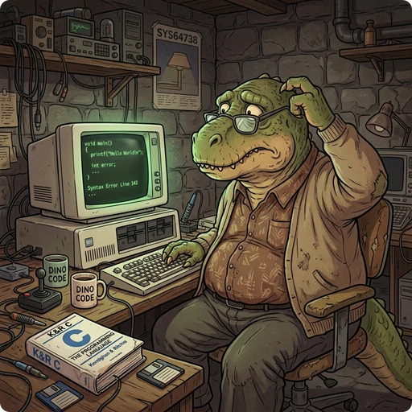

> 👉 **Besides `OPTIONS` lines, the options file accepts menu colors, status highlights, message filters, autopickup exceptions, key bindings, and map symbols.**

For where the options file is and how to edit it, see [[Accessing Options File]]. The ordinary options are on [[Options]].

## ⚙️ Fully-Supported in Modern Versions

### 🎨 MENUCOLOR

`MENUCOLOR` colors the lines in menus and inventory screens that match a regular expression.

**Syntax:**

```
MENUCOLOR="regular expression" = color
MENUCOLOR="regular expression" = color&attribute
```

**Examples:**

```
# Highlight blessed items in green
MENUCOLOR=" blessed " = green
# Highlight cursed items in red
MENUCOLOR=" cursed " = red
# Highlight worn cursed items in orange and underline them
MENUCOLOR=" cursed .* (being worn)" = orange&underline
# Show spells that cannot be recalled in gray (black)
MENUCOLOR="(You cannot recall this spell)" = black
```

### 📊 HILITE_STATUS

`HILITE_STATUS` colors the stats in the status window or bar, such as hit points, mana, hunger status, and attributes. A highlight can depend on a percentage, a value, or a text state.

**Syntax:**

```
HILITE_STATUS=field/value/color
HILITE_STATUS=field/value/color&attribute
```

**Examples:**

```
# Hit points by percentage range
HILITE_STATUS=hitpoints/100%/gray&normal
HILITE_STATUS=hitpoints/<100%/green&normal
HILITE_STATUS=hitpoints/<66%/yellow&normal
HILITE_STATUS=hitpoints/<50%/orange&normal
HILITE_STATUS=hitpoints/<33%/red&bold
HILITE_STATUS=hitpoints/<15%/red&inverse
# Hunger status warnings
HILITE_STATUS=hunger/satiated/yellow/hungry/orange/weak/red&bold/fainting/red&inverse
# Attribute improvements in green, penalties in red
HILITE_STATUS=characteristics/up/green/down/red
```

### 💬 MSGTYPE

`MSGTYPE` decides what happens to messages that match a regular expression: they can be shown, hidden, stopped with a `--More--` prompt, or kept from repeating.

**Syntax:**

```
MSGTYPE=action "regular expression"
```

The supported actions are:
- `show`: Display the message normally.
- `hide` (or `noshow`): Do not show the message at all.
- `stop` (or `more`): Force the player to press `--More--` or tap to acknowledge the message.
- `norep`: Suppress the message if it is an exact repeat of the previous message.

**Examples:**

```
# Pause on every "You see here a ..." message
MSGTYPE=stop "You see here a .*"
# Suppress repeats of the message when you swap places with your pet
MSGTYPE=norep "You swap places with .*"
# Hide a trivial environment message
MSGTYPE=hide "You hear a faint sloshing sound."
```

### 🎒 AUTOPICKUP_EXCEPTION

`AUTOPICKUP_EXCEPTION` adds items that autopickup always picks up or never picks up. These exceptions override the `pickup_types` setting.

**Syntax:**

```
AUTOPICKUP_EXCEPTION="<pattern>"   # Automatically picks up items matching the pattern
AUTOPICKUP_EXCEPTION="!<pattern>"  # Excludes items matching the pattern from autopickup
```

**Examples:**

```
# Always pick up gold
AUTOPICKUP_EXCEPTION="gold piece"
# Always pick up potions of extra healing
AUTOPICKUP_EXCEPTION="potion of extra healing"
# Never pick up loadstones
AUTOPICKUP_EXCEPTION="!loadstone"
```

### ⌨️ BINDINGS

`BINDINGS` maps a key on a hardware keyboard to a game command or a menu shortcut. It is useful on desktop platforms (Windows) and with a physical keyboard connected to a mobile device.

**Syntax:**

```
BINDINGS=key:command
```

The command is the extended command name, such as `look` or `drop`, not the key that normally runs it.

**Example:**

```
# Map the v key to the look (:) command
BINDINGS=v:look
```

## 🖥️ Only Supported in ASCII Mode in Modern Version

These settings take effect when a modern version of the game is switched to **ASCII mode** in the in-game settings.

### 🧱 SYMBOLS

`SYMBOLS` changes the character used for a wall, floor, corridor, or other map terrain when the map is shown as text.

**Syntax:**

```
SYMBOLS=S_symbolname:character
```

You can also choose a whole symbol set, such as `IBMGraphics_2` or `DECgraphics`, in your main `OPTIONS` line:
`OPTIONS=symset:IBMGraphics_2`

**Examples:**

```
# Show vertical walls as a vertical bar
SYMBOLS=S_vwall:|
# Show the floor as a dot
SYMBOLS=S_room:.
```

### 🪨 BOULDER

`BOULDER` sets the character for boulders on the map in ASCII mode.

**Syntax:**

```
BOULDER=character
```

**Examples:**

```
# Show boulders as a capital O
BOULDER=O
# Show boulders as a percent sign
BOULDER=%
```
