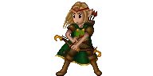

> 👉 **GnollHack animates its characters, spell effects, explosions and most traps.**

There are two kinds of animation: stand animations, such as moving fire, and action animations, such as the swing of a sword in an attack. Every character has attack and kick animations, and spellcasters also have one for casting a spell. Explosions, rays, the swallow graphics and other special effects are animated too.
