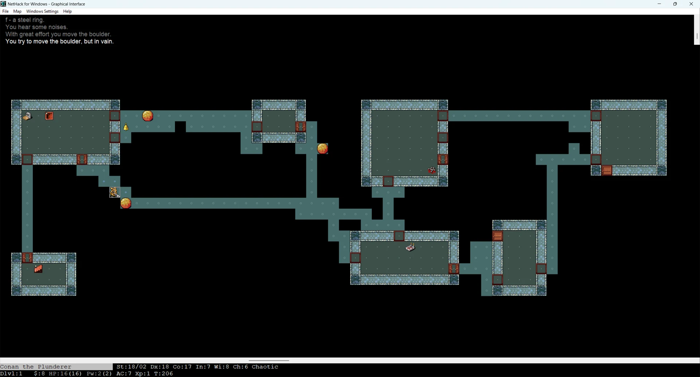
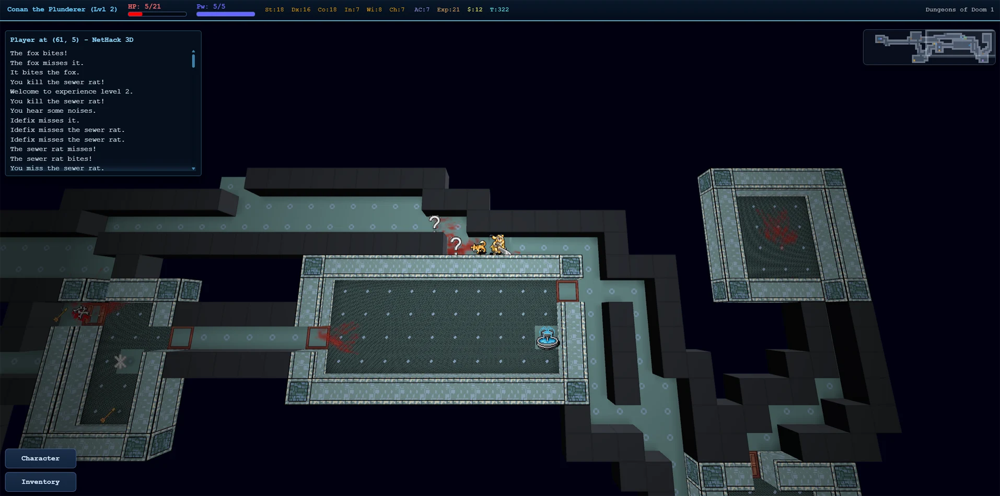
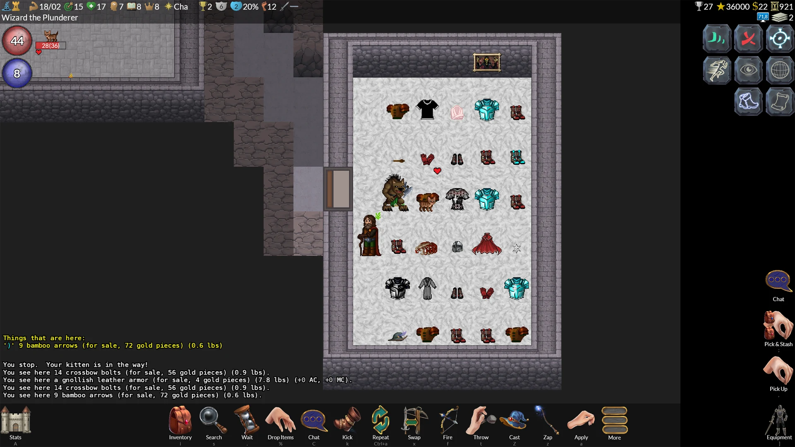

> 👉 **The official NetHack Windows GUI, NetHack 3D, and GnollHack differ in graphics, sound, controls, and the platforms they run on.**

## 📖 Overview

The [NetHack Windows GUI](https://nethack.org/) is the official graphical interface that the NetHack DevTeam ships with NetHack for Windows. It was contributed by Alex Kompel and uses static 2D tiles.

[NetHack 3D](https://github.com/JamesIV4/nethack-3d) is a third-party interface by JamesIV4 that draws low-resolution NetHack tilesets inside a 3D dungeon. It runs in a web browser, as an app, or in VR on Meta Quest.

[GnollHack](https://gnollhack.com/) is a variant of NetHack, forked from NetHack 3.6.2, with its own rules. Its graphical client, made by Sound Mind Games, has animated 2D graphics, music, and voiceovers.

## 📊 Feature Comparison

### Graphics and Sound

| Feature | NetHack Windows GUI | NetHack 3D | GnollHack |
|---------|---------------------|------------|---------------------------|
| **Visual perspective** | 2D top-down grid. Zooming in and out isn't possible, but a fit-to-screen mode scales the map to the window. | 3D perspective supporting a top-down view, a first-person mode, and a terminal view. VR modes are available on Meta Quest. The camera zooms from single tiles out to the whole level. | High-resolution 2D top-down grid that can be zoomed in and out. |
| **Graphics and engine** | Traditional static 2D tilesets (typically 16x16 or 32x32 pixels). | Renders traditional 2D tilesets (such as the Nevanda tileset) as camera-facing elements inside a 3D dungeon. Ten tilesets are built in, custom tilesets can be imported, and a 3D ASCII mode is also available. | 2D tiles of 64x96 pixels, drawn in multiple layers; item tiles are 64x48 pixels, and large monsters and features such as trees use enlarged tiles of up to 192x192 pixels. The tileset has over 23,000 base tiles.1 |
| **Animations and effects** | No animations; the tiles are static. | Defeated monsters can shatter into pieces with blood mist and splatter. Also features dynamic lighting, animated movement, floating damage indicators, and equipped-weapon visuals in first-person VR. | Character animations (attacking, kicking, etc.), animated dungeon features, and spell effects. |
| **Sound support** | Basic sound effects for musical instruments, squeaky boards, and gaining or losing experience levels (new in NetHack 5.0). Limited support for custom sound mapping. | Sound effects for exploration and combat. Custom sound packs can be created and edited in the game. | Over 1,100 sound effects, 37 music tracks, and voice acting by 96 voice actors (over 5,000 voiceover lines). See [[Advanced Sound System]]. |

- 1 "Over 23,000 base tiles" means that GnollHack has over 23,000 × 64 × 96 pixels of custom tile graphics. That's over 141,312,000 pixels, which means *over 17 full 4K screens* of custom tile graphics. Some of these graphics are auto-generated, such as statue graphics, by our custom Tile Set Compiler. Animations also take up a lot of space.

### Interface and Controls

| Feature | NetHack Windows GUI | NetHack 3D | GnollHack |
|---------|---------------------|------------|---------------------------|
| **User interface** | Map, message, and status windows; menus and longer texts open in modal text windows. | A HUD, a scalable minimap, and customizable hotbars. | A graphical status bar, action buttons, and separate Stats and Equipment screens. On desktop, each action button shows its keyboard shortcut. |
| **Input and controls** | Keyboard-centric. Uses numpad or vi-keys for movement. Very rudimentary mouse support. No game controller support. | Keyboard and mouse, controller (with radial action menus), and touch controls. Tracked controllers are supported in VR. | Keyboard, touch, and mouse, with point-and-click play. Controller support (with radial action menus) on the Steam Deck, Linux, macOS, and Windows. |
| **Inventory management** | The inventory is a text menu where items are bound to letters. Since NetHack 5.0, selecting an item in the inventory opens a menu of context-sensitive item actions. Otherwise, the player must first use an appropriate command, such as Quaff (`q`) for drinking. | Graphical inventory with item categories and quantities, and context actions for each item. | Animated, graphical inventory. Most common item commands are accessible directly through the inventory screen. |
| **Targeting system** | Keyboard directional cursor. | Mostly keyboard directional cursor, but mouse and touch can be used in the far look mode. | Mouse and touch, and also a keyboard directional cursor. |
| **Configuration** | Global options are set in a text-based configuration file. | GUI settings and selected startup options (such as autopickup and pet names) are set in in-game menus. | Most settings are in an in-game settings menu; global options are also in a text-based configuration file. |

All three also let you change the game's own options during play from an in-game menu.

### Availability and Versions

| Feature | NetHack Windows GUI | NetHack 3D | GnollHack |
|---------|---------------------|------------|---------------------------|
| **Native OS Support** | Windows | Android, Linux (+Steam Deck), macOS, Windows, and Meta Quest | Android, iOS, Linux (+Steam Deck), macOS, and Windows |
| **Web Browser Support** | ❌ | ✅ | ❌ |
| **Game version** | Vanilla NetHack 5.0 | Vanilla NetHack 5.0 or 3.6.7, or Slash'EM | GnollHack, forked from NetHack 3.6.2 |
| **First released** | 2002, with NetHack 3.4.0 | 2026 | Mobile: 2023, Windows: 2025, Steam Deck and native macOS and Linux: 2026 |
| **Download** | [NetHack website](https://www.nethack.org/) | [GitHub](https://github.com/JamesIV4/nethack-3d/releases/latest) or [play in a web browser](https://jamesiv4.github.io/nethack-3d/) | [Google Play Store](https://play.google.com/store/apps/details?id=com.soundmindentertainment.gnollhack), [Apple App Store](https://apps.apple.com/app/gnollhack/id1626979951), [Steam](https://store.steampowered.com/app/3558190/GnollHack/?utm_source=wiki), [GitHub](https://github.com/hyvanmielenpelit/GnollHack/releases), [GnollHack website](https://gnollhack.com/) |

## 💡 Which One to Pick?

| GUI | Pick it for |
| :-- | :------- |
| **[NetHack Windows GUI](https://nethack.org/)** | Vanilla NetHack 5.0 on Windows with the official interface, if you play mostly with the keyboard. |
| **[NetHack 3D by JamesIV4](https://github.com/JamesIV4/nethack-3d)** | Vanilla rules in 3D, including in a web browser and in VR on Meta Quest. |
| **[GnollHack](https://gnollhack.com/)** | NetHack's dungeon with different rules and a choice of difficulty levels, on a phone or tablet as well as a desktop. |

## 🖼️ Screenshots

### NetHack Windows GUI

NetHack's Windows GUI looks like this with the **Nevanda tileset** (it's one of the best ones available; its tiles are 32x32 pixels in size):

### NetHack 3D (by JamesIV4)

NetHack 3D looks like this in the top-down overview mode, using the **Nevanda tileset** (its tiles are 32x32 pixels in size):

### GnollHack

GnollHack uses its own **custom tileset**, shown here in the modern Windows client. Its tiles are 64x96 pixels and its item tiles 64x48 pixels.

## 📖 See Also

- **[[Comparisons to Other Games]]**
- **[[Graphical NetHack Ports and Variants]]**

## 📅 Validity

The GnollHack details are valid for GnollHack 3.39 (4.3.0 Build 39), checked on November 8, 2026. The NetHack 3D details were checked on November 8, 2026, when its latest release was 1.6.2. The NetHack Windows GUI details date from November 2026.
