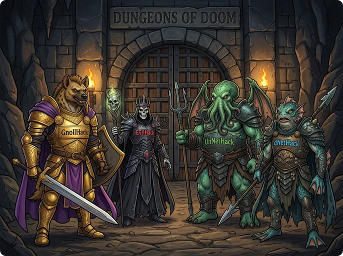

> 👉 **Like GnollHack, [EvilHack](https://nethackwiki.com/wiki/EvilHack) started from NetHack 3.6.2, and [UnNetHack](https://nethackwiki.com/wiki/UnNetHack) and [dNetHack](https://nethackwiki.com/wiki/DNetHack) started from NetHack 3.4.3.**

## ⚖️ Difficulty

GnollHack has 7 [[difficulty levels]] and non-permadeath modes such as [[Casual Mode]] and [[Modern Mode]]. The early game is also more forgiving: you start with stronger equipment, and random monsters come as encounters whose whole group must fit the dungeon level and your experience level.

EvilHack was designed from the start to be much harder to win than vanilla *NetHack*. Its monsters have more hit points, fight more intelligently, and use items and spells that only the player could use before.

UnNetHack has optional challenges that you set in the configuration file. Marathon starts you with 999 HP that you cannot heal, and in Heaven or Hell you and every monster have 1 HP, with three extra lives for you.

## ⌨️ Interface and Input Methods

GnollHack has its own interface for mobile and desktop devices. You manage the inventory by tapping or clicking: selecting an item opens a menu of the actions that apply to it, such as Wield or Put On, and common actions are on an on-screen command bar. The map uses [[animated high-resolution tiles|Improved Graphical Interface]] instead of ASCII, and the game has a [[soundtrack|Music]] and [[voice acting|Voiceovers]].

The three variants are played with NetHack's keyboard commands. EvilHack's Windows download, listed in [[Graphical NetHack Ports and Variants]], has a tty version and a GUI version, and UnNetHack has come with a tiles interface for Windows, using the DawnHack tiles, since version 3.6.1. dNetHack is supported only on Unix, or on Windows through WSL. All three can be played online on the Hardfought servers.

## ⚙️ Systems and Mechanics

In GnollHack, items can have random [[prefixes and suffixes|Mythic and Legendary Items]], and [[weapon quality modifiers]] such as exceptional and elite raise a weapon's damage. Extra [[equipment slots]] hold robes, bracers, and miscellaneous items. Gold has more uses as well; for example, you can pay NPCs to identify unknown items.

In EvilHack, many objects can be made of a material other than their usual one, including the new adamantine and spider silk. It adds the Convict, Infidel, and Druid roles and eight races, among them the centaur, giant, illithid, and tortle. An Infidel worships Moloch and starts the game with the Amulet of Yendor. Any body armor lowers your chance of casting a spell; in vanilla NetHack, only metal armor does.

UnNetHack adds levels and branches: the Town, with a town watch and muggers; the Ruins of Moria, six levels that go upward; the Black market, a shop that spans a whole level; and Sheol, an ice-themed branch in Gehennom. Its Sokoban has three levels instead of four.

dNetHack adds horror elements from the Call of Cthulhu roleplaying game, and new roles such as the Binder, the Noble, and the Anachrononaut. Warding signs replace Elbereth, and you do not always have to fight the demon and devil lords on their levels.

## 📖 See Also

- **[[Comparisons to Other Games]]**
