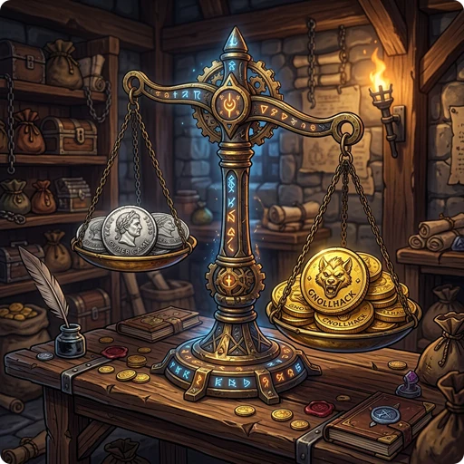

## 🧙‍♂️ NetHack and Its Variants

- **[[NetHack 5.0 vs. GnollHack Release 3]]** — Which of the two current releases to play, and where to get each.
- **[[How GnollHack differs from NetHack]]** — The rule changes a NetHack 3.6 player will notice, from spells and combat to equipment slots and gold.
- **[[Comparison of GnollHack and NetHack Infrastructure]]** — What runs around each game: accounts, scoreboards, bones sharing, servers, and bots.
- **[[Comparison of NetHack GUIs]]** — NetHack's own Windows interface and NetHack 3D next to GnollHack.
- **[[Graphical NetHack Ports and Variants]]** — The maintained graphical versions of NetHack and its variants that you can play without compiling anything.
- **[[Comparison to Other NetHack Variants]]** — How EvilHack, UnNetHack, and dNetHack differ from GnollHack and from each other.

## 🎲 Other Roguelikes

- **[[GnollHack vs. Pathos vs. NetHack]]** — Pathos: NetHack Codex uses NetHack's monsters and items but was written from scratch, with rules of its own.
- **[[Roguelike Comparison]]** — Adds Shattered Pixel Dungeon to NetHack, GnollHack, and Pathos, with prices per store and controller support.
