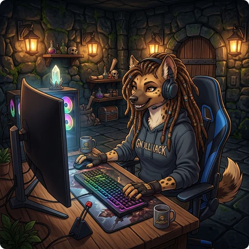

> 👉 **The desktop versions of GnollHack add full keyboard play, configurable mouse buttons, a wider status bar, and their own defaults for several settings.**

## ⌨️ Keyboard Shortcuts

On desktop, you can play the whole game with [[Keyboard Shortcuts]], as in NetHack.

## 🎮 Game Controllers

You can also play with a game controller: an Xbox or other XInput controller on Windows, a gamepad on Linux, or an Xbox, PlayStation, or other gamepad on macOS. The controls are the same as on the Steam Deck, with radial menus and on-screen button hints. See [[Steam Deck Controls]].

## 🖱️ Mouse Button Quick Actions

In the [[Settings]] screen, you can give the **Right Mouse Button** and the **Middle Mouse Button** each a quick action:

| Quick Action Option | Description |
| :--- | :--- |
| **Default / By Role** | Runs the default action for your character class. For details, see [[Character Classes]]. |
| **Off** | Disables clicks on the configured button. |
| **Look** | Looks at the target tile, the same as Far Look (`/`). |
| **Move** | Travels or moves your character to the clicked tile. |
| **Cast** | Casts your **Quick Spell** at the target. You set the Quick Spell in the cast menu. |
| **Fire** | Fires or throws your quivered ranged weapon or projectile at the target. If autoswapping is on, it switches to the correct launcher when needed. |
| **Zap** | Zaps your **Quick Wand** at the target. You set the Quick Wand in the item action screen of the inventory. |
| **Polearm** | Attacks the target with a polearm, switching to it if autoswapping is on. If you are not wielding one and have none as your alternate weapon, it wields one from your inventory. |

### Role-Specific Defaults

With **Default / By Role**, the click action depends on your character class:

| Character Class / Role | Right Click Default | Middle Click Default |
| :--------------------- | :-----------------: | :------------------: |
| [[/Roles/Healer]] / [[/Roles/Monk]] / [[/Roles/Priest]] / [[/Roles/Wizard]] | Cast | Zap |
| [[/Roles/Knight]] | Polearm | Look |
| All Other [[Character Classes]] | Fire | Look |

## ⚙️ Settings Enabled on Desktop by Default

These settings have different defaults on desktop and on mobile. You can change them in the [[Settings]] screen:

| Setting Name | Default Value | Description |
| :--- | :--- | :--- |
| **Single Commands Page** | **On** (Desktop)   **Off** (Mobile) | Shows all commands of the More Commands launcher on one page. On mobile, they are split over several pages instead. |
| **OK on Double Click** | **On** (Desktop)   **Off** (Mobile) | Double-clicking an item in a menu selects it and presses the OK button. |
| **On Switching Apps** | **Checkpoint** (Desktop)   **Save Game** (Mobile) | What the game does when its window loses focus. **Checkpoint** saves a checkpoint in the background without closing open menus or exiting; **Save Game** saves the game and returns to the main menu. |
| **Desktop Status Bar** | **On** (Desktop)   **Off** (Mobile) | Uses the extra width of a desktop screen to show all 6 **Attribute Scores** and **Alignment** with icons, and has toggles to show **Score** and **XP** on the status bar. On mobile, attributes and alignment are not shown on the status bar. |
| **Desktop Buttons** | **On** (Desktop)   **Off** (Mobile) | Shows **Stats** and **Equipment** buttons in the bottom-left and bottom-right corners of the main screen. On mobile, or when the setting is off, you open them by clicking or tapping the top-left and top-right corners of the screen. |
| **Show Keyboard Shortcuts** | **On** (Desktop)   **Off** (Mobile) | Shows each action button's keyboard shortcut on the button. |

## 🔍 More Commands Search Filter

On desktop, the More Commands menu has a search field. Type in it to filter the commands as you type, instead of scrolling through the list.

## 🖱️ Menu Navigation

In menus, right-clicking an item works like a **Long Tap** on mobile, which opens a context menu, item details, or extra options.

## 🖥️ Windowed Mode

The **Windowed Mode** setting switches the game between full-screen and windowed mode.

> ⚠️ **Warning:** The change takes effect only after you restart the game.
