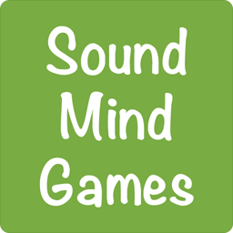

> 👉 **GnollHack is developed by *Sound Mind Games* (Hyvän mielen pelit ry), a Finnish nonprofit organization.**

## About Sound Mind Games

**Sound Mind Games** (Hyvän mielen pelit ry) is a Finnish nonprofit organization that offers work trials and subsidized jobs in IT, media, and game development for people navigating mental health challenges.

- [Visit Hyvän mielen pelit ry Website](https://hyvanmielenpelit.fi/) (In Finnish)

## Sponsor Us

Sponsoring Sound Mind Games supports both its games and the mental wellbeing and careers of the people who make them.

- [Sponsor Us](https://hyvanmielenpelit.fi/tule-mukaan/pienkannatusjaseneksi/in-english) (In English, links to the relevant page on the Sound Mind Games website)
