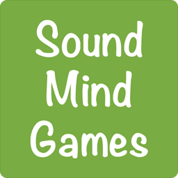

> 👉 **GnollHack is developed by *Sound Mind Games* (Hyvän mielen pelit ry), a Finnish non-profit organization.**

## About Sound Mind Games

**Sound Mind Games** (Hyvän mielen pelit ry) is a Finnish non-profit organization that offers flexible internships and work try-outs in the IT, media, and game sectors. People facing mental health challenges work on real projects together at their own pace. The practical experience, skills, and confidence they gain help them move on to working life.

- [Visit Hyvän mielen pelit ry Website](https://hyvanmielenpelit.fi/) (In Finnish)

## Sponsor Us

Sponsoring Sound Mind Games supports both its games and the mental wellbeing and careers of the people who make them.

- [Sponsor Us](https://hyvanmielenpelit.fi/tule-mukaan/pienkannatusjaseneksi/in-english) (In English, links to the relevant page on the Sound Mind Games website)
