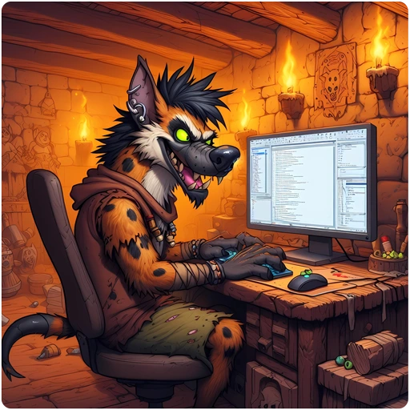

> 👉 **The starting point for GnollHack developers: how to build the game, how it is designed, and how to test it.**

## ℹ️ Overview

GnollHack is actively developed for **Android**, **iOS**, **Windows**, **Linux** and **macOS** as one **.NET MAUI** app. On Linux and macOS, the app runs on Avalonia UI through the [[/Development/Avalonia Port]], which also runs on Windows for development and testing. The legacy clients, the Xamarin.Forms mobile versions and the native Win32 and ASCII versions, are no longer maintained.

> 📢 **Important:** If you are new to the codebase, **you must read this first**:
> - **[[/Development/Overview of Building GnollHack with .NET MAUI]]** — Explains how the native C library, the C# wrapper, and build-time tools interact. Skipping this is the #1 reason developers struggle to build the game.

For an introduction to the whole stack, from the C engine in .NET MAUI and Avalonia UI to the Gnoll Overseer and GnollBench, read [[Shipping a Cross-Platform Roguelike and Its AI Advisor with .NET MAUI, Avalonia UI, and Frontier AI Models|/Guides/GnollHack, Gnoll Overseer, and GnollBench for Software Engineers]]. [[Articles]] lists more articles for developers.

## 🛠️ Building GnollHack

[[/Development/Build Instructions]] has everything for building the game: setting up a Windows computer, the build instructions of every modern client from Windows and Android to the Avalonia versions for Linux and macOS, the native libraries and assets built apart from the clients, troubleshooting, and the release checklist.

## 🏗️ Design and Architecture

[[/Development/Design Details]] explains how the game is built inside, and why: the architecture of the modern clients, the repository structure, the Avalonia port and the design details of its Linux, macOS and Windows flavors, native crash reporting, game controller support, and the history of the clients.

## 🧪 Testing and Debugging

[[/Development/Testing and Debugging]] collects the tools for testing the game: Developer Mode and Wizard Mode, debugging the Avalonia port, testing on a Steam Deck and a Mac, and where each version keeps its files.

## 🖥️ Supported Platforms

The table below summarizes support for the modern client. Note that emulator performance varies, and platform support is subject to CPU architecture availability.

| Platform | Technology | CPU Arch | Solution | Projects | Emulator Support1 |
|:---------|:-----------|:---------|:---------|:---------|:----------------------------:|
| Android | .NET MAUI | Arm64, x642 | GnollHackM | GnollHackM | Yes4 |
| iOS6 | .NET MAUI | Arm64 | GnollHackM | GnollHackM | Yes4 |
| Windows | .NET MAUI | x64, (Arm643) | GnollHackM | GnollHackM | No5 |
| Linux7 | .NET MAUI on Avalonia | x64 | GnollHackM | GnollHackM | N/A |
| macOS7 | .NET MAUI on Avalonia | Arm64 | GnollHackM | GnollHackM | N/A |

- 1 Emulator support refers to whether the port is supported by popular cross-operating-system emulators.
- 2 Android x64 binaries are used by Android emulators running on a Windows machine with an x64 CPU, such as the Google Play Games for PC emulator.
- 3 .NET MAUI supports Arm64 on Windows, but we have not built Arm64 binaries because we do not have a Windows test device with an Arm64 CPU.
- 4 May exhibit odd behavior or crash.
- 5 GnollHack's modern Windows port (.NET MAUI) does not run on Wine or Proton because they do not support running WinUI 3 applications.
- 6 The iOS version from the App Store works also on macOS (on Macs with the M1 processor or later; we don't support Intel Macs). It has some quirks on a Mac, so the native macOS version on Steam is the recommended way to play on macOS.
- 7 Built with `GnhAvalonia=true`. The Linux version is released on Steam and as an AppImage, and the macOS version, for Apple Silicon Macs, on Steam. The same Avalonia build also runs on Windows, for development and testing only. See [[/Development/Avalonia Port]].

### 💻 Future Platform Support

- Currently, there are no plans to support *gaming consoles*.
- *Game controllers* are supported on the Steam Deck, starting from version 3.32, and on desktop Linux, macOS and Windows, but not yet on Android and iOS. See [[Steam Deck Controls]] and [[/Development/Gamepad Support]].

## 🛑 Legacy Clients

The build instructions of the legacy clients, which are kept for historical reference only, are on [[/Development/Legacy Client Development]].

## 🐺 Gnoll Overseer

- [[/Guides/Technological Overview of Gnoll Overseer]] — The technology stack of the Gnoll Overseer, our AI-powered game advisor.

## 🤖 AI

- [[/Development/AI Safety Settings]] — Gnoll Overseer safety settings
- [[/Development/AI Instructions]] — A list of GnollHack-related AI instructions in the Wiki
