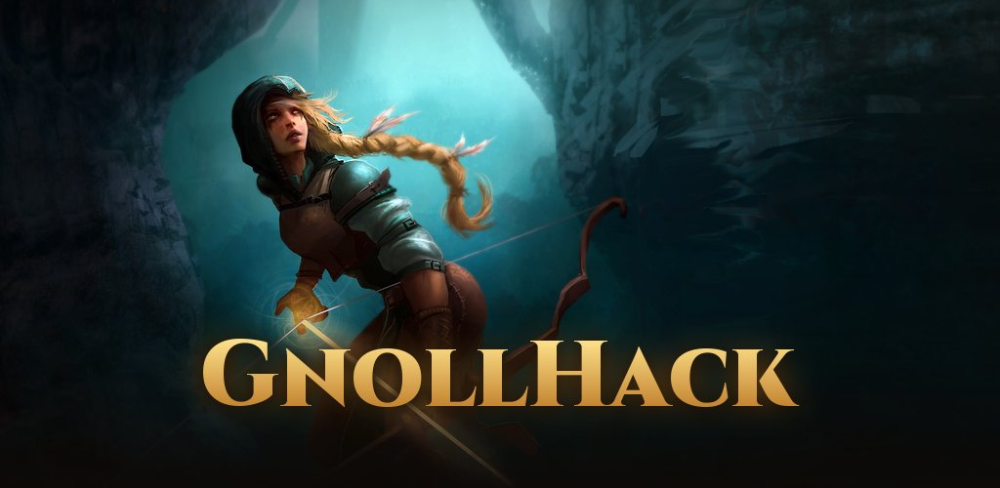
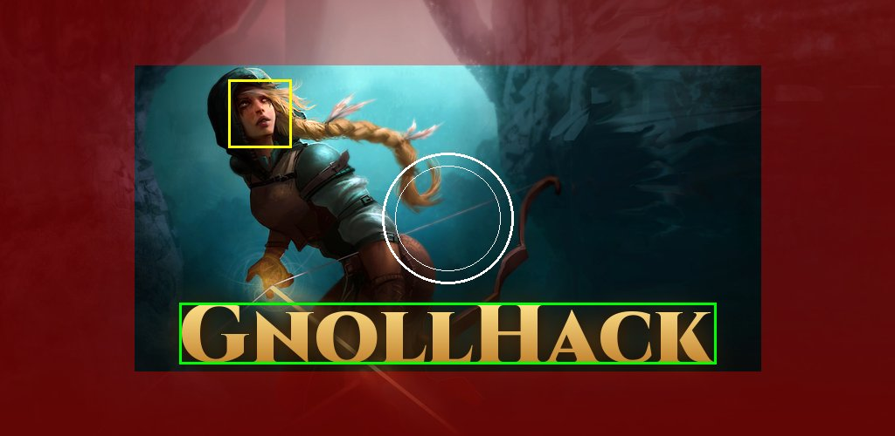

The copiable prompt for these instructions is on the [[/Development/AI Instructions]] page.

These instructions describe how to create GnollHack's Google Play feature graphic: the 1024×500 image that Google Play shows as the cover of the preview video, in large-format collections of recommended games, and in ads. A Python script in this wiki makes it from one character portrait. The result is one PNG file for the user to upload in Play Console. Never upload or publish anything on Google Play yourself.

The feature graphic uses the style of the Steam store and library images, and its script reuses the Steam script's code for the art, the grading, and the lockup: see [[/Development/AI/Steam Store Assets]]. This page covers only what differs for Google Play.

These instructions cover only the feature graphic. The listing's other graphics are made elsewhere: the app icon (512×512) comes from the GnollHack repository, the screenshots are captures of the game, and the preview video is a YouTube video.

## Inputs to Collect

Collect the following before running anything:

1. **Portrait folder.** The script needs `WomanRanger.png` from Matt Forsyth's Art Pack #1 Fantasy Character Portraits (5000×2813 pixels), the same folder that the Steam images use: `G:\Shared drives\Hyvän mielen pelit projektit\Pictures\Matt Forsyth\Art Pack #1 Fantasy Character Portraits` on Hyvän mielen pelit's shared Google Drive. If that folder is not there, ask the user for it. Always use the PNG file, not the JPG file.
2. **Output folder.** The current feature graphic is on the same shared drive, in `G:\Shared drives\Hyvän mielen pelit projektit\GnollHack\Android\Google Play Store Assets\v1`, with a `README.txt` that names the portrait. Build into a temporary folder first and compare the new image with the current one. Ask the user whether to update the `v1` folder or to start a new version folder, and never write over the existing image without asking first.
3. **What to change.** Ask what is to change, such as the portrait or the composition. If the user names no changes, rebuild the image as it is.

## Google's Rules

| Property | Rule |
|----------|------|
| **Size** | 1024×500 pixels |
| **Format** | JPEG, or 24-bit PNG without an alpha channel |
| **File size** | At most 15 MB, as Play Console's upload field states |
| **Required** | Yes: a listing cannot be published without a feature graphic |

Google's Metadata policy applies to the feature graphic and to every translation of the listing. The image must not show:

- the app's store performance or ranking, award icons, price, or promotional information;
- the names of Google Play programs, such as "Editor's choice" or "New".

Google calls the following practices "highly recommended". They are not requirements:

- Keep text to a minimum, and localize any text. The game's name needs no localization.
- No "Best", "#1", "Top", "New", "Free", "Discount", "Sale", or "Million Downloads"; no testimonials or awards; no images of devices; no Google Play or other store badges; nothing time-limited.
- Do not repeat the app icon's branding prominently. GnollHack's app icon is the shield, so the feature graphic shows the name without it.
- Use vibrant colors. Avoid pure white, black, and dark gray, which blend into the Play Store's background. Use a theme that is similar to or goes with the app icon and the game.
- Add alt text of at most 140 characters that does not start with "photo of" or "image of".

How Google Play shows the image:

- **Video cover.** The feature graphic is the cover image of the preview video. When the video does not play automatically, Google Play puts a play button in the middle of the image. Other formats may put other controls over it.
- **Cutoff zones.** Keep the focal point toward the center, and keep the logo and the name out of the cutoff zones at the edges. Google draws the cutoff zones only in a diagram, without numbers. Measured from that diagram on November 25, 2026, they are about 15% of the width on the left and right and 15% of the height at the top and bottom. That leaves a safe area of about columns 154–870 and rows 75–425. These are measurements of a drawing, not numbers from Google.
- **Play button size.** Google does not give the size of the play button. The script estimates it as a circle in the middle of the image with a radius of 12% of the height (60 pixels), and keeps a margin of 3% of the height (15 pixels) around it. The face and the name stay outside this 75-pixel circle, which spans columns 437–587.
- **Small screens.** Google says fine detail will not be visible on many phone screens.

## Style

The feature graphic follows the style of the Steam images: the same WomanRanger portrait as the Main Capsule and the Library Header, not mirrored; the gold Cinzel Black name with its warm glow and dark drop shadow; contrast ×1.08 and saturation ×1.05; the warm near-black overlay (RGB 14, 9, 6); and one Lanczos step from the 5000×2813 portrait, without upscaling the art. The differences come from Google's rules:

- **No shield.** The name stands alone. GnollHack's app icon is the shield, and Google recommends against repeating the app icon's branding prominently. Without the shield, the name also gets the full width of the space it has.
- **The name's place.** The play button covers the middle of the image, so the name goes in the band below it, centered and inside the safe area, as a title under the art. That band is about 100 pixels tall and 700 pixels wide. Do not put the name beside the play button: the strip between the play button zone and the right cutoff zone is only about 280 pixels wide, which leaves the name less than half as large and hard to read on phone screens.
- **Brightness.** The WomanRanger crop is already about 60% near-black (luminance below 24) before any grading. The feature graphic is brightened ×1.2, and its darkening is lighter than on the Main Capsule, so that the finished image has fewer near-black pixels than the art itself and the cave's teal carries the color. The bottom is darkened more, so that the name reads over the ranger's legs and bow. Zooming in on the brighter middle of the art would make the image lighter, but it crops the ranger and the bow.
- **Text.** "GnollHack" is the only text on the image.
- **File.** PNG, sRGB, 8 bits per channel, RGB without an alpha channel.

## Feature Graphic

At zoom 1.0, the portrait's 5000-pixel width scales to exactly 1024 pixels, so the art covers the image without extension. The ranger's face center is at 29% of the width and 26% of the height, which puts her face box at columns 261–333 and rows 91–169: inside the safe area and left of the play button. The image is brightened ×1.2. The bottom is darkened from 50% of the height with a peak alpha of 225, and the other edges are darkened a little (top 30, left 15, right 90).

The name's width is set to 620 pixels, which gives a font size of 95 pixels. It is centered at 50% of the width and 76.5% of the height, so its letters span columns 205–819 and rows 347–417: below the play button zone, inside the safe area, below the ranger's glowing hand, and over her legs and bow. At 256×125, the name is about 154 pixels wide; check that it is still readable.



*Example artwork by Matt Forsyth. Not free to use: a commercial license is required. See [[Example Image License|#example-image-license]].*

The check image draws the cutoff zones in red, the face in yellow, the name in green, and the play button zone in white. The thin circle is the estimated button and the thick circle includes the margin:



*Example artwork by Matt Forsyth. Not free to use: a commercial license is required. See [[Example Image License|#example-image-license]].*

## Generator Script

The script is in this wiki's repository, `hyvanmielenpelit/GnollHackWiki`, at `uploads/Development/AI/Google Play Store Assets/make_google_play_assets.py`: [make_google_play_assets.py](/uploads/Development/AI/Google%20Play%20Store%20Assets/make_google_play_assets.py). It loads the Steam script, `make_steam_store_assets.py`, from the sibling folder `uploads/Development/AI/Steam Store Assets`, so both must be in the same repository checkout. It also needs Python 3 with Pillow, the installed Cinzel Black font (see [[/Development/AI/Steam Events and Announcements]]), and the GnollHack repository, from which the Steam script's lockup code loads the shield file even when the shield is not drawn. Check that Pillow is installed with `python -c "import PIL; print(PIL.__version__)"`.

Run it with:

```text
python make_google_play_assets.py --art-dir <portrait folder> --out-dir <output folder>
    [--checks-dir <folder>] [--examples-dir <folder>] [--gnollhack-repo C:\hmp\GnollHack]
    [--force]
```

| Option | Meaning |
|--------|---------|
| **`--art-dir`** | The folder with the portrait PNG files |
| **`--out-dir`** | The output folder. The script writes the image directly into it |
| **`--checks-dir`** | The folder for the check images. The default is a folder in the system's temporary folder. Never use a folder inside a repository |
| **`--examples-dir`** | Writes the two example JPG files of this page into the folder. Use it only when the examples on this page are to be replaced |
| **`--gnollhack-repo`** | The GnollHack repository, for the shield file. The default is `C:\hmp\GnollHack` |
| **`--force`** | Overwrites an existing image. Without it, the script stops if its output file exists |

The output file is `GH_GOOGLE_PLAY_FEATURE_GRAPHIC.png`.

### Parameters

The tables at the top of the script set the image, so a change of portrait or layout is a change to these tables, not to the code:

- **`ASSETS`** has one entry, `featuregraphic`, with the same keys as the Steam script's `ASSETS`: `art`, `focus`, `at`, `zoom`, `extend`, `grade`, and `lockup`. They are described in [[/Development/AI/Steam Store Assets]]. The face boxes of the portraits come from the Steam script's `PORTRAITS`, so a new portrait is added there.
- **`CUTOFF`** gives the cutoff zones as fractions of the image: left, top, right, and bottom. They are measured from Google's diagram.
- **`PLAY_BUTTON`** gives the estimated play button's radius and the margin around it, as fractions of the image's height.
- **`DARK_LEVEL`** is the luminance below which a pixel counts as near-black.

The script stops if the Steam script is missing or no longer defines what it uses, or if the portrait would be upscaled. It checks that the image is RGB, 1024×500, and at most 15 MB, and it prints a warning when:

- the name (the lockup) reaches into a cutoff zone;
- the face is not inside the safe area;
- the name or the face intersects the play button zone;
- the name covers the face;
- the finished image has more near-black pixels than the ungraded art of its crop (a check of ours for Google's advice against black and dark gray, not a number from Google).

### Check Images

The script writes these into the checks folder:

| File | Shows |
|------|-------|
| **`downscale_512x250.png`**, **`downscale_256x125.png`** | The image at half and at a quarter of its size, to check that the name is readable on phones. Google does not publish its display sizes; these sizes are our choice |
| **`cutoff_zones.png`** | The cutoff zones in translucent red, the face in yellow, the name in green, and the play button zone in white |
| **`video_cover_simulated.png`** | The image with a generic play button at the estimated size, as on the video cover |
| **`on_backgrounds.png`** | The image at 512×250 on a white and on a near-black background |

## Checking and Delivering

Before delivering:

1. Look at the image and at every check image.
2. Check that the script printed no warnings. If it did, change the parameters and run it again.
3. Check that the name is readable in `downscale_256x125.png`.
4. Check that the image has no text other than "GnollHack".
5. Check in `video_cover_simulated.png` and `cutoff_zones.png` that the face and the name are clear of the play button and outside the cutoff zones.
6. Check the edges for unfinished art or a visible seam.
7. Check that the image looks like one family with the Steam images on [[/Development/AI/Steam Store Assets]].

Then deliver to the user:

- the full path of the image, and the image sent directly if your tools can send files;
- a proposed alt text of at most 140 characters that describes the image and does not start with "photo of" or "image of";
- a reminder that the user uploads the image in Play Console, enters the alt text, and checks whether translated or custom store listings have their own feature graphic to replace.

## Example Image License

The example images on this page contain artwork by Matt Forsyth from a commercial art pack. They are not free: any use of them requires a commercial license. They are on this page only to show the layout to AI agents. The scripts in this wiki contain no artwork: they read the portraits from the folder given to them.

## External Links

Read on November 25, 2026:

- [Add preview assets to showcase your app (Play Console Help)](https://support.google.com/googleplay/android-developer/answer/9866151)
- [Best practices for your store listing (Play Console Help)](https://support.google.com/googleplay/android-developer/answer/13393723)
- [Metadata (Play Console Help)](https://support.google.com/googleplay/android-developer/answer/9898842)
