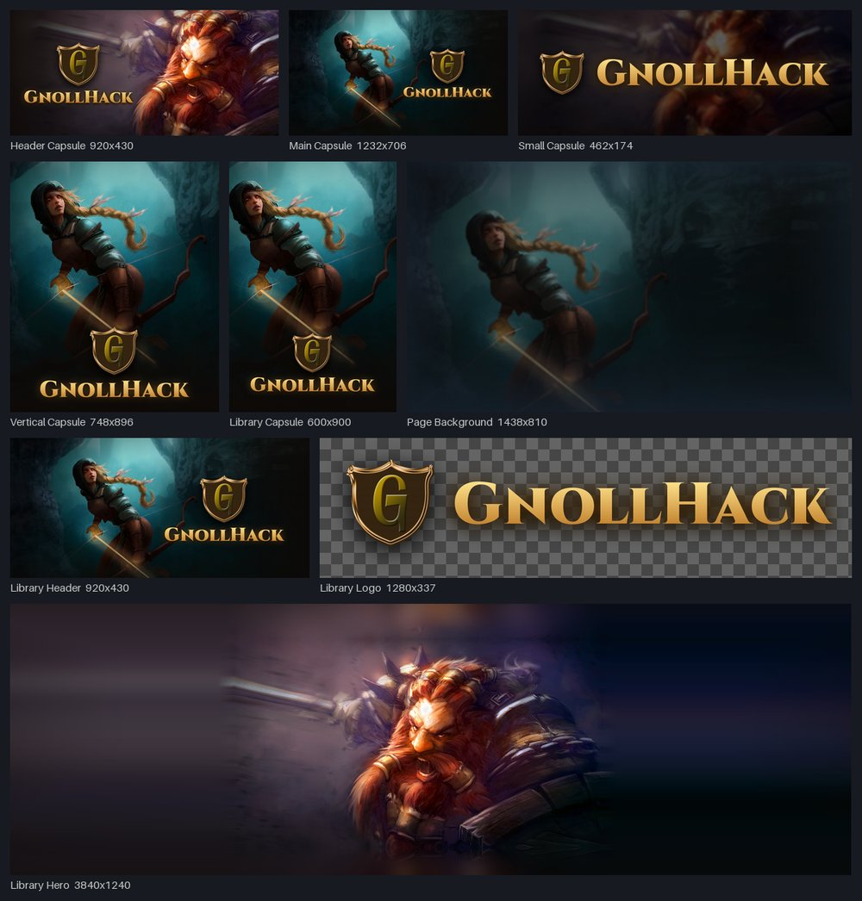
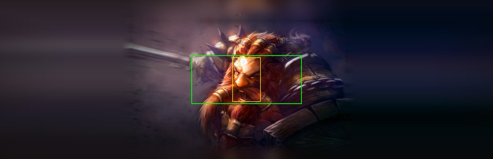
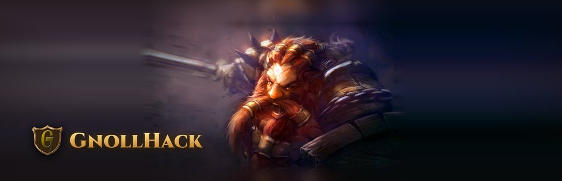

The copiable prompt for these instructions is on the [[/Development/AI Instructions]] page.

These instructions describe how to create GnollHack's Steam store and library images: the nine images that Steam shows on the store page, in store lists, and in the Steam library. A Python script in this wiki makes all of them from two character portraits. The result is nine image files for the user to upload in Steamworks. Never upload or publish anything on Steam yourself.

The images use the same style as the Steam event images: the fonts, the shield, the gold colors, and the grading are described in [[/Development/AI/Steam Events and Announcements]]. This page covers only what differs for store and library images.

## Inputs to Collect

Collect the following before running anything:

1. **Portrait folder.** Ask the user for the folder that contains the portrait PNG files. The script needs `DwarfWarrior.png` and `WomanRanger.png` from Matt Forsyth's Art Pack #1 Fantasy Character Portraits (5000×2813 pixels). Always use the PNG files, not the JPG files.
2. **Output folder.** Ask the user where the images go. Never write over existing images without asking first.
3. **What to change.** Ask which images to rebuild, and whether any portrait is to be replaced. If the user names no changes, rebuild all nine.

## Valve's Rules

| Asset | Size | Rules |
|-------|------|-------|
| **Header Capsule** | 920×430 | Steam generates smaller versions from it, such as 460×215. Key art and the game's logo, legible against the background. No text other than the game's name |
| **Small Capsule** | 462×174 | Steam generates 184×69 and 120×45. The logo must be readable even at the smallest size and should nearly fill the capsule |
| **Main Capsule** | 1232×706 | Shown in the carousel on Steam's front page. Same rules as the Header Capsule |
| **Vertical Capsule** | 748×896 | Shown at the top of the front page during seasonal sales, and on sale pages. Same rules as the Header Capsule |
| **Page Background** | 1438×810 | Optional. Ambient, so that it does not compete with the content of the store page. Steam applies its own template to the uploaded image. Without one, Steam makes the background from the game's last screenshot |
| **Library Capsule** | 600×900 | Steam generates 300×450. Must include the logo; no other text |
| **Library Header** | 920×430 | Shown in Recent Games and other places in the library. Branding and art similar to the capsules |
| **Library Hero** | 3840×1240 | Steam generates 1920×620. No text and no logo. Steam crops it depending on the window size, but never the centered 860×380 safe area (columns 1490–2350, rows 430–810). The main character's face must be entirely inside the safe area |
| **Library Logo** | 1280 wide or 720 tall | The logo on a transparent background, any aspect ratio. In Steamworks, the user positions it over the hero (bottom left, top center, center, or bottom center). It must stay legible over the hero |

Rules for all of them:

- Every capsule shows the game's name or logo, and nothing else as text: no taglines, quotes, review scores, awards, discount text, or calls to action.
- Artwork must be rated PG-13 or milder.
- Text about an event or update is allowed only in a time-limited Artwork Override (at most 14 days, localized). Artwork Overrides are not covered by these instructions.

## Style

Follow the style of [[/Development/AI/Steam Events and Announcements]], with these differences:

- **Lockup.** The shield and the game name together. The name is "GnollHack" in **Cinzel Black** (Cinzel draws the lowercase letters as small capitals), with the gold gradient, a soft warm glow, and a soft dark drop shadow. The shield gets a soft drop shadow. There are two variants:
  - **Horizontal:** The shield on the left, the name on the right, centered on the shield. Used for the Small Capsule and the Library Logo.
  - **Stacked:** The shield above the name, centered. Used for the Header Capsule, the Main and Vertical Capsules, the Library Capsule, and the Library Header.
- **Shield file.** The GnollHack repository's `win/win32/xpl/GnollHackM/Assets/AppIcon/gnollhack-icon-v2-512-1240_x_1240.png`. It is the same shield as the event images' logo file, at 1171×1160 visible pixels, so it is never upscaled.
- **No taglines.** The name is the only text on any image.
- **Margins.** Keep the lockup at least 5% of the image's width away from every edge.
- **Grading.** Contrast ×1.08 and saturation ×1.05, then a warm near-black overlay (RGB 14, 9, 6) that fades out from the lockup's side, and slightly darker edges. The subject stays bright. The Small Capsule and the Page Background use their own grading, described below.
- **Scaling.** Scale the 5000×2813 portrait in one Lanczos step to each final size, and never upscale it. When the art does not cover the image, extend it with blurred art at the sides, as described for each image below.
- **Files.** PNG, sRGB, 8 bits per channel, RGB without an alpha channel. Only the Library Logo is RGBA, with real transparency.

## Images

All nine images of the current set:



*Example artwork by Matt Forsyth. Not free to use: a commercial license is required. See [[Example Image License|#example-image-license]].*

### Header Capsule

DwarfWarrior, with his face right of the center (at 70% of the width) and the art zoomed to 110% of the size that covers the image. The left side is darkened. The stacked lockup, 380 pixels wide, is centered at 25% of the width. Check that the name is readable at 460×215.

### Small Capsule

DwarfWarrior as a background texture only: brightness ×0.36 and a 1.5-pixel blur, so that the art does not compete with the name. The horizontal lockup spans 88% of the width (406 pixels) and is centered. The shield is smaller in relation to the name than in the other lockups (1.25 times the font size), so that the name can be as large as possible. Check that the name is readable at 120×45. If it is not, leave the shield out.

### Main Capsule

WomanRanger on the left, not mirrored: a mirrored archer looks wrong. The right side is darkened. The stacked lockup, 500 pixels wide, is centered at 72.5% of the width and in the middle of the height.

### Vertical Capsule

WomanRanger, with her face in the upper quarter of the image. The art is moved up, and the gap at the bottom is filled with mirrored, blurred art, which the bottom darkening covers. The stacked lockup, 540 pixels wide, is centered at 80% of the height. Its shield is smaller than in the other stacked lockups (2.1 times the font size instead of 2.6), so that it does not cover the subject.

### Page Background

Valve does not document the template that Steam applies to the Page Background. Third-party guides say that it tints the image blue and fades its edges. Design it so that it works with or without that template:

- WomanRanger, whose teal cave colors survive a blue tint. The ranger is placed toward the left side.
- No text and no logo: the store page already shows the name.
- Ambient grading: contrast ×0.8, saturation ×0.9, brightness ×0.7, a 2-pixel blur, and the brightest values compressed, so that the image reads as atmosphere and has no bright highlights.
- The edges are darkened toward the store page's own color (RGB 27, 40, 56), so that the image does not end in a hard line.
- No strong shapes at the top center, where the store page's header and media area cover it.

Tell the user to check the Page Background in the Steamworks store preview. If it looks wrong there, the user leaves it out, and Steam keeps making the background from the last screenshot.

### Library Capsule

The same composition as the Vertical Capsule, with a 450-pixel lockup. Check that the name is readable at 300×450.

### Library Header

The same composition as the Main Capsule, with a 370-pixel lockup.

### Library Hero

DwarfWarrior, with no text and no logo. His face, from the forehead to the mouth, must be entirely inside the safe area, so the art is scaled down to 44% of the size that covers the image and centered on his face. The art then covers only the middle of the image:

- At the left and right, extend it by stretching the colors of the art's outermost columns sideways and blurring them. Do not mirror the art there: a mirrored copy repeats the dwarf at both sides.
- At the top and bottom, extend it with mirrored, blurred art, and darken both edges.
- Darken the lower-left corner a little, so that the logo stays legible there.

The check image draws the safe area in green and the face in yellow:



*Example artwork by Matt Forsyth. Not free to use: a commercial license is required. See [[Example Image License|#example-image-license]].*

### Library Logo

The horizontal lockup, 1280 pixels wide including its shadow, with the height trimmed to the lockup and its shadow (337 pixels in the current set). Its shadow is 1.6 times as wide as in the other lockups and is part of the transparency, so that the logo stays legible over both the light and the dark parts of the hero. The logo over the hero at the bottom-left position:



*Example artwork by Matt Forsyth. Not free to use: a commercial license is required. See [[Example Image License|#example-image-license]].*

## Generator Script

The script is in this wiki's repository, `hyvanmielenpelit/GnollHackWiki`, at `uploads/Development/AI/Steam Store Assets/make_steam_store_assets.py`: [make_steam_store_assets.py](/uploads/Development/AI/Steam%20Store%20Assets/make_steam_store_assets.py). It needs Python 3 with Pillow, the installed Cinzel Black font (see [[/Development/AI/Steam Events and Announcements]]), and the GnollHack repository for the shield. Check that Pillow is installed with `python -c "import PIL; print(PIL.__version__)"`.

Run it with:

```text
python make_steam_store_assets.py --art-dir <portrait folder> --out-dir <output folder>
    [--checks-dir <folder>] [--examples-dir <folder>] [--gnollhack-repo C:\hmp\GnollHack]
    [--only <asset names>] [--force]
```

| Option | Meaning |
|--------|---------|
| **`--art-dir`** | The folder with the portrait PNG files |
| **`--out-dir`** | The output folder. The script writes the images into its `STORE` and `LIBRARY` subfolders |
| **`--checks-dir`** | The folder for the check images. The default is a folder in the system's temporary folder. Never use a folder inside a repository |
| **`--examples-dir`** | Writes the three example JPG files of this page into the folder. Use it only when the examples on this page are to be replaced |
| **`--gnollhack-repo`** | The GnollHack repository, for the shield. The default is `C:\hmp\GnollHack` |
| **`--only`** | Builds only the named images: `storeheader`, `smallcapsule`, `maincapsule`, `verticalcapsule`, `pagebackground`, `librarycapsule`, `libraryheader`, `libraryhero`, `librarylogo` |
| **`--force`** | Overwrites existing images. Without it, the script stops if any of its output files exists |

The output files are named as follows:

| Asset | File |
|-------|------|
| **Header Capsule** | `STORE\GH_STEAM_ASSET_STOREHEADER.png` |
| **Small Capsule** | `STORE\GH_STEAM_ASSET_STORE_SMALLCAPSULE.png` |
| **Main Capsule** | `STORE\GH_STEAM_ASSET_STORE_MAINCAPSULE.png` |
| **Vertical Capsule** | `STORE\GH_STEAM_ASSET_STORE_VERTICALCAPSULE.png` |
| **Page Background** | `STORE\GH_STEAM_ASSET_STORE_PAGEBACKGROUND.png` |
| **Library Capsule** | `LIBRARY\GH_STEAM_ASSET_LIBRARYCAPSULE.png` |
| **Library Header** | `LIBRARY\GH_STEAM_ASSET_LIBRARYHEADER.png` |
| **Library Hero** | `LIBRARY\GH_STEAM_ASSET_LIBRARYHERO.png` |
| **Library Logo** | `LIBRARY\GH_STEAM_ASSET_LIBRARYLOGO.png` |

### Parameters

Two tables at the top of the script set every image, so a change of portrait or layout is a change to these tables, not to the code:

- **`PORTRAITS`** gives each portrait's face box, from the forehead to the mouth, as fractions of the portrait's width and height. The art is centered on the face by default, and the script uses the face box for the hero check and the lockup checks. To use a new portrait, add it here: look at the portrait with a grid drawn over it, and measure its face box.
- **`ASSETS`** has one entry per image:

| Key | Meaning |
|-----|---------|
| **`art`** | The portrait's file name without `.png` |
| **`focus`** | The point of the portrait, as fractions, that is placed at `at`. The default is the face's center |
| **`at`** | Where the focus point lands on the image, as fractions of its width and height |
| **`zoom`** | The art's scale in relation to the smallest scale that covers the image. Below 1, the art is extended at the sides |
| **`extend`** | How the art is extended: `mirror` (the default) or `smear`, which stretches the outermost columns sideways |
| **`grade`** | Contrast, saturation, brightness, blur, highlight compression, the darkened side, and the darkened edges and corner |
| **`lockup`** | The variant (`horizontal` or `stacked`), the visible width in pixels, the center as fractions of the image, and optionally the shield size in relation to the font size and the shadow strength |

The script stops if a portrait would be upscaled. It checks the size and color mode of every image it writes, and it prints a warning when:

- a lockup is closer than 5% of the image's width to an edge;
- a lockup covers the face (the Small Capsule is allowed to);
- the hero's face is not inside the safe area;
- the shield would be upscaled.

### Check Images

The script writes these into the checks folder:

| File | Shows |
|------|-------|
| **`downscale_*.png`** | The Header Capsule at 460×215, the Small Capsule at 184×69 and 120×45, the Library Capsule at 300×450, and the hero at 1920×620. `downscale_smallcapsule_120x45_zoomed.png` shows the 120×45 version enlarged four times |
| **`hero_safe_area.png`** | The hero with the safe area (green) and the face (yellow) |
| **`logo_over_hero_*.png`** | The logo over the hero at the four positions of Steamworks, at 1920×620 |
| **`page_background_simulated.png`** | The Page Background with a blue tint and faded edges, as a stand-in for Steam's undocumented template, with the store page's 940-pixel content column outlined in blue |
| **`contact_sheet.png`** | All nine images in one sheet |

## Checking and Delivering

Before delivering:

1. Look at every image the script wrote and at every check image.
2. Check that the script printed no warnings. If it did, change the parameters and run it again.
3. Check that the name is readable in every downscaled version, including the Small Capsule at 120×45.
4. Check that no image has any text other than "GnollHack", and that the hero and the Page Background have none at all.
5. Check that the hero's face is inside the safe area and that no lockup covers a face.
6. Check the edges of every image for unfinished art or a visible seam where the art was extended.
7. Check that the images look like one family with the event images.

Then deliver to the user:

- the full paths of the nine images, and the contact sheet sent directly if your tools can send files;
- a list of the images that changed, if only some were rebuilt;
- a reminder that the user uploads the images in Steamworks (Store Assets and Library Assets), positions the Library Logo over the hero, and checks the Page Background in the store preview before publishing.

## Example Image License

The example images on this page contain artwork by Matt Forsyth from a commercial art pack. They are not free: any use of them requires a commercial license. They are on this page only to show the layout to AI agents. The script in this wiki contains no artwork: it reads the portraits from the folder given to it.

## External Links

Read on November 23, 2026:

- [Graphical Assets - Overview (Steamworks documentation)](https://partner.steamgames.com/doc/store/assets)
- [Store Graphical Assets (Steamworks documentation)](https://partner.steamgames.com/doc/store/assets/standard)
- [Library Assets (Steamworks documentation)](https://partner.steamgames.com/doc/store/assets/libraryassets)
- [Graphical Asset Rules (Steamworks documentation)](https://partner.steamgames.com/doc/store/assets/rules)
- [Steamworks asset templates (Dropbox folder)](https://www.dropbox.com/scl/fo/cvkwbosmrimklcl9h0qko/AF5IPErKP-mQM_3YO1Dw2lA?rlkey=b3ad0izykq367g4luasrinw9z&dl=0)
