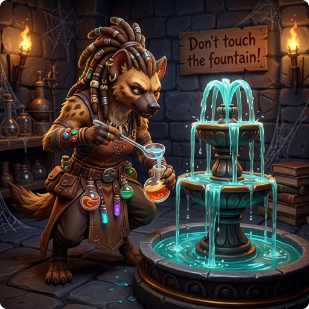

> 👉 **A diluted potion is a watered-down potion, usually made by dipping it into water, and it works at half strength.**

## 💧 General Effects of Dilution

Quaffing a diluted potion differs from quaffing an undiluted one in three ways:

- The amount of the effect, such as the hit points healed or the damage taken, is halved.
- Temporary effects, such as levitation, blindness, invisibility, or confusion, last half as long.
- It gives exactly half the nutrition.

Diluted potions of gain ability, gain level and polymorph also have a 50% chance to do nothing at all.

## 🧪 Specific Potion Effects

Besides these general rules, dilution changes how many potions behave when you quaff them or use them in other ways:

| Potion | Effect of Dilution |
| :----- | :----------------- |
| [[/Items/Potion of blindness]] | The blindness effect lasts for half the normal duration. |
| [[/Items/Potion of dwarven mushroom brew]] | Quaffing it will refresh you without causing confusion. (Undiluted brew confuses the player.) |
| [[/Items/Potion of elven herbal brew]] | Does not provide the small 1 HP heal that the undiluted brew gives. |
| [[/Items/Potion of gain ability]] | There is a 50% chance that the potion will have no effect at all. |
| [[/Items/Potion of gain level]] | There is a 50% chance that the potion will fail, giving only "an elevated feeling" (or an "uneasy feeling" if cursed) instead of a level up or rising to the level above. |
| [[/Items/Potion of healing]]   [[/Items/Potion of extra-healing]]   [[/Items/Potion of greater healing]]   [[/Items/Potion of full healing]] | Heals half the normal amount of hit points. If the potion is breathed or splashed on you, its vapors normally restore 1 HP (2 for extra and greater healing, 3 for full healing); each of those points has a 50% chance to fail. |
| [[/Items/Potion of speed]]   [[/Items/Potion of greater speed]]   [[/Items/Potion of lightning speed]] | The speed buff is stepped down by one tier. For example, a diluted potion of lightning speed grants the same buff as an undiluted potion of greater speed. |
| [[/Items/Potion of oil]] | When used to refill a light source, it gives three quarters of the fuel of an undiluted potion. |
| [[/Items/Potion of polymorph]] | There is a 50% chance that the potion will fail, causing you to only "shudder for a moment" instead of changing your form. |
| [[/Items/Potion of restore ability]] | Even if blessed, it will only restore a single drained attribute. (An undiluted blessed potion restores all drained attributes.) |
| [[/Items/Potion of see invisible]] | A blessed diluted potion only grants temporary see invisible. (An undiluted blessed potion grants the ability permanently.) |
| [[/Items/Potion of sickness]] | It turns out to be mildly stale juice instead of contaminated: you lose only 1 HP and do not get food poisoning. |

## 🚰 Dipping in Water

Dipping a potion into water usually makes it diluted. Dipping an already diluted potion into water or a fountain usually washes it out completely, turning it into a [[/Items/potion of water]].
