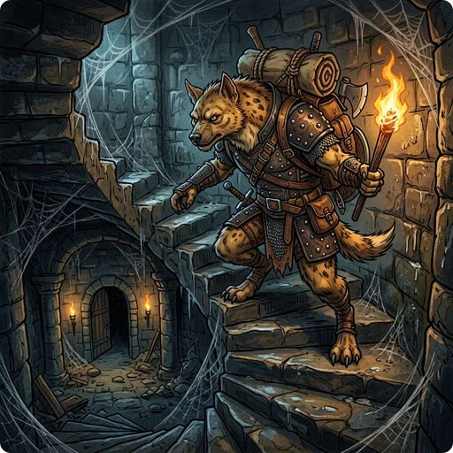

The main dungeon of GnollHack is the [[/Dungeon/Dungeons of Doom]], which runs from the surface down to the [[/Dungeon/Underground Castle]], above [[/Dungeon/Gehennom]]. *Branches* and *special levels* lie along the way.

**Branches** are sub-dungeons that leave the main path, often with their own tileset, monsters and rules. **Special levels** are single levels inside a branch, usually with a fixed layout and fixed features.

The **level range** of a branch or special level is the set of levels of its parent branch on which it, or the entrance to it, can appear. A range of 2–4 means level 2, 3 or 4 of the parent branch.

## ⚔️ The Dungeons of Doom

The Dungeons of Doom are 24 or 25 levels deep.

### 🔀 Dungeon Branches

| Branch | Level Range | Description |
| :----- | :---------: | :---------- |
| **[[/Dungeon/Gnomish Mines]]** | 2–4 | A cavern system filled with gnomes and dwarves. Contains special levels like [[/Dungeon/Mine Town]]. |
| **[[/Dungeon/Sokoban]]** | 6–8 | A puzzle branch where you must push boulders into pits. |
| **[[/Dungeon/Quest]]** | 11–14 | A role-specific quest branch. *Message: "You receive a faint telepathic message from..." (followed by a message from your Quest Leader).* |
| **[[/Dungeon/Fort Ludios]]** | 12–20 | A hidden fortress guarded by soldiers and [[/Monsters/Croesus]]. The portal is found in a vault. |
| **[[/Dungeon/Gehennom]]** | 24–25 | The lower half of the dungeon, full of demons. Entered from the Underground Castle. |
| **[[/Dungeon/Elemental Planes]]** | 1 | Reached by going up the stairs on dungeon level 1 with the [[/Items/Amulet of Yendor]]. The endgame: the Planes of Earth, Air, Fire and Water, and the Astral Plane. |

### 🚩 Special Levels

| Special Level | Level Range | Description |
| :------------ | :---------: | :---------- |
| **[[/Dungeon/Delphi]]** | 5–7 | Home to the [[/Monsters/Oracle]], who provides minor and major consultations. |
| **[[/Dungeon/Big Room]]** | 10–12 | One open room the size of the level, full of monsters. Appears in 40% of games. |
| **[[/Dungeon/Treasure Island]]** | 14–17 | Treasure behind a water moat. New in GnollHack. |
| **[[/Dungeon/Medusa's Island]]** | 22–23 | A water-filled cavern housing [[/Monsters/Medusa]]. |
| **[[/Dungeon/Minotaur Maze]]** | 23–24 | A maze-like level with a [[/Monsters/minotaur]]. Redesigned in GnollHack. |
| **[[/Dungeon/Underground Castle]]** | 24–25 | The fortress above Gehennom, with a [[/Items/wand of wishing]]. |

## ⛏️ The Gnomish Mines

### 🔀 Dungeon Branches

| Branch | Level Range | Description |
| :----- | :---------: | :---------- |
| **[[/Dungeon/Large Circular Dungeon]]** | 4–6 | Two high-tech levels, the Quantum Tunnel and the Quantum Core, reached through a portal below [[/Dungeon/Mine Town]]. New in GnollHack. |

### 🚩 Special Levels

| Special Level | Level Range | Description |
| :------------ | :---------: | :---------- |
| **[[/Dungeon/Mine Town]]** | 3–4 | An underground town with shops, a temple and guards. |
| **[[/Dungeon/Mines' End]]** | 8–9 | The bottom level of the Mines, where the [[/Artifacts/The Gladstone]] lies. |

## 🔥 Gehennom

### 🔀 Dungeon Branches

| Branch | Level Range | Description |
| :----- | :---------: | :---------- |
| **[[/Dungeon/Plane of the Modron]]** | 3–4 | Five geometric levels inhabited by modrons, reached through a portal. New in GnollHack. |
| **[[/Dungeon/Hellish Pastures]]** | 8–13 | A hidden cow level of demonic cattle, reached through a portal. New in GnollHack. |
| **[[/Dungeon/Vlad's Tower]]** | 9–13 | A three-level tower of undead with the [[/Artifacts/Candelabrum of Invocation]]. |

### 🚩 Special Levels

| Special Level | Level Range | Description |
| :------------ | :---------: | :---------- |
| **[[/Dungeon/Valley of the Dead]]** | 1 | The first level of Gehennom: graveyards, undead and a temple of Moloch. |
| **[[/Dungeon/Dis]]** | 2 | The iron city ruled by [[/Monsters/Dispater]]. |
| **[[/Dungeon/Maladomini]]** | 4–8 | The domain of [[/Monsters/Baalzebub]], Lord of the Flies. |
| **[[/Dungeon/Jubilex's Realm]]** | 4–8 | A swamp with acidic oozes and [[/Monsters/Jubilex]], the Faceless Lord. |
| **[[/Dungeon/Orcus Town]]** | 5–15 | A ruined town ruled by [[/Monsters/Orcus]]. |
| **[[/Dungeon/Wizard's Tower]]** | 10–13 | A three-level tower holding the [[/Monsters/Wizard of Yendor]] and the [[/Artifacts/Book of the Dead]]. It can be entered only through a portal in one of the [[/Dungeon/Fake Wizard's Towers]]. |
| **[[/Dungeon/Lair of Tarrasque]]** | 10–18 | Home of the [[/Monsters/Tarrasque]]. New in GnollHack. |
| **[[/Dungeon/Yeenaghu's Domain]]** | 10–18 | The domain of [[/Monsters/Yeenaghu]], demon lord of gnolls. New in GnollHack. |
| **[[/Dungeon/Fake Wizard's Towers]]** | 13–18 | Two decoy towers, one of which contains the portal to the true [[/Dungeon/Wizard's Tower]]. |
| **[[/Dungeon/Moloch's Sanctum]]** | 18–20 | The lowest level of Gehennom, housing the [[/Items/Amulet of Yendor]] and the [[/Monsters/High Priest]] of Moloch. |

## 🔗 Dungeon Placement Dependencies

Many branches and special levels are not placed at a depth of their own but relative to another level, so when that level moves, they move with it.

### 🔮 Placed Relative to Delphi

[[/Dungeon/Delphi]], the Oracle's level, is on level 5, 6 or 7 of the [[/Dungeon/Dungeons of Doom]]. Three other locations are counted from it:
- **[[/Dungeon/Sokoban]]**: The stairs up to Sokoban are 1 level below Delphi.
- **[[/Dungeon/Quest]]**: The magic portal to your role's quest is 6 or 7 levels below Delphi.
- **[[/Dungeon/Treasure Island]]**: 9 or 10 levels below Delphi.

### 🏰 Fixed-Range Placements

Two locations in the Dungeons of Doom have depth ranges of their own:
- **[[/Dungeon/Big Room]]**: Between levels 10 and 12, in the 40% of games that have one.
- **[[/Dungeon/Fort Ludios]]**: The portal is in a vault between levels 12 and 20.

### 🧭 The Bottom of the Main Dungeon

The last three levels of the Dungeons of Doom are counted from the bottom:
- **[[/Dungeon/Underground Castle]]**: The last level.
- **[[/Dungeon/Minotaur Maze]]**: 1 level above the Castle.
- **[[/Dungeon/Medusa's Island]]**: 2 levels above the Castle.

[[/Dungeon/Gehennom]] begins below the Castle, with the [[/Dungeon/Valley of the Dead]] as its first level.

### ⛏️ The Gnomish Mines

The [[/Dungeon/Gnomish Mines]] branch off the Dungeons of Doom on level 2, 3 or 4 and are 8 or 9 levels deep. Inside the Mines:
- **[[/Dungeon/Mine Town]]**: The 3rd or 4th level.
- **[[/Dungeon/Large Circular Dungeon]]**: Its portal is 1 or 2 levels below Mine Town.
- **[[/Dungeon/Mines' End]]**: The last level.

### 🔥 Gehennom

Gehennom has 18 to 20 levels. Some of its locations are counted from the top and the rest from the bottom.

**Counted from the top:**
- **[[/Dungeon/Valley of the Dead]]**: Level 1.
- **[[/Dungeon/Dis]]**: Level 2, directly below the Valley.
- **[[/Dungeon/Plane of the Modron]]**: The portal is on level 3 or 4.
- **[[/Dungeon/Maladomini]]** and **[[/Dungeon/Jubilex's Realm]]**: Levels 4 to 8.
- **[[/Dungeon/Orcus Town]]**: Levels 5 to 15.
- **[[/Dungeon/Hellish Pastures]]**: The portal is on levels 8 to 13.
- **[[/Dungeon/Vlad's Tower]]**: The stairs up to the tower are on levels 9 to 13.
- **[[/Dungeon/Wizard's Tower]]**: The top level of the tower is on level 10 or 11, and the middle and bottom levels are the two levels directly below it.

**Counted from the bottom:**
- **[[/Dungeon/Moloch's Sanctum]]**: The last level.
- **[[/Dungeon/Fake Wizard's Towers]]**: 2 to 5 levels above the bottom.
- **[[/Dungeon/Lair of Tarrasque]]** and **[[/Dungeon/Yeenaghu's Domain]]**: 2 to 8 levels above the bottom, so they always come late in the game.
