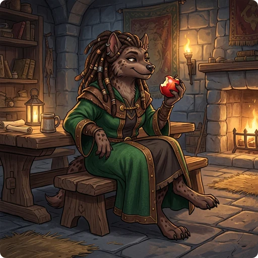

> 👉 **In GnollHack, what you eat decides your hunger state, and some foods raise your attributes or level while others are dangerous.**

## 🍗 Hunger and Nutrition States

Your nutrition level sets your hunger state, and the hunger state affects your [[attribute scores]], your speed, and whether you survive.

| Hunger State | Nutrition Range | Strength Penalty | Status Effects & Hazards |
| :----------- | :-------------: | :--------------: | :----------------------- |
| **SATIATED** | > 1000 | None | High choking risk if eating food with > 50 nutrition. |
| **NOT HUNGRY** | 151 – 1000 | None | Normal state. |
| **HUNGRY** | 51 – 150 | None | Character begins to feel hungry. Stops travel and non-eating occupations. |
| **WEAK** | 1 – 50 | -1 [[Strength]] | Temporary [[Strength]] loss; you need food badly. |
| **FAINTING** | <= 0 | -1 [[Strength]] | High chance of fainting and losing consciousness for 1 to 10 turns. |
| **FAINTED** | (Unconscious) | -1 [[Strength]] | Unconscious and helpless against attacks. |
| **STARVED** | Below -(100 + 10 * [[Constitution]]) | Dead | Death by starvation, unless life-saved. |

Your character normally uses up **1 point of nutrition every turn**, and each melee attack you make costs one extra turn's worth of nutrition on top of that. Worn magical items add to this: each worn item whose page lists *Consumes nutrition every 20 rounds when worn* uses 1 more point every 20 turns, counted separately for every such item. The same cost applies to each worn magical ring (a ring that can be enchanted counts only while its enchantment is not +0), to a worn magical amulet, and to carrying the Amulet of Yendor. Wearing two such items, with nothing else adding to your hunger, therefore raises the rate from 1 to 1.1 points per turn on average.

### 😵 Choking Hazard

Eating while **SATIATED** can kill you: if your nutrition reaches **2000** or more, you choke to death. Food with **50 or less nutrition** (such as fruits, herbs, garlic, and most mushrooms) never causes choking, so you can eat it even when satiated. For anything with more than 50 nutrition, the game first asks *"However, you are feeling very full; eat it nevertheless?"*, and eating it anyway risks choking.

With magical breathing, for example from an amulet of magical breathing or while polymorphed into a breathless monster, you cannot choke to death. If you overeat, you "choke, but recover your composure."

## 🍎 Comestibles and Special Food Items

Besides the NetHack foods, GnollHack has new fruits and mushrooms. Unlike in NetHack, some fruits raise an attribute permanently.

| Food Item | Nutrition | Special Effect when Eaten | Notes |
| :-------- | :-------: | :------------------------ | :---- |
| **[[/Items/Food ration]]** | 800 | None | Travel ration. |
| **[[/Items/K-ration]]** | 525 | None | Army ration. |
| **[[/Items/C-ration]]** | 450 | None | Canned army ration. |
| **[[/Items/Cram ration]]** | 900 | None | Dwarven travel ration. Non-rotting. |
| **[[/Items/Elven waybread]]** | 1000 | Cures food sickness | Elven travel bread. Non-rotting. |
| **[[/Items/Handful of spinach leaves]]** | 2 | Increases [[Strength]] | Blessed: +1 or +2 Str; Uncursed: +1 Str; Cursed: -1 Str. |
| **[[/Items/Banana]]** | 2 | Increases [[Dexterity]] | Blessed: +1 or +2 Dex; Uncursed: +1 Dex; Cursed: -1 Dex. Can tame [[/Monsters/Monkey]]. |
| **[[/Items/Pomegranate]]** | 2 | Increases [[Constitution]] | Blessed: +1 or +2 Con; Uncursed: +1 Con; Cursed: -1 Con. |
| **[[/Items/Avocado]]** | 2 | Increases [[Charisma]] | Blessed: +1 or +2 Cha; Uncursed: +1 Cha; Cursed: -1 Cha. |
| **[[/Items/Cloudberry]]** | 15 | Restores lost [[attribute scores]] | Works like a potion of restore ability. |
| **[[/Items/Fig]]** | 40 | Cures sickness | Cures food poisoning and illness. |
| **[[/Items/Dragon fruit]]** | 25 | Cures petrification | Stops stoning/petrification countdown. Cursed: no effect. |
| **[[/Items/Phantomberry]]** | 2 | Grants 1 experience level | Cursed: acts as a potion of poison instead. |
| **[[/Items/Carrot]]** | 50 | Cures blindness | Restores sight. |
| **[[/Items/Eucalyptus leaf]]** | 30 | Cures sickness | Cures food poisoning and illness. |
| **[[/Items/Fortune cookie]]** | 15 | Contains a rumor message | Unless you are blind, you read the fortune, which breaks the illiterate conduct. |
| **[[/Items/Lump of royal jelly]]** | 200 | Increases [[Strength]] & heals | Blessed/Uncursed: heals HP (and max HP) and cures leg wounds; Cursed: damages HP. |
| **[[/Items/Slime mold]]** | 300 | None | Its name can be changed in the game options. |
| **[[/Items/Tin]]** | Varies | Varies | Boiled/Homemade: 50; French fried (greasy): 40; Pickled: 40; Soup: 20; Rotten: -50. |
| **[[/Items/Tripe ration]]** | 200 | Causes sickness for non-carnivores | Safe for carnivores/beast forms. Monks suffer vegan penalties. |

> ℹ️ **Note:** Opening or eating a French fried tin makes your fingers greasy, so you may slip and drop your weapon or fail to cast spells properly.

### 🍄 Shuffled Mushrooms

Mushroom appearances (e.g. "golden mushroom", "violet mushroom") are shuffled in every game, but each type always has the same effect:

| Food Item | Nutrition | Special Effect when Eaten |
| :-------- | :-------: | :------------------------ |
| **[[/Items/Champignon]]** | 7 | No special effect. |
| **[[/Items/Penny bun]]** | 5 | Cures hallucination. |
| **[[/Items/Chanterelle]]** | 3 | Cures teleportitis. |
| **[[/Items/Fly agaric]]** | 5 | Poisonous (causes poison damage unless resistant). |
| **[[/Items/Death cap]]** | 4 | Deadly poisonous (see [[Poisoning Effects]]). |
| **[[/Items/Mana mushroom]]** | 5 | Confers temporary Mana Regeneration. |
| **[[/Items/Healing mushroom]]** | 5 | Confers temporary Health Regeneration. |
| **[[/Items/Panther cap]]** | 3 | Confers Blind Telepathy. |
| **[[/Items/Oracular toadstool]]** | 5 | Causes hallucination. |

## 👹 Attribute and Level Gains from Corpses

Some corpses can permanently raise an attribute (up to your natural maximum) or give you an experience level.

When you finish eating a corpse, the game rolls for each attribute and intrinsic the monster can give. If more than one roll succeeds, you get one of them, chosen at random.

| Conveyed Gain | Conveying Monsters | Conveyance Chance | Notes |
| :------------ | :----------------- | :---------------: | :---- |
| **[[Strength]]** | All [[/Monsters/Giant]] corpses (Fire, Frost, Hill, Stone, Storm, etc.) | **50%** | Giants also convey element-specific resistances (cold, fire, shock). |
| **[[Dexterity]]** | [[/Monsters/Monkey]], all [[/Monsters/Snake]] corpses, pythons included | **20%** (Monkey) **10%** (Snakes) | |
| **[[Constitution]]** | All [[/Monsters/Ogre]] corpses (Ogre, Ogre Lord, Ogre King, etc.) | **25%** | |
| **[[Intelligence]]** | [[/Monsters/Tentacled one]], [[/Monsters/Elder tentacled one]], all [[/Monsters/Lichen]] (Lichen, White, Black) | **25%** (Tentacled ones) **1% – 4%** (Lichens) | For lichens, the chance equals the monster's difficulty (Lichen: 1%, White lichen: 2%, Black lichen: 4%). |
| **[[Wisdom]]** | All [[/Monsters/Nagas]], [[/Monsters/Owlbear]]s, [[/Monsters/Treant]]s, and [[/Monsters/Angel]]s | **1% – 30%** **20%** (Owlbears) | Except for owlbears, the chance equals the monster's difficulty, up to 30% (e.g. Angel: 21%, Treant: 7%). |
| **[[Charisma]]** | All [[/Monsters/Nymphs]] and [[/Monsters/Harpy]] | **25%** | Nymphs include Wood, Water, and Mountain nymphs. |
| **Five [[Attribute Scores]]** | [[/Monsters/Titan]] | **50%** each | Titans convey [[Strength]], [[Constitution]], [[Intelligence]], [[Wisdom]], and [[Charisma]], but not [[Dexterity]]. |
| **[[Experience Level]]** | [[/Monsters/Wraith]], [[/Monsters/Spectre]], [[/Monsters/King wraith]] | **100%** | Level gain is guaranteed upon eating. Undead wights/wraithlords leave no corpses. |

## ⚠️ Dangerous Food and Penalties

A gnoll can smell dangerous food: before a gnoll eats something that could be tainted, rotten, poisonous or otherwise harmful, the game names the danger and asks whether to eat it anyway. The table below lists common warnings of this kind. Other characters get them only after reading a blessed scroll of food detection, and only until that sense first speaks up, whether to warn of a danger or to point out food that is unfamiliar to them. Without that sense of smell, the corpse confirmation option, which is on by default, asks before you eat a corpse whose properties or freshness you do not know, and warns you about a corpse you know to be rotten, unfresh or dangerous, such as a petrifying or poisonous corpse.

Recognizing a corpse's properties is a different ability: gnolls and Healers have it from the start, Priests gain it at experience level 4, Archaeologists at 7 and Cavemen at 10. With it, examining a corpse lists what eating it does, even for a kind of monster you have never eaten.

| Dangerous Food Type | Sensory Warning Prompt | Consequence of Eating |
| :--- | :--- | :--- |
| **Tainted Meat** | *"...could be tainted! Eat it anyway?"* | Causes food poisoning/illness. |
| **Dangerous (Stoning/Sliming/Mummy Rot)** | *"...could be something very dangerous! Eat it anyway?"* | Immediate petrification (death) or green sliming (death) or mummy rot. |
| **Rotten Food** | *"...could be rotten! Eat it anyway?"* | Causes vomiting, confusion, and loss of nutrition. |
| **Poisonous Food** | *"...might be poisonous! Eat it anyway?"* | Causes poison damage, [[Strength]] loss, or death (unless resistant). |
| **Stunning Food** | *"...might make you stunned! Eat it anyway?"* | Confers the Stunned condition for several turns. |
| **Cursed Apple** | *"...might have been poisoned. Eat it anyway?"* | Puts you to sleep for a long time. |
| **Non-Vegetarian (Monks)** | *"...unhealthy. Eat it anyway?"* | Violates vegetarian conduct, leading to a loss of alignment and luck. |
| **Acidic Food** | *"...rather acidic. Eat it anyway?"* | Inflicts acid damage to mouth/stomach (unless resistant). |

### 🥩 Cannibalism and Pets

Eating a corpse of your starting race (e.g. a human eating a human), of the race you are polymorphed into, or of your were-beast counterpart is cannibalism. It gives you **Monster Aggravation**, which alerts monsters to your presence, and costs **2 to 5 Luck**. Eating a cat or dog ([[/Monsters/Little dog]], [[/Monsters/Dog]], [[/Monsters/Large dog]], [[/Monsters/Kitten]], [[/Monsters/Housecat]], [[/Monsters/Large cat]]) also gives you **Monster Aggravation**. A [[/Roles/Caveman]] or an [[/Races/Orc]] suffers neither penalty.

### 🤢 Rotten and Cursed Food

Food counts as rotten because of its curse status or its age.

#### Spoilage & Rotting Rules

| Food Status / Type | Spoilage / Rotting Rule |
| :--- | :--- |
| **Cursed Food** | **Always** treated as rotten immediately, regardless of age. |
| **Blessed Food** | Can rot after **80 turns** with a **1 in 7 (14.3%)** chance on the first bite. |
| **Uncursed Food** | Can rot after **40 turns** with a **1 in 7 (14.3%)** chance on the first bite. |
| **Non-Rotting Food** | **Immune** to spoiling. Includes [[/Items/Cram ration]], [[/Items/Elven waybread]], [[/Items/Tin]]s, and [[/Items/Fortune cookie]]s. |

Once an item has rolled a successful rotting check, it is permanently marked as rotten.

#### First-Bite Consequences

A bite of rotten or cursed food prints *"Blecch! Rotten [food]!"* and halves the food's remaining nutrition. Then the game checks for the ailments below in order, and the first one that triggers ends the check:

| Status Ailment | Chance (Normal Vision) | Chance (If Already Blind) | Duration | Description / Details |
| :------------- | :--------------------: | :-----------------------: | :------: | :-------------------- |
| **Confusion** | **25%** | **25%** | 2d4 turns | Prints a light-headed message and confuses the character. |
| **Blindness** | **18.75%** | **0%** | 2d10 turns | Only checked if you did not become confused. |
| **Unconsciousness** | **18.75%** | **25%** | 1 to 10 turns | Only checked if you did not become confused or blinded. You pass out/faint. |
| **No Effect** | **37.5%** | **50%** | N/A | You eat the food without any immediate status ailments. |

## 🌟 Intrinsic Abilities from Corpses

Many corpses can give you a permanent intrinsic, such as an elemental resistance or telepathy.

The chance generally depends on the monster's level. Most elemental resistances have a base divisor of 15 (i.e., `Monster Level / 15` chance). If a monster's level meets or exceeds the divisor, the chance is 100%. Some specific monsters or intrinsics have different rules or guaranteed chances.

When a corpse gives you one of the abilities below and you have not already gained it that way, a message tells you so. Some of these read differently while you are hallucinating.

| Message | Intrinsic |
| :--- | :--- |
| *You feel cold for a moment.* | Fire resistance |
| *You feel hot inside.* | Cold resistance |
| *You feel wide awake.* | Sleep resistance |
| *You feel less soluble.* | Acid resistance |
| *You feel very firm.* | Disintegration resistance |
| *Your health currently feels a bit more amplified!* | Shock resistance |
| *You feel healthy.* | Poison resistance (*You feel especially healthy.* if you already resist poison) |
| *You feel very jumpy.* | Teleportitis |
| *You feel in control of yourself.* | Teleport control |
| *You feel a strange mental acuity.* | Blind telepathy |

> ℹ️ **Note:** Oozes and puddings (such as [[/Monsters/Black pudding]], [[/Monsters/Brown pudding]], and [[/Monsters/Gray ooze]]) leave a glob upon death instead of a corpse. Eating their globs conveys intrinsic abilities with the listed chances.

### Elemental & Status Resistances

#### 50% Acid Resistance

| Conveying Monsters | Conveyance Chance |
| :----------------- | :---------------: |
| [[/Monsters/Ancient yellow dragon]], [[/Monsters/Yellow dragon]] | 100% |

#### 50% Cold Resistance

| Conveying Monsters | Conveyance Chance |
| :----------------- | :---------------: |
| [[/Monsters/Brown mold]] | 6.7% |
| [[/Monsters/Gray ooze]] | 20.0% |
| [[/Monsters/Blue jelly]] | 26.7% |
| [[/Monsters/Brown pudding]], [[/Monsters/Winter wolf cub]], [[/Monsters/Yeti]] | 33.3% |
| [[/Monsters/Gelatinous cube]] | 40.0% |
| [[/Monsters/Winter wolf]] | 46.7% |
| [[/Monsters/Flesh golem]] | 60.0% |
| [[/Monsters/Black pudding]], [[/Monsters/Frost giant]] | 66.7% |
| [[/Monsters/Ancient white dragon]], [[/Monsters/Ice troll]], [[/Monsters/Mucilaginous cube]], [[/Monsters/Tiamat]], [[/Monsters/White dragon]] | 100% |

#### 50% Fire Resistance

| Conveying Monsters | Conveyance Chance |
| :----------------- | :---------------: |
| [[/Monsters/Red mold]] | 6.7% |
| [[/Monsters/Fire ant]], [[/Monsters/Gray ooze]], [[/Monsters/Red naga hatchling]] | 20.0% |
| [[/Monsters/Gelatinous cube]], [[/Monsters/Pyrolisk]], [[/Monsters/Red naga]] | 40.0% |
| [[/Monsters/Hell hound pup]] | 46.7% |
| [[/Monsters/Salamander]] | 53.3% |
| [[/Monsters/Fire giant]], [[/Monsters/Flesh golem]] | 60.0% |
| [[/Monsters/Hell hound]], [[/Monsters/Pyrohydra]] | 80.0% |
| [[/Monsters/Ancient gold dragon]], [[/Monsters/Ancient red dragon]], [[/Monsters/Cerberus]], [[/Monsters/Gold dragon]], [[/Monsters/Infernal pteranodon]], [[/Monsters/Ixoth]], [[/Monsters/Lord Surtur]], [[/Monsters/Mucilaginous cube]], [[/Monsters/Phoenix]], [[/Monsters/Red dragon]], [[/Monsters/Tiamat]], [[/Monsters/Wizard of Yendor]] | 100% |

#### 50% Shock Resistance

| Conveying Monsters | Conveyance Chance |
| :----------------- | :---------------: |
| [[/Monsters/Brown pudding]] | 33.3% |
| [[/Monsters/Gelatinous cube]] | 40.0% |
| [[/Monsters/Electric eel]] | 46.7% |
| [[/Monsters/Flesh golem]] | 60.0% |
| [[/Monsters/Black pudding]] | 66.7% |
| [[/Monsters/Ancient blue dragon]], [[/Monsters/Blue dragon]], [[/Monsters/Mucilaginous cube]], [[/Monsters/Storm giant]], [[/Monsters/Tiamat]] | 100% |

#### Disintegration Resistance

| Conveying Monsters | Conveyance Chance |
| :----------------- | :---------------: |
| [[/Monsters/Ancient black dragon]], [[/Monsters/Bahamut]], [[/Monsters/Black dragon]], [[/Monsters/Tiamat]] | 100% |

#### Poison Resistance

| Conveying Monsters | Conveyance Chance |
| :----------------- | :---------------: |
| [[/Monsters/Brown mold]], [[/Monsters/Cave spider]], [[/Monsters/Red mold]], [[/Monsters/Yellow mold]] | 6.7% |
| [[/Monsters/Centipede]], [[/Monsters/Homunculus]] | 13.3% |
| [[/Monsters/Black naga hatchling]], [[/Monsters/Golden naga hatchling]], [[/Monsters/Gray ooze]], [[/Monsters/Guardian naga hatchling]], [[/Monsters/Jellyfish]], [[/Monsters/Quasit]], [[/Monsters/Red naga hatchling]], [[/Monsters/Shrieker]], [[/Monsters/Soldier ant]], [[/Monsters/Violet fungus]] | 20.0% |
| [[/Monsters/Black unicorn]], [[/Monsters/Blue jelly]], [[/Monsters/Chickatrice]], [[/Monsters/Gray unicorn]], [[/Monsters/Snake]], [[/Monsters/Water moccasin]], [[/Monsters/White unicorn]] | 26.7% |
| [[/Monsters/Killer bee]] | 30.0% |
| [[/Monsters/Brown pudding]], [[/Monsters/Cockatrice]], [[/Monsters/Giant beetle]], [[/Monsters/Giant spider]], [[/Monsters/Gremlin]], [[/Monsters/Quivering blob]] | 33.3% |
| [[/Monsters/Cobra]], [[/Monsters/Pit viper]], [[/Monsters/Pyrolisk]], [[/Monsters/Red naga]], [[/Monsters/Tengu]] | 40.0% |
| [[/Monsters/Xan]] | 46.7% |
| [[/Monsters/Scorpion]] | 50.0% |
| [[/Monsters/Black naga]] | 53.3% |
| [[/Monsters/Flesh golem]], [[/Monsters/Queen bee]] | 60.0% |
| [[/Monsters/Black pudding]], [[/Monsters/Gargantuan beetle]], [[/Monsters/Giant cockatrice]], [[/Monsters/Golden naga]] | 66.7% |
| [[/Monsters/Nurse]] | 73.3% |
| [[/Monsters/Guardian naga]], [[/Monsters/Lernaean hydra]], [[/Monsters/Phase spider]] | 80.0% |
| [[/Monsters/Ancient green dragon]], [[/Monsters/Gargantuan cockatrice]], [[/Monsters/Green dragon]], [[/Monsters/Master Kaen]], [[/Monsters/Medusa]], [[/Monsters/Scorpius]], [[/Monsters/Tiamat]], [[/Monsters/Wizard of Yendor]] | 100% |

#### Sleep Resistance

| Conveying Monsters | Conveyance Chance |
| :----------------- | :---------------: |
| [[/Monsters/Homunculus]] | 13.3% |
| [[/Monsters/Woodland-elf]] | 26.7% |
| [[/Monsters/Green-elf]] | 33.3% |
| [[/Monsters/Gelatinous cube]], [[/Monsters/Grey-elf]] | 40.0% |
| [[/Monsters/Elf-lord]], [[/Monsters/Elven bard]] | 53.3% |
| [[/Monsters/Elvenking]], [[/Monsters/Flesh golem]] | 60.0% |
| [[/Monsters/Elf]] | 66.7% |
| [[/Monsters/Ancient orange dragon]], [[/Monsters/Mucilaginous cube]], [[/Monsters/Orange dragon]], [[/Monsters/Tiamat]] | 100% |

### Magical & Utility Intrinsics

#### Blind Telepathy

| Conveying Monsters | Conveyance Chance |
| :----------------- | :---------------: |
| [[/Monsters/Floating eye]] | 100% |

#### Invisibility

| Conveying Monsters | Conveyance Chance |
| :----------------- | :---------------: |
| [[/Monsters/Stalker]] | 100% |

#### See Invisible

| Conveying Monsters | Conveyance Chance |
| :----------------- | :---------------: |
| [[/Monsters/Stalker]] | 100% |

#### Teleport Control

| Conveying Monsters | Conveyance Chance |
| :----------------- | :---------------: |
| [[/Monsters/Tengu]] | 50.0% |
| [[/Monsters/Phase spider]] | 100% |

#### Teleportitis

| Conveying Monsters | Conveyance Chance |
| :----------------- | :---------------: |
| [[/Monsters/Leprechaun]] | 50.0% |
| [[/Monsters/Tengu]] | 60.0% |
| [[/Monsters/Quantum mechanic]] | 70.0% |
| [[/Monsters/Elder quantum mechanic]], [[/Monsters/Phase spider]] | 100% |

## 🧠 Brain Eating

When you are polymorphed into a [[/Monsters/Tentacled one]] or an [[/Monsters/Elder tentacled one]], a tentacle hit lets you eat the monster's brain:

- If your current [[Intelligence]] is below your natural maximum, you recover **1 point** of it (*"You feel smarter."*). Your maximum does not rise.
- You gain **1 to 30** nutrition, which cannot make you choke.
- The target loses **1 to 2 points** of [[Intelligence]], and dies of brain loss if its [[Intelligence]] drops below 3.
- Mindless monsters (e.g. golems, molds, fungi) and monsters with brain protection do not notice the attack. You gain nothing and they lose nothing.
- Monsters without a physical brain (e.g. ghosts, spectres, elementals) are not affected at all.
- The brain of a petrifying monster (e.g. Medusa) starts the stoning countdown at once.
- Trying to eat the brain of a Rider (Death, Famine, Pestilence) kills you instantly (*"Ingesting that is fatal."*).
- Eating the brain of another tentacled one or of your own starting species counts as cannibalism.

## 💡 Advanced Eating Mechanics

- A [[/Monsters/Lizard]] corpse or the corpse of an acidic monster (such as an [[/Monsters/Acid blob]]) cures petrification at once.
- [[/Roles/Monk]]s, and anyone keeping a vegetarian or vegan conduct, are penalized for eating meat or animal products. The Monk page has the details.
- A [[/Monsters/Green slime]] corpse or a glob of green slime slowly turns you into a slime, which is fatal unless cured.
- Corpses left lying too long become tainted and give you food poisoning, unless you are a [[/Roles/Caveman]] or an [[/Races/Orc]] or resist sickness. An uncursed corpse becomes tainted after **210 turns**, a cursed one after **140 turns**, and a blessed one after **280 turns**.
