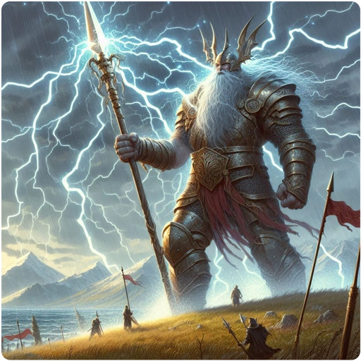

There are four types of elemental enchantments in GnollHack:

- Fire enchantment — 4d6 fire damage upon hit.
- Lightning enchantment — 6d6 electrical damage upon hit.
- Cold enchantment — 12d6 cold damage upon hit.
- Death enchantment — Slays the target upon hit, unless it resists death. Can be applied only to weapons made of bone, tooth, glass or crystal.

Fire, lightning and cold enchantments dissipate upon successful hit for ammo, thrown weapons, and stackable weapons. For other types of weapons, they have a 20% chance of dissipating when you hit with them, and a 1 in 3 chance when a monster hits with them. A death enchantment dissipates upon every successful hit, even when the target resists death. In melee between two monsters, such as your pet and its target, an elemental enchantment has no effect and does not dissipate.

[[/Spells/Fire-enchant item]] removes a cold enchantment instead of adding fire, and [[/Spells/Cold-enchant item]] removes a fire enchantment instead of adding cold. An item with a death enchantment cannot be given any other elemental enchantment. Each spell enchants at most three items of a stack, and [[/Spells/Death-enchant item]] only one.
