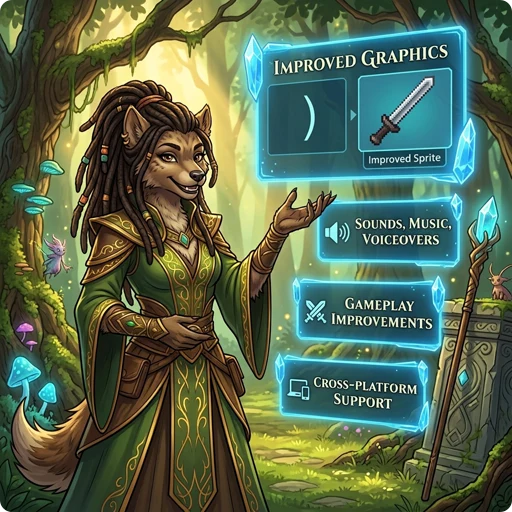

> 👉 **GnollHack adds graphics, sound, voiceovers, a new spell system, more equipment, and modern controls to NetHack, and changes many of its rules.**

## 🖥️ Graphics

- Large 64x96 tiles, with several tile layers on one square and monsters that span multiple squares, up to 192x192 pixels in size.
- Over 23,000 tiles, all drawn by real artists specifically for GnollHack.

See [[Improved Graphical Interface]].

## 🎬 Animations

- All characters have attack and kick animations, and spellcasters also have spell casting animations.
- Spell effects, explosions, rays, and traps are animated.

See [[Animations]].

## 🔊 Sound

- Over 1,100 game sounds powered by [FMOD](https://www.fmod.com/) and an internal sound set system, with spatial sound that depends on distance and obstacles.

See [[Advanced Sound System]].

## 🎵 Music

- A soundtrack of 37 music tracks that changes with the dungeon branch, special level, and situation. 14 of the tracks were composed specifically for GnollHack.

See [[Music]].

## 🗣️ Voiceovers

- 96 voice actors in 111 roles voice the game's characters and events.
- Over 5,000 recorded voiceover lines.

See [[Voiceovers]].

## 🔮 Magic and Spells

- Spells are prepared with Mix (`Shift+x`) from material components, called reagents. Each preparation gives a set number of castings, and spells are never forgotten.
- Over 200 spells in 12 spell schools and 14 spell levels, from minor cantrips to level 12.

See [[Spells]] and [[Spell Casting]].

## 🎒 Items and Equipment

- Ordinary equipment can appear with mythic or legendary properties, and weapons come in quality tiers from exceptional to celestial, primordial, and infernal.
- Wear a robe over your body armor, and equip bracers and up to five miscellaneous items.
- Every common item action is available directly from the inventory, and Examine (`Alt+x`) shows an item's exact statistics.

See [[Items]], [[Artifacts]], [[Mythic and Legendary Items]], and [[Exceptional, Elite, Celestial, Primordial, and Infernal Items]].

## ⚔️ Combat and Skills

- NetHack's weapon skills are merged into 12 weapon skills, which can be raised as high as Grand Master and increase your chance of critical hits.
- Launchers add their own damage to the missiles they fire, swapping between two weapon sets does not take a turn, and you can dual-wield artifacts and weapon-shields.

See [[Skills]] and [[Changing Between Two Sets of Weapon and Shield]].

## 👹 Monsters and Pets

- Monsters often appear as encounters whose overall difficulty fits the dungeon level and your experience level.
- Chat with non-player characters: shopkeepers identify items, priests heal you and cure sickness, and some peaceful monsters can be hired to join your party.
- Pets find their way to you with the same pathfinding as the travel command, and their hit points are shown on the status lines.

See [[Monsters]] and [[/Items/Manuals/Understanding Pets and Hirelings]].

## 🌟 Progression and Game Modes

- Reach up to experience level 50, with a much faster experience curve than in NetHack.
- The titular [[/Races/Gnoll]] replaces the gnome as a playable race.
- Seven difficulty levels from Standard to Grand Master, and a choice of [[gameplay modes|Choosing the Right Gameplay Mode]].

See [[Races]], [[Character Classes]], and [[Difficulty Levels]].

## 🤖 AI Advisor

- The **[[Gnoll Overseer]]** is a free, optional in-game AI advisor that uses frontier AI models together with GnollHack's game data, source code, and wikis.
- When you open it during play, the Overseer reads your current stats, inventory, and surroundings to give spoiler-aware tactical advice. It stays out of the way if you prefer playing unaided.
- Model accuracy, speed, and reliability are evaluated continuously with **[[GnollBench]]**, the Gnoll Overseer's own multi-provider benchmark.

## 🎮 Steam Deck and Game Controllers

- Play the whole game with the Steam Deck's built-in controls, starting from version 3.32, or with a game controller on Windows, Linux, and macOS.
- Radial menus put every command within reach, and a strip of button hints at the bottom of the screen always shows what each button does.
- The controller also works in menus, settings, the in-app wiki, and the Gnoll Overseer chat.
- Xbox controllers work on all three desktop platforms, and PlayStation controllers are also supported on macOS.

See [[Steam Deck and Controller Support|Steam Deck Controls]].

## 💻 Platform Support (Modern Graphical UI)

- Android
- iOS
- Linux (including the Steam Deck)
- macOS
- Windows

Game controllers are supported on the Steam Deck, Linux, macOS, and Windows. See [[Steam Deck Controls]].

## 🖱️ Desktop and Technology

- [[Desktop Features]] — Features that appear only on the desktop versions of GnollHack
- [[Technological Features]] — GnollHack from the development technology perspective

## 📖 More Information

- See [[Detailed Features]] for a complete reference of the gameplay changes GnollHack makes to NetHack.
- You may also want to read about [[How GnollHack differs from NetHack]].
