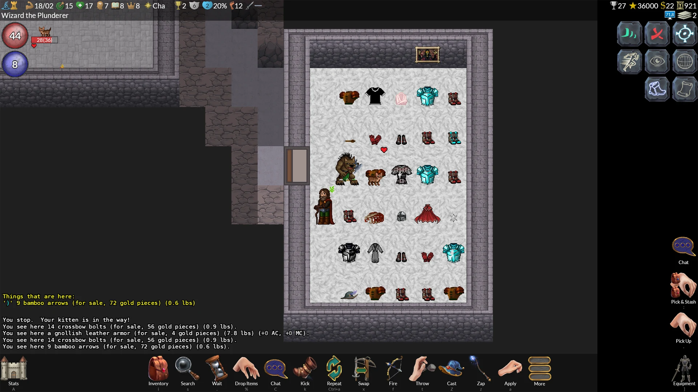
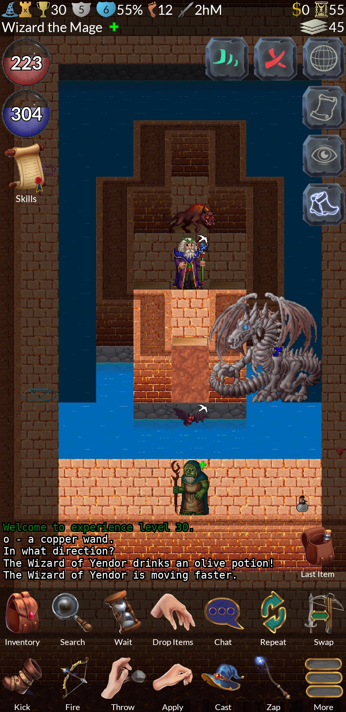
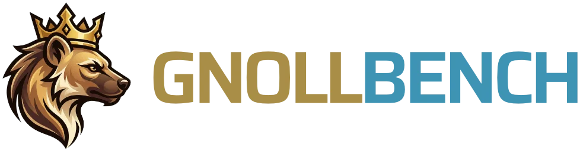

# Shipping a Cross-Platform Roguelike and Its AI Advisor with .NET MAUI, Avalonia UI, and Frontier AI Models

*How a Finnish non-profit wrapped a 500,000-line C game engine in .NET MAUI and Avalonia UI, built a free in-game AI advisor backed by 31 tools, and created a multi-judge benchmark to keep its advice honest.*

**By Sound Mind Games (Hyvän mielen pelit ry)** · 8 min read

*GnollHack running on Windows. The same .NET MAUI and C# codebase runs on Android, iOS, Linux, macOS, and the Steam Deck.*

> **At a glance:** [GnollHack](https://gnollhack.com/) is a free, open-source graphical remaster and variant of the 1987 roguelike classic [NetHack](https://www.nethack.org/). Instead of Unity or Unreal, it runs on **.NET MAUI**, **Avalonia UI**, **SkiaSharp**, and **FMOD** over a 500,000-line C99 core. It also ships with the **[[/Gnoll Overseer]]**, a free in-game advisor powered by frontier AI models, and **[[/GnollBench]]**, a domain-specific AI benchmark that grades models against the game's C source code.

When most developers think of [.NET MAUI](https://github.com/dotnet/maui) and [Avalonia UI](https://avaloniaui.net/), they think of enterprise forms and business software. When game developers start a cross-platform 2D project, they almost always reach for Unity, Godot, or Unreal.

For the past seven years, our team at [[Sound Mind Games|/Developer]] (Hyvän mielen pelit ry, a Finnish non-profit working in gaming and mental health) took a different route. We built **GnollHack**, a graphical remaster and expansion of NetHack, on top of .NET MAUI, Avalonia UI, and SkiaSharp, and shipped it on [Steam](https://store.steampowered.com/app/3558190/GnollHack/?utm_source=wiki) (Windows, Linux, macOS, and Steam Deck), [Google Play](https://play.google.com/store/apps/details?id=com.soundmindentertainment.gnollhack), and the [App Store](https://apps.apple.com/app/gnollhack/id1626979951).

Along the way, we faced a classic design problem: NetHack is famous for having decades of hidden rules, and looking up ten wiki tabs mid-fight breaks the flow of the game, especially on mobile or a handheld. To solve that, we built the **[[/Gnoll Overseer]]**, an opt-in AI advisor inside the game that gives players free access to frontier models from Anthropic, Google, and OpenAI. And because a single confident wrong answer in a permadeath game can kill a character that took days to build, we engineered **[[/GnollBench]]**, an evaluation system that tests models under the live product's exact prompt and tools.

Here is how the architecture fits together, how the benchmark works, and how we used coding agents to build the AI stack while keeping the game itself human-made.

## Why Build a Game in .NET MAUI and Avalonia UI?

NetHack was first released in 1987. Its C codebase models thousands of item, monster, and dungeon interactions. Rewriting those rules in C# would have meant years of introducing subtle bugs into mechanics that players have relied on for decades.

Instead, we kept the C99 core intact, extended it for GnollHack, and compiled it as a native library on every platform (`gnollhackwin.dll`, `libgnollhackdroid.so`, `libgnollhackios.a`, `libgnollhacklinux.so`, and `libgnollhackmac.dylib`). A shared C# layer communicates with the C engine through P/Invoke.

Why use .NET MAUI for the frontend instead of a traditional game engine?

1. **A traditional roguelike is heavily UI-driven.** Inventory screens, spell mixing menus, item comparison tables, message logs, settings, and embedded web views take up as much screen time as the dungeon map. .NET MAUI provides mature layouts, text rendering, and native controls out of the box.
2. **SkiaSharp and FMOD handle the game loop.** [SkiaSharp](https://github.com/mono/SkiaSharp) draws the 2D dungeon canvas at 60 to 90 FPS with GPU acceleration, while [FMOD](https://www.fmod.com/) plays spatial audio, music, and voiceovers. The C game engine runs on its own background thread, separate from the .NET MAUI UI thread and the Skia rendering thread, so turn calculations never block animations.
3. **Avalonia UI closes the desktop gap.** .NET MAUI targets Android, iOS, and Windows (via WinUI 3), but it has no official Linux backend, and Windows WinUI 3 apps do not run under Valve's Proton compatibility layer on the Steam Deck. Rather than maintaining a second UI codebase, our [[/Development/Avalonia Port]] compiles the exact same `GnollHackM.csproj` and XAML pages with `-p:GnhAvalonia=true` on top of `Avalonia.Controls.Maui` and .NET 11. That single MSBuild property brings native builds to Linux, the Steam Deck, and Apple Silicon macOS.

| Metric / Component | GnollHack Implementation |
| :--- | :--- |
| **Native Game Engine** | ~500,000 lines of C99 (forked from NetHack 3.6.2 in July 2019) |
| **Managed Client Code** | ~180,000 lines of C# and XAML in a single .NET MAUI project |
| **UI Backends** | .NET MAUI (Android, iOS, WinUI 3) and `Avalonia.Controls.Maui` (Linux, macOS, Steam Deck) |
| **Graphics & Audio** | Over 23,000 hand-drawn 64×96 base tiles via SkiaSharp; over 1,100 sounds, 37 music tracks, and over 5,000 voiceover lines (96 voice actors in 111 roles) via FMOD |
| **Scale & Distribution** | Over 11,000 commits; ~2,000 monthly players; 4.6★ on Google Play; 100% free with no ads or microtransactions |

*GnollHack on Android. All 23,000+ tiles and 5,000+ voiceover lines in the game are created by human artists and voice actors.*

## Gnoll Overseer: Free Frontier AI Inside a Game Client

In a typical playthrough of 50,000 turns, a player will run into situations where three or four obscure mechanics interact at once: monster resistances, character intrinsics, cursed gear, and prayer timeouts. Reading separate wiki articles for each piece is slow.

The **[[/Gnoll Overseer]]** is an optional advisor embedded in the game client (and available on the web at [overseer.gnollhack.com](https://overseer.gnollhack.com)). What makes it unusual in gaming is both its cost model and its architecture:

- **Free frontier models, plus Bring Your Own Key (BYOK):** Players get free access to system models from OpenAI, Google, and Anthropic (such as GPT-6 Luna, Gemini 4 Argon, and Claude Sonnet 5.5), or they can add their own API key (encrypted at rest with AES-256-GCM) to choose from a catalog of 30 model configurations.
- **Live game snapshots from the C engine:** When a player opens the Overseer during a run, the C engine writes a plain-text snapshot of the game state: character attributes, equipment, inventory with container contents, the visible dungeon map with a coordinate legend, recent messages, discoveries, and conducts.
- **31 specialized tools (20 server-side, 11 client-side):** Rather than relying on what a language model remembers from training, the Overseer looks up facts before answering. On the server (.NET 10, ASP.NET Core, and SignalR), 20 tools query monster, item, and artifact definitions, search ~5,400 pages across the GnollHack and NetHack wikis via Lucene.NET, and inspect an in-memory C lexer index of both the GnollHack and NetHack source trees. When needed, the main model can delegate multi-step research to three parallel specialist sub-agents (the Wiki Researcher, the Source Investigator, and the Game Data Analyst).
- **Bidirectional native WebView bridge:** Inside the game, the Angular 22 chat frontend runs inside a platform WebView (WebView2 on Windows, `WKWebView` on iOS and macOS, Android WebView on Android, and Chromium Embedded Framework on Linux). When the AI needs more information from the player's device, the server sends a `tool_client_request` event over SignalR, the Angular app calls into the native C# client over the platform bridge, and the client returns data from 11 device tools, including refreshed game snapshots, full message logs, past character dumplogs, and crash logs.
- **Spoiler guardrails and privacy modes:** By default, spoiler protection checks the player's discovery log so the advisor does not ruin unencountered bosses or puzzle solutions. Players can also switch chats between Standard, Confidential (encrypted at rest, internet tools off, and permanently destroyed on deletion), and Incognito (held in server memory only, never written to disk).

For a deeper look at the backend and client bridge, see the [[/Guides/Technological Overview of Gnoll Overseer]].

## GnollBench: Benchmarking AI When Wrong Advice Kills Characters

Public AI leaderboards like [Artificial Analysis](https://artificialanalysis.ai/) or [Arena](https://arena.ai/) answer a general question: *"How capable is this model across math, coding, and general chat?"* They cannot tell you whether a model will confidently advise a player to punch a cockatrice bare-handed (which turns the character to stone) or misread a C bitmask in GnollHack's source code.

To measure how models actually perform as the Overseer, we built **[[/GnollBench]]**. Its design follows three engineering rules that set it apart from standard benchmarks:

### 1. The Production Configuration Is the Instrument

A candidate model in GnollBench is not tested under a simplified benchmark prompt. It receives the **exact production system prompt** and **16 read-only production lookup tools** (wiki search, monster/item/artifact stats, knowledge base, and C source code inspection) with the same per-question budgets as the live chat. When a model fails a question in GnollBench, it exposes a real failure mode that players would hit, often pointing us to a missing fact on the wiki or a tool description that needs clarification.

### 2. A Two-Company Blind Grading Panel Plus a Source-Code Verifier

Using a single AI model to grade another AI model introduces same-family bias: Models tend to favor outputs written by models from their own provider. GnollBench addresses this with a multi-role pipeline:

| Role | Responsibility in a GnollBench Run |
| :--- | :--- |
| **Candidate** | Answers suites of 18+ GnollHack questions (Simple, Intermediate, Advanced), or questions bound to a real exported game snapshot, using the production tools. |
| **Assessor & Co-Assessor (The Panel)** | Two judge models from **two different AI providers** (neither from the candidate's model family when avoidable, and never the model under test). Both grade every answer concurrently and **blind** to each other against a detailed rubric. Their average sets the quality score. |
| **Reference Reader** | A third model from a third provider that grades every answer blind as an anchor to measure agreement between graders and flag disputed verdicts for human review, without altering the score. |
| **Claim Verifier** | An independent agent with read-only tools that checks unverified claims and contested sentences directly against the GnollHack C source code and wiki, requiring exact file and line citations. |

### 3. Non-Compensatory Scoring, Critical-Error Caps, and Rewarding Honesty

Each answer is graded on a 0–6 Behaviorally Anchored Rating Scale across four dimensions: **Accuracy (55%)**, **Completeness (25%)**, **Conciseness (10%)**, and **Readability (10%)**. Instead of an arithmetic average, where a polite, well-structured answer could still get a passing grade despite being wrong, GnollBench combines the dimensions with a **weighted geometric mean**:

$Q = A^{0.55} \cdot C^{0.25} \cdot Cn^{0.10} \cdot R^{0.10}$

If Accuracy drops to level 1 (15 points) while every other dimension is a perfect level 6 (100 points), the geometric mean pulls the score down to **35**, compared to 53 under an arithmetic mean.

On top of that, two rules shape how models handle uncertainty:

- **The Critical Error Ceiling (25 / 100):** If an answer states a confident falsehood that would harm a player who acted on it (contradicted by the rubric or the game board, and quoted verbatim by the grader), the answer's score is capped at **25**. If the two panel judges split on whether a critical error occurred, the Claim Verifier checks the quoted sentence against the C source code and wiki to uphold or overturn the cap.
- **The Honesty Floor (50 / 100):** Standard benchmarks often punish a model for saying *"I don't know,"* which rewards guessing. In GnollBench, if a model searches the tools, cannot verify a fact, states nothing false, and honestly reports what it could not verify, the answer is marked **Not Attempted** and receives a floor score of **50**, twice as much as a dangerous bluff.

### What GnollBench Revealed Across Frontier Models

GnollBench tracks three headline metrics: **Intelligence Index** (difficulty-weighted quality with a 95% confidence interval), **Speed** (model thinking time with tool execution time subtracted), and **Cost**. It refuses to publish an index if a provider error interrupted any question in the run.

In our October 2026 engineering review across a 36-question battery (two 18-question suites, graded by a panel of Claude 5 Opus and GPT-5.6 Sol with Gemini 3.8 Flash as Reference Reader and Claim Verifier), the trade-offs between intelligence, speed, and cost were clear:

| Candidate Model (Thinking Level) | Provider | Intelligence Index (0–100) | Mean Time / Question | Battery Cost (36 Questions) |
| :--- | :--- | :-: | :-: | :-: |
| **GPT-6 Astra (medium)** | OpenAI | **87** | 21.2 s | $6.97 |
| **GPT-6 Luna (max)** | OpenAI | **83** | 74.3 s | $0.24 |
| **GPT-6 Luna (high)** | OpenAI | **83** | 28.2 s | $0.11 |
| **GPT-5.6 Luna (max)** | OpenAI | **82** | 48.3 s | $0.37 |
| **Claude 5.5 Haiku (xhigh)** | Anthropic | **81** | 45.4 s | $0.30 |
| **GPT-5.6 Luna (high)** | OpenAI | **81** | 25.8 s | $0.21 |
| **Claude 5.5 Sonnet (high)** | Anthropic | **79** | 16.5 s | $2.15 |
| **Claude 5.5 Opus (medium)** | Anthropic | **79** | 27.2 s | $4.03 |
| **Claude 5.5 Sonnet (medium)** | Anthropic | **76** | **10.5 s** | $1.40 |

Plotting Intelligence against Cost immediately showed our best cost-performance trade-offs: **GPT-6 Luna (high)** delivered an Intelligence Index of 83 at just **`$0.11`** for the 36-question battery (~28 seconds per question), nearly matching the top-scoring **GPT-6 Astra (medium)** (87 at **`$6.97`**) at less than one-sixtieth of the cost. Meanwhile, another strong contender, **GPT-6.1 Sol (medium)**, scored 86.4 in a separate run at 19.3 seconds per question, but failed twice with provider errors during earlier battery runs, which GnollBench's integrity rules caught before we made it a default for players.

For the full statistical model, comparability rules, and a comparison with public benchmarks like Artificial Analysis, HealthBench, and BALROG, see the [[/Guides/Technological Overview of GnollBench]] and [[/Guides/Comparison of GnollBench and Popular AI Benchmarks]].

## How We Use Coding Agents (and Where We Don't)

We draw a clear line between the **GnollHack game** and the **AI companion ecosystem** around it, as detailed in our [[/AI Usage Policy]]:

| Area | GnollHack (The Game) | Gnoll Overseer & GnollBench |
| :--- | :--- | :--- |
| **Primary Coder** | Human developer | Autonomous AI coding agents |
| **AI's Role** | Assistant, code reviewer, edge-case finder, and Sentry crash investigator | Writes all application code under human architectural review |
| **Human's Role** | Lead architect, C/C# programmer, and game designer | System architect, implementation plan reviewer, and QA tester |
| **Art, Music & Voiceovers** | **100% human-made** (real artists, composers, and 96 voice actors) | Promotional and web illustrations produced with generative AI tools |

On the engineering side, two workflows made working with coding agents (primarily Claude Code, alongside Google Antigravity and OpenAI Codex) practical across a complex multi-platform stack:

### 1. Evidence-Based Crash Analysis Across C and C# with Sentry MCP

Because GnollHack runs a C99 engine inside a .NET MAUI and Avalonia host, a production crash can originate in C, in C#, or inside one of the underlying frameworks. We integrated `Sentry.Maui` and `sentry-native` so that both layers report into a **single unified Sentry event**, combining 82 breadcrumb sites and a 40-entry debug ring buffer from the C engine with 162 breadcrumb sites, memory/disk telemetry, and scope synchronization (`EnableScopeSync`) from the C# app.

When an issue appears in Sentry, our coding agent connects via the **Sentry MCP** server and follows a strict crash-analysis skill:

1. It reads every event, breadcrumb, and native/managed stack trace from Sentry.
2. It cross-references the trace against **9 framework repositories checked out on local disk** alongside our own code: `.NET MAUI`, `.NET runtime`, `.NET Android`, `.NET iOS`, `WinUI`, `CsWinRT`, `SkiaSharp`, `Skia`, and `HarfBuzz`.
3. The skill forces the agent to end its report with a binary **Yes or No** on whether the root cause is proven by the evidence. Guessing is forbidden. If the answer is *No*, the agent recommends targeted `debugprint()` calls for the next release. If *Yes*, it either fixes our bug or drafts an upstream issue with a minimal reproduction (such as diagnosing that a recurring `"Window was already deactivated"` crash on iOS and Windows was thrown by `.NET MAUI`'s `Window.cs` on repeated activation events, or filing upstream issues like `dotnet/maui #31315`).

### 2. On-Demand Agent Skills and a Shared Plans Repository

To keep coding agents effective without filling up their context windows, we keep always-on session rules small (~7,000 tokens) and store **57 modular skills** (~210,000 words across client architecture, server patterns, build pipelines, and benchmark analysis) that load **only on demand**. For example, our `build-pipeline` skill documents every step and trap of building the native C solution, WSL game data archives, and .NET MAUI targets so that an agent, or a framework engineer investigating one of our bug reports, can build the entire project from a clean clone.

Every non-trivial feature follows a six-step workflow:

1. **Research:** Read-only sub-agents inspect the live codebase.
2. **Plan:** The agent writes a versioned implementation plan into a shared Git repository (`plans`) that syncs across machines, sessions, and agent tools.
3. **Approve:** A human architect reviews and approves the plan before a single source file is touched.
4. **Execute:** Coding sub-agents implement the changes, with each sub-agent assigned exclusively to its own files.
5. **Verify:** The main agent runs the compiler and test suites.
6. **Commit:** Only a human commits and pushes production code.

## Try It Out or Explore the Code

If you are a .NET developer curious about pushing .NET MAUI and Avalonia UI into 60–90 FPS game rendering, an AI engineer interested in tool-using agents and domain-specific evaluation, or a fan of deep RPGs, everything we built is open and free to explore:

- **Play GnollHack (100% free, no ads, no microtransactions):** Available on [Steam](https://store.steampowered.com/app/3558190/GnollHack/?utm_source=wiki) (Windows, Linux, macOS, Steam Deck), [Google Play](https://play.google.com/store/apps/details?id=com.soundmindentertainment.gnollhack), the [App Store](https://apps.apple.com/app/gnollhack/id1626979951), and [GitHub Releases](https://github.com/hyvanmielenpelit/GnollHack/releases).
- **Try the Gnoll Overseer:** Open it inside the game or on the web at [overseer.gnollhack.com](https://overseer.gnollhack.com).
- **Browse the Source Code:**
  - Game client & C engine: [github.com/hyvanmielenpelit/GnollHack](https://github.com/hyvanmielenpelit/GnollHack)
  - Gnoll Overseer & GnollBench server: [github.com/hyvanmielenpelit/MobileGnollHackLogger](https://github.com/hyvanmielenpelit/MobileGnollHackLogger)
- **Read the Technical Deep-Dives on the Wiki:**
  - [[/Technological Features]] & [[/Development/Avalonia Port]]
  - [[/Guides/Technological Overview of Gnoll Overseer]]
  - [[/Guides/Technological Overview of GnollBench]] & [[/Guides/Comparison of GnollBench and Popular AI Benchmarks]]
  - [[/Development/Design Details of Native Crash Reporting]]
