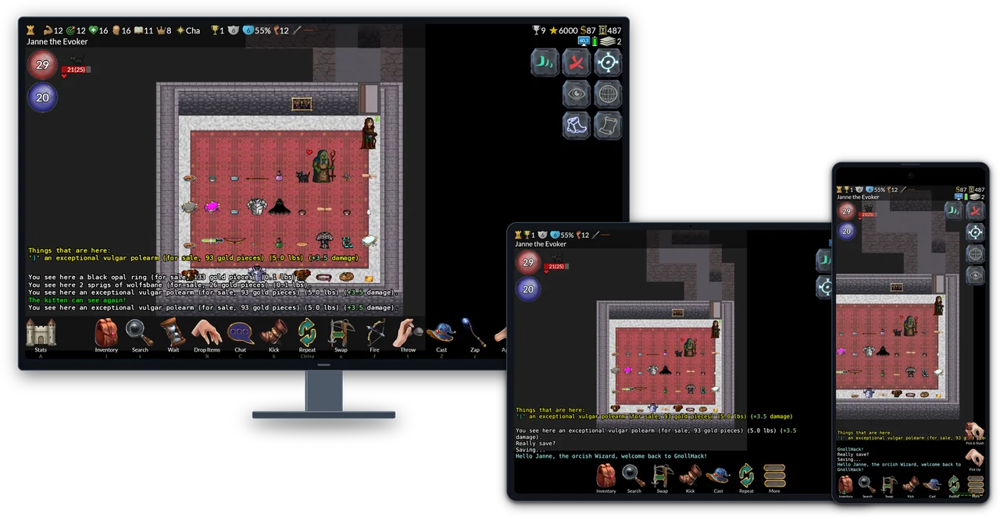
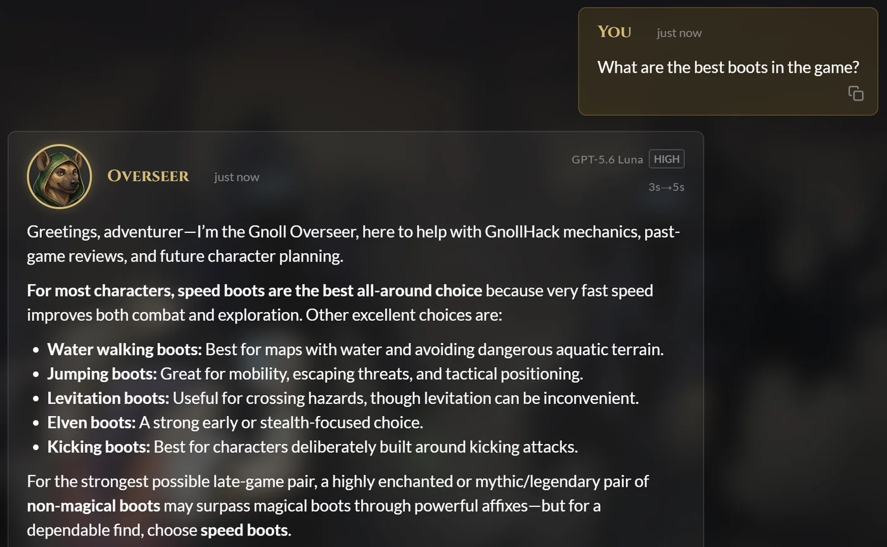
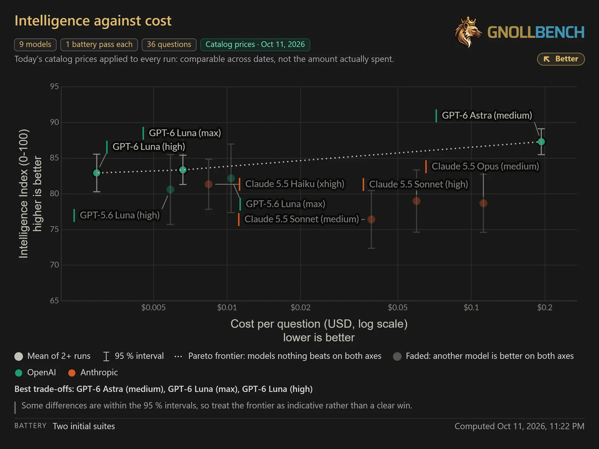
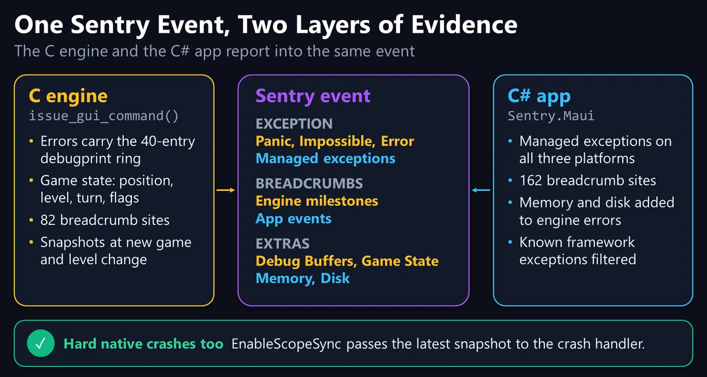

# Shipping a Cross-Platform Roguelike and Its AI Advisor with .NET MAUI, Avalonia UI, and Frontier AI Models

> 👉 **How a Finnish nonprofit wrapped a 500,000-line C game engine in .NET MAUI and Avalonia UI, built a free in-game AI advisor with 31 tools, and created a multi-judge benchmark to keep its advice honest.**

**By Sound Mind Games (Hyvän mielen pelit ry)**

*GnollHack on a desktop, a tablet, and a phone. One C engine and one C# codebase serve Android, iOS, Linux, macOS, Windows, and the Steam Deck.*

In NetHack, one wrong move can end a character that took days to build. Eat the wrong corpse, touch the wrong monster bare-handed, or pray too soon, and the run is over. There is no reload. So when we put an AI advisor inside our NetHack-based game, we had to answer an uncomfortable question: How do you know the advice is right?

That question shaped the advisor and the benchmark behind it. The stack they run on is unusual as well. Most developers know [.NET MAUI](https://github.com/dotnet/maui) and [Avalonia UI](https://avaloniaui.net/) from enterprise forms and business software, and game developers starting a cross-platform 2D project usually reach for Unity, Godot, or Unreal.

Seven years ago, our team at [[Sound Mind Games|/Developer]] (Hyvän mielen pelit ry, a Finnish nonprofit working on gaming and mental health) took a different route. We built [GnollHack](https://gnollhack.com/), a free, open-source graphical remaster and expansion of the 1987 roguelike [NetHack](https://www.nethack.org/), on .NET MAUI, Avalonia UI, and SkiaSharp. It ships on [Steam](https://store.steampowered.com/app/3558190/GnollHack/?utm_source=wiki) (Windows, Linux, macOS, and Steam Deck), [Google Play](https://play.google.com/store/apps/details?id=com.soundmindentertainment.gnollhack), and the [App Store](https://apps.apple.com/app/gnollhack/id1626979951).

NetHack is famous for decades of hidden rules, and looking things up in ten wiki tabs mid-fight breaks the flow of the game, especially on a phone or a handheld. So we built the **[[/Gnoll Overseer]]**, an opt-in AI advisor inside the game that gives players free access to frontier models from Anthropic, Google, and OpenAI. Because a single confident wrong answer can kill a character, we also built **[[/GnollBench]]**, a benchmark that tests models under the live product's own prompt and tools.

Below is how the architecture fits together, how the benchmark scores answers, and how we use coding agents to build the AI stack while the game itself stays human-made.

## 🐺 Why Build a Game in .NET MAUI and Avalonia UI?

NetHack's C codebase models thousands of interactions between items, monsters, and dungeon features. Rewriting those rules in C# would have meant years of introducing subtle bugs into mechanics that players have relied on for decades.

Instead, we kept the C99 core, extended it for GnollHack, and compiled it as a native library on every platform (`gnollhackwin.dll`, `libgnollhackdroid.so`, `libgnollhackios.a`, `libgnollhacklinux.so`, and `libgnollhackmac.dylib`). A shared C# layer talks to the engine through P/Invoke.

We chose .NET MAUI over a game engine for three reasons:

1. **A traditional roguelike is mostly UI.** Inventory screens, spell menus, item comparison tables, message logs, settings, and embedded web views take up as much screen time as the dungeon map. Out of the box, .NET MAUI provides mature layouts, text rendering, and native controls.
2. **SkiaSharp and FMOD cover the game parts.** [SkiaSharp](https://github.com/mono/SkiaSharp) draws the 2D dungeon with GPU acceleration at 60 FPS or more (up to 90 FPS in the Avalonia builds), and [FMOD](https://www.fmod.com/) plays sound effects, music, and voiceovers. The C engine runs on its own thread, so turn calculations never block the UI or the animations.
3. **Avalonia UI closes the desktop gap.** On its own, .NET MAUI targets Android, iOS, and Windows (through WinUI 3). It has no official Linux backend, and WinUI 3 apps do not run under Valve's Proton compatibility layer on the Steam Deck. Instead of maintaining a second UI codebase, we compile the same `GnollHackM.csproj` and XAML pages with `-p:GnhAvalonia=true` on top of `Avalonia.Controls.Maui` and .NET 11 in our [[/Development/Avalonia port]], while the Android, iOS, and Windows clients stay on .NET 10. That one MSBuild property gives us native builds for Linux, the Steam Deck, and Apple Silicon Macs, rendering through OpenGL on Linux, Metal on macOS, and Direct3D 11 through ANGLE on Windows.

GnollHack in numbers:

- **Engine:** About 500,000 lines of C99, forked from NetHack 3.6.2 in July 2019.
- **Client:** About 180,000 lines of C# and XAML in one shared codebase.
- **UI backends:** .NET MAUI for Android, iOS, and Windows; `Avalonia.Controls.Maui` for Linux, macOS, and the Steam Deck.
- **Content:** Over 23,000 base tiles of 64×96 pixels, over 1,100 sound effects, 37 music tracks, and over 5,000 voiceover lines recorded by 96 voice actors in 111 roles. All of it was made by artists, composers, and voice actors, not by generative AI.
- **Project:** Over 11,000 commits, about 2,000 monthly players (most of them on mobile), and a 4.6★ rating on Google Play. The game is free, with no ads or microtransactions.

## 🧙 Gnoll Overseer: Free Frontier AI Inside a Game Client

A typical GnollHack playthrough lasts about 50,000 turns over several days. Along the way, a player runs into situations where three or four obscure mechanics interact at once: monster resistances, character intrinsics, cursed gear, and prayer timeouts. Reading a separate wiki article for each one is slow.

*The Gnoll Overseer answering a question about boots. The header of the answer shows the model and its thinking level.*

The **[[/Gnoll Overseer]]** is an optional advisor built into the game client, and it is also available on the web at [overseer.gnollhack.com](https://overseer.gnollhack.com). What sets it apart from most in-game assistants is both its cost model and its architecture:

- **Free frontier models, or bring your own key:** Players get free system models from OpenAI, Google, and Anthropic, such as GPT-6 Luna, Gemini 4 Argon, and Claude Sonnet 5.5. They can also add their own API key, encrypted at rest with AES-256-GCM, and choose from a catalog of 32 models.
- **Live game snapshots from the C engine:** When a player opens the Overseer during a game, the C engine writes a plain-text snapshot of the game state that covers attributes, equipment, inventory and container contents, the visible map with a coordinate legend, recent messages, discoveries, and conducts.
- **31 tools, 20 on the server and 11 on the device:** The Overseer looks up facts instead of relying on what the model remembers from training. On the server (.NET 10, ASP.NET Core, and SignalR), tools query monster, item, and artifact definitions, search nearly 5,000 pages of the GnollHack and NetHack wikis with Lucene.NET, and read an in-memory index of both games' C source code, built with a C lexer. A tool policy sets the order of sources: the game snapshot first, then the knowledge base, the wiki and game data, the source code, GitHub, and the web. For multi-step research, the main model can hand work to three specialist sub-agents that run in parallel (the Wiki Researcher, the Source Investigator, and the Game Data Analyst). Players turn them on in the settings.
- **A two-way bridge into the native app:** In the game, the Angular 22 chat runs inside the platform's WebView, which is WebView2 on Windows, `WKWebView` on iOS and macOS, Android WebView on Android, and the Chromium Embedded Framework on Linux. When the model needs something from the player's device, the server sends a `tool_client_request` event over SignalR, the Angular app calls into the C# client through the platform bridge, and one of the 11 device tools returns the data: a fresh game snapshot, the full message history, the dumplogs (end-of-game reports) of past characters, or the game's panic and app logs.
- **Spoiler protection and privacy modes:** By default, the Overseer checks what the player has already discovered, so it does not spoil unseen bosses or puzzle solutions. Each chat can be Standard, Confidential (encrypted at rest, internet tools off, and permanently destroyed on deletion), or Incognito (kept in server memory only and never written to disk).

For more detail on the server design and the client bridge, see the [[/Guides/Technological Overview of Gnoll Overseer]].

## 👑 GnollBench: Benchmarking AI When Wrong Advice Kills Characters

Public AI leaderboards such as [Artificial Analysis](https://artificialanalysis.ai/) and [Arena](https://arena.ai/) answer a general question: How capable is this model at math, coding, and general chat? They cannot tell you whether a model will confidently tell a player to fight a cockatrice bare-handed (which turns the character to stone), or whether it can read a bitmask in GnollHack's C source correctly.

To measure how models actually perform as the Overseer, we built **[[/GnollBench]]**. Three design rules set it apart from general benchmarks.

### 1. The Production Configuration Is the Instrument

A candidate model is not tested with a simplified benchmark prompt. It gets the **exact production system prompt** and the **16 read-only lookup tools** the live chat uses: wiki search; monster, item, and artifact data; the knowledge base; and C source code inspection. When a model fails a question, the failure is one that players would hit too, and it often points to a missing fact on the wiki or a tool description that needs to be clearer.

### 2. A Blind Grading Panel from Two Providers, Plus a Source-Code Verifier

When one AI model grades another, it tends to favor answers written by models from its own provider. GnollBench spreads grading over several roles:

- **Candidate:** Answers the questions of one or more suites with the production tools. A standard suite has 18 questions, six each at the Simple, Intermediate, and Advanced levels. A suite can also be built from a real exported game snapshot, with questions about that exact game.
- **Assessor and Co-Assessor (the panel):** Two judge models from **two different providers**, never the model under test. Both grade every answer at the same time, **blind** to each other, against a detailed rubric. Their average sets the quality score.
- **Reference Reader:** An optional third judge from a third provider. It grades every answer blind as an anchor for measuring how well the judges agree, and it flags disputed verdicts for human review. It never changes a score.
- **Claim Verifier:** An optional agent with read-only tools that checks unverified and disputed claims against the C source, the wiki, or the game snapshot. Every verdict must cite its evidence, such as the deciding lines of a source file.

### 3. Non-Compensatory Scoring, a Cap on Critical Errors, and a Reward for Honesty

Each answer is graded from 0 to 6 on a behaviorally anchored rating scale in four dimensions: **Accuracy (55%)**, **Completeness (25%)**, **Conciseness (10%)**, and **Readability (10%)**. Under an arithmetic mean, a polite, well-structured answer could pass despite being wrong. GnollBench combines the dimensions with a **weighted geometric mean** instead:

$Q = A^{0.55} \cdot C^{0.25} \cdot Cn^{0.10} \cdot R^{0.10}$

If Accuracy drops to level 1 (15 points) while every other dimension is at a perfect level 6 (100 points), the geometric mean pulls the score down to **35**. An arithmetic mean would give 53.

Two more rules shape how a model is rewarded for handling uncertainty:

- **The critical-error ceiling (25 of 100):** If an answer confidently states a falsehood that would hurt a player who acted on it, the score is capped at **25**. The falsehood must be contradicted by the rubric or the game board, and the grader must quote the sentence word for word. If the two panel judges disagree on whether a critical error occurred, the Claim Verifier checks the quoted sentence against the source code and the wiki to uphold or overturn the cap.
- **The honesty floor (50 of 100):** Most benchmarks punish a model for saying *"I don't know,"* which rewards guessing. In GnollBench, an answer that says it could not find or verify the information, and gives no value or recommendation in its place, is marked **Not Attempted**. If it makes no critical error and its Accuracy is level 5 or higher, it scores at least **50**, twice the most a dangerous bluff can get. With a correct answer worth about 92 points, answering a question where a wrong answer would be dangerous pays off only when the model is at least about 37% sure.

### What GnollBench Showed Across Frontier Models

GnollBench reports three headline metrics: the **Intelligence Index** (difficulty-weighted quality, with a 95% confidence interval), **Speed** (the model's own time per answer, with tool execution time subtracted), and **Cost**. It publishes no index for a run in which a provider error stopped a question.

For our October 2026 engineering review, we ran nine model configurations through a 36-question battery (two 18-question suites). Claude Opus 5 and GPT-5.6 Sol formed the panel, and Gemini 3.8 Flash served as the Reference Reader and the Claim Verifier. The cost column is the candidate's cost for one pass through the battery at catalog prices on October 11, 2026.

| Candidate Model (Thinking Level) | Provider | Intelligence Index (0–100) | Mean Time per Question | Battery Cost (36 Questions) |
| :--- | :--- | :-: | :-: | :-: |
| **GPT-6 Astra (medium)** | OpenAI | **87** | 21.2 s | $6.97 |
| **GPT-6 Luna (max)** | OpenAI | **83** | 74.3 s | $0.24 |
| **GPT-6 Luna (high)** | OpenAI | **83** | 28.2 s | $0.11 |
| **GPT-5.6 Luna (max)** | OpenAI | **82** | 48.3 s | $0.37 |
| **Claude Haiku 5.5 (xhigh)** | Anthropic | **81** | 45.4 s | $0.30 |
| **GPT-5.6 Luna (high)** | OpenAI | **81** | 25.8 s | $0.21 |
| **Claude Sonnet 5.5 (high)** | Anthropic | **79** | 16.5 s | $2.15 |
| **Claude Opus 5.5 (medium)** | Anthropic | **79** | 27.2 s | $4.03 |
| **Claude Sonnet 5.5 (medium)** | Anthropic | **76** | **10.5 s** | $1.40 |

*Intelligence against cost per question, on a log scale. The dotted line is the Pareto frontier: GPT-6 Astra (medium), GPT-6 Luna (max), and GPT-6 Luna (high).*

Plotting intelligence against cost showed the trade-offs at once. **GPT-6 Luna (high)** reached an Intelligence Index of 83 for **$0.11** per battery, at about 28 seconds per question. The top scorer, **GPT-6 Astra (medium)**, reached 87 for **$6.97**, more than 60 times the cost. Some of these differences fall within the 95% confidence intervals, so the frontier is a guide rather than a final ranking. GPT-6 Luna (high) is also the model we suggest players start with in [[/Guides/Choosing AI Model for Gnoll Overseer]].

Reliability counts too. **GPT-6.1 Sol (medium)** scored 86.4 at 19.3 seconds per question in a separate run, but two of its battery runs failed on provider errors. Because GnollBench publishes no index for an interrupted run, those failures showed up in the results instead of hiding inside an average.

For the full statistical model, the comparability rules, and a comparison with public benchmarks such as Artificial Analysis, HealthBench, and BALROG, see the [[/Guides/Technological Overview of GnollBench]] and the [[/Guides/Comparison of GnollBench and Popular AI Benchmarks]].

## 🛠️ How We Use Coding Agents, and Where We Don't

We draw a clear line between the **GnollHack game** and the **AI tools** around it:

- **In GnollHack itself**, a human developer writes the code and is its lead architect and game designer. AI works as an assistant: a code reviewer, an edge-case checker, a research aid, an expert helper for difficult tasks, and an investigator of crash reports in Sentry. All art, music, and voiceovers are made by people.
- **In the Gnoll Overseer and GnollBench**, autonomous AI coding agents write all of the code. A human is the system architect, reviews every implementation plan, and tests the result. Promotional and web illustrations for them are made with generative AI tools.

The rules are in our [[/AI Usage Policy]]. Our main coding agent is Claude Code, and our shared agent instructions also support Google Antigravity and OpenAI Codex. Two workflows made coding agents practical on a stack this mixed.

### 1. Evidence-Based Crash Analysis Across C and C# with Sentry MCP

GnollHack runs a C99 engine inside a .NET MAUI or Avalonia host, so a production crash can start in C, in C#, or inside one of the frameworks underneath. Both layers report to Sentry. The C# app uses Sentry's .NET SDK. When the C engine reports an error, the report carries the engine's last 40 debug messages and the current game state, and both layers add breadcrumbs. Hard native crashes are caught by `sentry-native`, and `EnableScopeSync` hands it the latest .NET context, so even those reports show what the player was doing.

*How the C engine and the C# app contribute evidence to the same Sentry event. From our October 2026 engineering review.*

When an issue appears in Sentry, our coding agent connects through the **Sentry MCP** (Model Context Protocol) server and follows a crash-analysis skill:

1. It reads every event of the issue, with breadcrumbs, extras, and native and managed stack traces.
2. It reads our code next to **nine framework repositories checked out on local disk**: .NET MAUI, the .NET runtime, .NET for Android, .NET for iOS, WinUI, CsWinRT, SkiaSharp, Skia, and HarfBuzz. When a stack trace ends in framework code, the agent keeps reading.
3. It must end its report with a plain **Yes or No**: Was a definitive root cause found? Speculation does not count. If the answer is No, the agent proposes targeted debug logging, wizard-mode test scenarios, and what to watch for in the next reports. If it is Yes, it fixes our bug or drafts an upstream issue with a minimal reproduction.

For example, a recurring "Window was already deactivated" exception from iOS and Windows turned out to be thrown by .NET MAUI itself when window activation events re-enter. It is reported upstream as [dotnet/maui#31315](https://github.com/dotnet/maui/issues/31315), and our client works around it until a fix ships. Every such workaround is recorded in a register in the repository, with the upstream issue and the condition for removing it.

### 2. On-Demand Agent Skills and a Shared Plans Repository

To keep coding agents effective without filling their context windows, the rules loaded into every session stay small (under 10,000 tokens), and everything else goes into more than 60 modular skills, over 250,000 words on client architecture, server patterns, build pipelines, and benchmark analysis. A skill loads **only when a task needs it**. For example, our `build-pipeline` skill documents every step and trap of building the native C solution, the game data, and the .NET MAUI targets. With it, an agent, or a framework engineer checking one of our bug reports, can build the whole project from a clean clone.

Every non-trivial feature follows the same six steps:

1. **Research:** Read-only sub-agents inspect the live codebase.
2. **Plan:** The agent writes a versioned implementation plan into a shared Git repository, so the plan follows the work across computers, sessions, and agent tools.
3. **Approve:** A human architect reviews and approves the plan before any source file is touched.
4. **Execute:** Coding sub-agents implement the changes, each one working only on its own files.
5. **Verify:** The main agent, not the sub-agents, runs the build and the tests.
6. **Commit:** Agents commit and push only when a human asks them to.

## 💡 What We Learned

- **Keep the legacy core and wrap it.** A 1987 C engine, compiled as a native library under a modern C# UI, kept decades of tested game rules intact.
- **Give the model tools, not trust.** The Overseer looks facts up in the wiki, the game data, and the source code instead of answering from memory.
- **Benchmark the product, not the model.** Testing with the production prompt and tools finds the failures players would actually see.
- **Make honesty pay.** A cap on dangerous errors and a floor for honest abstentions make "I could not verify this" score higher than a confident guess.
- **Make agents prove their conclusions.** A crash report that must answer Yes or No keeps an agent from presenting a guess as a root cause.

Everything described here is open source: the game, the C engine, the Overseer, and GnollBench.

## 📖 Learn More

- [[/Technological Features]] and [[/Development/Avalonia Port]]
- [[/Guides/Technological Overview of Gnoll Overseer]]
- [[/Guides/Technological Overview of GnollBench]] and [[/Guides/Comparison of GnollBench and Popular AI Benchmarks]]
- [[/Development/Design Details of Native Crash Reporting]]

## 🔗 External Links

- **Play GnollHack:** [Steam](https://store.steampowered.com/app/3558190/GnollHack/?utm_source=wiki) (Windows, Linux, macOS, and Steam Deck), [Google Play](https://play.google.com/store/apps/details?id=com.soundmindentertainment.gnollhack), the [App Store](https://apps.apple.com/app/gnollhack/id1626979951), and [GitHub Releases](https://github.com/hyvanmielenpelit/GnollHack/releases)
- **Try the Gnoll Overseer:** In the game, or on the web at [overseer.gnollhack.com](https://overseer.gnollhack.com)
- **Game client and C engine:** [github.com/hyvanmielenpelit/GnollHack](https://github.com/hyvanmielenpelit/GnollHack)
- **Gnoll Overseer and GnollBench server:** [github.com/hyvanmielenpelit/MobileGnollHackLogger](https://github.com/hyvanmielenpelit/MobileGnollHackLogger)

## 📅 Validity

As of version 3.39 and November 9, 2026.
