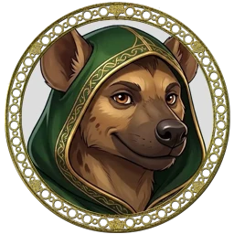

> 👉 **The Gnoll Overseer is built directly into GnollHack and engineered from the inside out like an enterprise software-engineering agent.**

When technology giants like Microsoft, Google, NVIDIA, and Razer build AI gaming assistants, they design them from the **outside in**, bolting an operating-system overlay across thousands of games and using computer vision to guess what is happening from a screenshot. Meanwhile, when players turn to standalone chatbots like **ChatGPT** or **Gemini**, they get ungrounded answers pulled from pre-training memory that routinely confuse game variants, hallucinate fatal mechanics, and spoil late-game secrets.

The **[[/Gnoll Overseer]]** takes the exact opposite approach. Built directly into *GnollHack* (and available on the web at [overseer.gnollhack.com](https://overseer.gnollhack.com)), it is engineered from the **inside out** like an enterprise software-engineering agent.

Most remarkably, it was not built by a trillion-dollar tech giant. It was created by **[[Sound Mind Games|/Developer]] (*Hyvän mielen pelit ry*)**, a small Finnish non-profit organization that provides supportive IT and game-development internships for individuals navigating mental health challenges. By turning open-source transparency into a deterministic verification architecture, this small Finnish non-profit has built a single-game tactical advisor that surpasses the biggest enterprises in the world.

## 📊 At-a-Glance Comparison

| Feature / Capability | **Gnoll Overseer** | **Generic AI Chatbots** | **Enterprise OS & Hardware Overlays** | **Esports Coaching Overlays** |
| :--- | :--- | :--- | :--- | :--- |
| **Products** | Gnoll Overseer, by Sound Mind Games | ChatGPT, Gemini, Claude Web | Microsoft Gaming Copilot, Google Play Sidekick, NVIDIA G-Assist, Razer AVA | CoachCamel, iTero AI, Mobalytics |
| **Primary Scope** | Single-game mastery (*GnollHack* / *NetHack*) | General-purpose conversation | Multi-game OS overlays & PC hardware tuning | Competitive multiplayer match telemetry |
| **How It Sees Your Game** | **Direct C-engine state snapshot** + bidirectional native client bridge (11 device tools) | **Blind** (Requires manual typing or uploading screenshots) | **External screen-scraping** (Vision Mode screenshots / video stream) | **External API hooks** (Match KDA, gold, draft lobby) |
| **Sees Hidden State?** *(Bags, intrinsics, timers)* | **Yes** (Full inventory contents, prayer status, discoveries, dungeon overview) | **No** | **No** (Only knows what is visibly drawn on screen at that second) | **Partial** (Only public match events exposed by client API) |
| **Knowledge Grounding** | **31 tools:** Live C source-code lexer, exact monster/item structs, dual wikis, GitHub | Pre-training memory + general web search (prone to variant confusion) | Bing / Google web search or compressed local wiki RAG | Static statistical win-rate tables or prompt-wrapped summaries |
| **Reads Source Code at Runtime?** | **Yes** (Indexes & lexes C `.c`/`.h` source files to prove exact math & RNG) | **No** | **No** (Closed-source games prohibit code inspection) | **No** |
| **Postmortem & Server Learning** | **Yes** (Reads local device dumplogs + searches all players' server dumplogs) | **No** (Unless user manually uploads a file) | **Account-level only** (Achievements & play history) | **Yes** (Match history statistics) |
| **Spoiler Protection** | **Yes (State-Verified):** Checks player's discovery log before revealing items/bosses | **No** (Freely blurts out endgame spoilers) | **No** | **N/A** |
| **AI Model Tier** | **Frontier Multi-Provider:** All public models from Anthropic, OpenAI, and Google | Single vendor per app (OpenAI *or* Google *or* Anthropic) | Lightweight low-latency voice models or local 8B GPU SLMs | Cheap "mini/flash" API wrappers or non-LLM statistical ML |
| **BYOK & Privacy Modes** | **Yes:** AES-256-GCM encrypted BYOK; Standard, Confidential & Incognito modes | **No BYOK** in consumer apps; vendor-bound storage | **No BYOK** (DIY plugin SDK only on NVIDIA); closed cloud ecosystems | **No BYOK**; free tiers with paid premium subscriptions |
| **Published Accuracy Benchmark** | **Yes ([[/GnollBench]]):** Multi-provider AI grading panel + source-code claim verifier | General academic benchmarks only | **None** | **None** |

## 💬 How the Gnoll Overseer Beats Standalone Chatbots

In a famously unforgiving permadeath roguelike like *GnollHack*, generic AI chatbots fail for three reasons:

1. **The "Variant Hallucination" Trap:** Standard ChatGPT or Gemini answers from general training data. It routinely conflates classic *NetHack 3.6/3.7* rules with *GnollHack*'s new mechanics, spells, monster stats, and artifacts. In a game where one wrong assumption kills a character that took days to build, guessing from memory is fatal.
2. **Zero Live Engine Awareness:** To get tactical help from a generic chatbot, you have to manually type out your stats, resistances, surrounding monsters, and dozens of inventory items. The Gnoll Overseer receives a complete, structured state snapshot directly from the game engine the instant you open it.
3. **31 Deterministic Tools vs. Unverified Web Search:** Instead of guessing, the Overseer follows a strict 7-step verification precedence (`Context → Knowledge Base → Wiki/Stats → Source Code → GitHub → Web Search → Sub-agent delegation`). It parses exact monster, object, and artifact definitions, searches both the *GnollHack* and offline *NetHack* wikis via Lucene.NET, and when a question requires deep cross-referencing, it can delegate to three specialist sub-agents (*Wiki Researcher*, *Source Investigator*, and *Game Data Analyst*).

## 🏢 How the Gnoll Overseer Beats Big Tech Gaming Assistants

Commercial gaming assistants from **Microsoft (Gaming Copilot)**, **Google (Play Games Sidekick)**, **NVIDIA (Project G-Assist)**, and **Razer (AVA)** excel at horizontal features: they offer hands-free voice chat, work across many games, or run small offline models on a local GPU.

However, as **tactical advisors inside a single game**, they cannot compete with the Gnoll Overseer's vertical depth:

### True Engine Telemetry vs. "Pixel Guessing"

Microsoft Gaming Copilot, Google Play Sidekick, and Razer AVA work from the outside by taking screenshots of your display. In a complex tactical game, the fact that decides whether you live or die is almost never drawn on the screen: *What is inside your closed [[/Items/bag of holding]]? Which potions have you already identified? Is your prayer timeout zero? What intrinsics do you have?* Because the Gnoll Overseer is part of *GnollHack*, the engine hands it your exact internal state, including container contents, conducts, enlightenment, and dungeon branch overviews.

### Runtime C Source-Code Grounding (A Category of One)

No commercial game assistant reads the game's source code to answer a player's question. Big studios treat source code as locked intellectual property, and even studio-partnered tools like NVIDIA G-Assist rely on a database of game knowledge such as a wiki. The Gnoll Overseer maintains a live, in-memory index with a custom **C lexer** over both the *GnollHack* and *NetHack* source trees (`src`, `include`, `dat`, and client code). When you ask about an obscure spellcasting success formula, armor class calculation, or prayer timeout, the Overseer inspects the actual `.c` and `.h` functions to give you mathematically proven truth.

### Frontier Reasoning Models & Encrypted BYOK

Because commercial overlays serve millions of free or flat-rate users, unit economics force them to use lightweight, low-latency voice models or heavily quantized local Small Language Models (like G-Assist's 6 GB VRAM local model).

- **The Gnoll Overseer uses true frontier models** across three rival providers via a custom unified architecture: **Anthropic** (Claude models), **OpenAI** (GPT models), and **Google** (Gemini models), complete with configurable reasoning effort and thinking budgets.
- **System Models are Free, plus Full BYOK:** Players can use the [[free server-managed models|/Guides/Choosing AI Model for Gnoll Overseer]] or supply their own API keys (Bring Your Own Key) for any of the three providers.

### State-Verified Spoiler Guardrails

Ask a generic chatbot or screen-scraping overlay about an unidentified wand or a dungeon branch, and it will happily spoil the entire game. The Gnoll Overseer categorizes knowledge into three tiers and cross-checks your live character snapshot: core rules are always explained, specific item/monster/artifact powers are revealed **only after verifying in your discovery log that you have already encountered or identified them**, and future bosses or puzzle solutions are withheld unless you explicitly enable *Allow Spoilers*.

### GnollBench: Anti-Bluffing Scientific Verification

Before any AI model is offered in the Overseer, it must pass **GnollBench**, an open-source, domain-specific evaluation harness running under the exact production system prompt and a practical subset of the 31-tool suite:

- Answers are graded blind by a **two-provider AI panel** using a weighted geometric mean across Accuracy, Completeness, Conciseness, and Readability, backed by an automated **source-code claim verifier**.
- **Lethal Hallucinations Are Capped:** If a model confidently asserts a dangerous falsehood (e.g., claiming a [[/Monsters/cockatrice]] is safe to punch bare-handed), its score is hard-capped at **25 out of 100**, no matter how well-written the response is.
- **Honesty Beats Bluffing:** If a model cannot verify a mechanic and honestly states why, it receives a floor score of **50 out of 100**, mathematically incentivizing models never to guess when a player's life is on the line.

### Enterprise-Grade Privacy & Crypto-Shredding

Unlike big-tech ecosystems designed to harvest telemetry, the Overseer offers [[three chat modes|/Guides/Chat Confidentiality Modes in Gnoll Overseer]]: **Standard**, **Confidential** (stored using per-chat envelope encryption with internet-reaching tools disabled, and **crypto-shredded** by destroying the encryption key upon deletion), and **Incognito** (held strictly in RAM and never written to disk), alongside outbound DLP secret masking and malware scanning.

## 💡 The Verdict

To be fair, if a player wants a voice-activated companion that follows them across *Call of Duty*, *Minecraft*, and *Candy Crush*, or tunes their graphics card fan curves offline, Microsoft, Google, and NVIDIA have built [[impressive horizontal tools|/Guides/What Makes Gnoll Overseer Special#where-other-assistants-are-ahead]].

But when the question is **"Which AI advisor gives the smartest, deepest, most rigorously verified tactical advice inside a game?"**, **the Gnoll Overseer has no peer.**

## 📖 Learn More

- [[/Gnoll Overseer]] — All Gnoll Overseer guides in one place.
- [[/Guides/What Makes Gnoll Overseer Special]] — What sets the Overseer apart from other AI game assistants, and where they are ahead.

## 🔗 External Links

- [Project G-Assist](https://www.nvidia.com/en-us/software/nvidia-app/g-assist/) — NVIDIA's product page.
- [Project G-Assist Is Available Now in NVIDIA App](https://www.nvidia.com/en-us/geforce/news/g-assist-ai-companion-for-rtx-ai-pcs/) — NVIDIA's release article.
- [Introducing Project G-Assist](https://www.nvidia.com/en-us/geforce/news/g-assist-ai-assistant/) — NVIDIA's article on the 2024 technology demo.
- [CoachCamel](https://www.overwolf.com/app/coachcamel_team-coachcamel) — The app's page on Overwolf.
- [iTero](https://itero.gg) — The developer's website.
- [Mobalytics](https://mobalytics.gg) — The developer's website.

## 📅 Validity

As of November 15, 2026.
