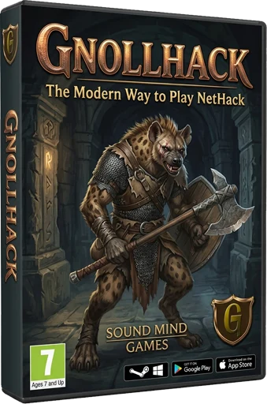
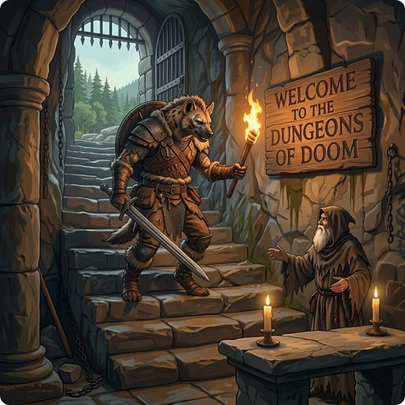

# GnollHack Wiki

<small>*Disclaimer: GnollHack doesn't use AI art in the game. It's only used on the wiki as illustrations. Please see our [[AI Usage Policy]].*</small>

GnollHack is the modern way to play [NetHack](https://www.nethack.org/), one of the deepest and greatest roguelikes ever created. It takes the limitless depth and emergent gameplay of the original and elevates them with a modern UI, animated tile graphics, sound effects, music, and voiceovers, while preserving most of NetHack's core mechanics and complexity. This makes it an ideal choice for NetHack veterans seeking a graphical upgrade with expanded mechanics. Its modern interface and cross-platform support also help newcomers experience traditional roguelike gameplay with minimal friction.

- **100% free:** No ads or in-app purchases
- **Play anywhere:** Windows, macOS, Linux, iOS, Android, and Steam Deck
- **Play your way:** Full touch, mouse, keyboard, and gamepad support, including Steam Deck controls

> ### ⭐⭐⭐⭐⭐
>
> *"I've never experienced a game like this and I absolutely love it. No two runs will ever be the same, allowing for huge amounts of replayability. Probably the best mobile game I've ever played."*
>
> — **Google Play Review**

> ### The best NetHack rendition I've ever played ⭐⭐⭐⭐⭐
>
> *"Long time NH player and played many variants, including hack, rogue and moria which are all similar. This is, by far, the best rendition I have ever played. The quests, voice acting, pleasant graphics, music, NPCs, new spell system, and more are wonderful additions while still remaining true to core NH. And of course, various surprising ways to meet your end.*
>
> *And it's free! Well done developers! I highly recommend this game to anyone that played the original. You will enjoy it."*
>
> — **Paradeth on Steam**

## ℹ️ Introduction

- **[[Overview]]** — Main introduction to GnollHack
- **[[Screenshots]]** — GnollHack screenshots from various platforms 
- **[[User Reviews]]** — A curated list of GnollHack user reviews
- **[[Comparisons to Other Games]]** — Find out how GnollHack compares to NetHack, other NetHack variants, and other roguelike games
- **[[Age Ratings]]** — GnollHack's age ratings in various regions

## 🏁 Getting Started

- **[[Download]]** — Download and installation instructions for GnollHack
- **[[Steam Deck and Controller Support|Steam Deck Controls]]** — Play with the Steam Deck's built-in controls or a game controller, such as an Xbox controller
- **[[Tutorials]]** — Learn to play GnollHack
- **[[Choosing the Right Gameplay Mode]]** *(modern versions only)*
- **[[Choosing the Right Difficulty Level]]**

<small>*Disclaimer: Illustrations on the wiki don't reflect actual gameplay.*</small>

## 🕹️ Game Content

- **[[Gameplay Information]]** — The central hub for all game content and mechanics, including character creation, UI, stats, equipment, items, spells, monsters, religion, and advanced topics

## ✨ Features

- **[[Features]]** — Main features of GnollHack
- **[[Detailed Features]]** — A complete reference of the gameplay changes GnollHack makes to NetHack
- **[[How GnollHack differs from NetHack]]** — A side-by-side comparison of GnollHack and NetHack
- **[[Desktop Features]]** — Take a look at the features that appear only on the desktop versions of GnollHack
- **[[Auto-Stashing Algorithm]]** — Learn how GnollHack automatically sorts loot
- **[[Save File Transfer]]** — How to move your save files across different devices and platforms
- **[[Game Quirks]]** — Some non-obvious quirks where the game may behave in surprising ways

## 📖 Reference

- **[[Commands]]** — Commands available as clickable GUI buttons in the modern versions of the game.
- **[[Keyboard Shortcuts]]** — GnollHack supports NetHack-style keyboard shortcuts, which are especially useful when playing with a physical keyboard 
- **[[Steam Deck Controls]]** — How to play GnollHack with the Steam Deck's built-in controls or a game controller on Windows, Linux, and macOS

## ⚙️ Game Configuration

- **[[Settings]]** — GnollHack's modern ports have settings, which can be used to configure the game
- **[[Options]]** — You can configure GnollHack via a NetHack-style Options file
- **[[Additional Options]]** — Additional options that you can configure via a NetHack-style Options file

## 🌍 Online Sharing

- **[[Social Sharing Guide]]** — Learn how to share your achievements, progress, and screenshots with the community
- **[[Share Your Progress to Discord Server Channel]]** — Modern clients can share your progress to Discord
- **[[GnollHack Account]]** — The GnollHack Account server supports top score recording, bones sharing, Junethack, and the NetHack Scoreboard *(modern versions only)*
- **[[Bones Sharing]]** — You can share your dead characters with others *(modern versions only)*
- **[[Save File Tracking]]** — The modern Windows version requires your save files to be tracked online to make them eligible for server posting

## 🤖 Game Advisor

GnollHack is famously tough, so we built the *Gnoll Overseer* to help you along. Powered by *frontier AI models* and grounded in real game data, it gives you accurate, high-quality tactical advice in every game situation. Learning to play GnollHack has never been easier! Got a question? Just ask the Overseer!

- **[[Gnoll Overseer]]** — Advanced in-game AI advisor for all things GnollHack.
- **[[GnollBench]]** — An AI benchmark measuring how AI models perform as the Gnoll Overseer.

## 📋 Technical Information

- **[[Troubleshooting]]** — How to solve various technical problems
- **[[Emulator Support]]** — Learn about which emulators support GnollHack
- **[[Save Game Compatibility]]** — Check which patches are compatible with each other
- **[[Technical Systems]]** — How GnollHack's save recovery, save transfer and other technical systems work behind the scenes
- **[[Version Identifier Letters]]** — Find out what letters are used to describe different versions of GnollHack

## 🛠️ Development

- **[[Development Information]]** — Build instructions, design details, and testing and debugging
- **[[Technological Features]]** — Major features of GnollHack from the development technology perspective
- **[[Development Timeline]]** — Important dates in GnollHack development

## 🤝 Contributions

- **[[Art Contribution Guidelines]]** — Read this if you want to contribute art to GnollHack
- **[[Code Contribution Guidelines]]** — Read this if you want to contribute code to GnollHack
- **[[Credits]]**

## 📝 Wiki Development

- **[[Editing the Wiki]]** — How to edit the GnollHack Wiki

## 💡 Additional Information

- **[[Tournaments]]** — How to participate in tournaments
- **[[Legacy Information]]** — A central hub for pages that relate only to the legacy versions of GnollHack

## 🎬 Additional Material

- **[[GnollHack Animations]]** — GnollHack-themed animated YouTube Shorts
- **[[GnollHack Universe Videos]]** — GnollHack-themed photorealistic YouTube Shorts

## 🗣️ Contact Us

- **[[Communities]]** — Communities related to GnollHack
- **[[Contact Information]]**
- **[[Developer]]** — About Sound Mind Games (Hyvän mielen pelit ry)

## 📄 Legal Information

- **[[Privacy Policy]]**
- **[[Terms and Conditions]]**
- **[[AI Usage Policy]]**
- **[[Overseer AI Providers]]**
- **[[GnollHack Account Terms of Service]]**
- **[[Gnoll Overseer Terms of Service]]**
