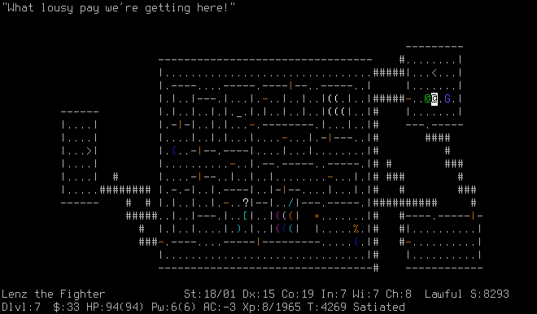
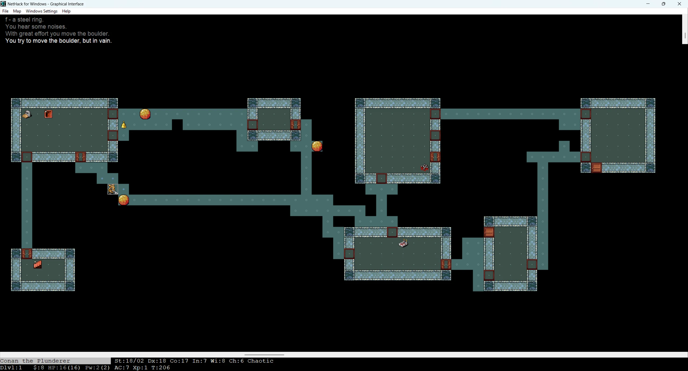
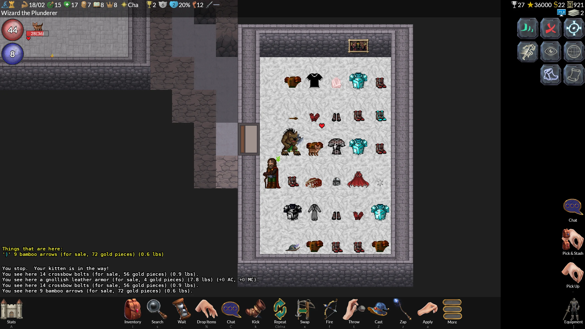

> 👉 **GnollHack keeps most of NetHack 3.6.2's rules and adds graphics and sound, a new spell system, more equipment slots, and difficulty levels, and it delays many of NetHack's instant deaths.**

For every rule change, see [[Detailed Features]]; for a shorter overview, see [[Features]]. [[NetHack 5.0 vs. GnollHack Release 3]] compares the current releases of the two games, and comparisons with other games are collected on [[Comparisons to Other Games]].

## 📱 Presentation and UI

| Feature | NetHack 3.6 | GnollHack |
|---------|---------|-----------|
| **Graphics** | Text characters, or static 2D tiles in some interfaces | A graphical interface on every platform, with 2D [[animations]] |
| **Audio** | No music or built-in sound effects; some builds can play your own sound files for chosen messages | Sound effects, a [[music]] soundtrack, and [[voiceovers]] |
| **Inventory Actions** | Commands by key, such as `q` to quaff and `r` to read | Select an item in the inventory to get all its common actions |
| **Information** | Damage numbers and most item stats are not shown, so players look them up in spoilers | Detailed stats in the game and exact damage in messages |

NetHack 5.0 has caught up on two of these: it plays a few sound effects (musical instruments, squeaky boards, gaining or losing a level), and selecting an item in its inventory opens a menu of actions for it. GnollHack also has an optional AI advisor, the [[Gnoll Overseer]], which uses the live game state and the game's own data.

## 🔮 Magic and Spells

| Feature | NetHack 3.6 | GnollHack |
|---------|---------|-----------|
| **Spells** | 40 spells in 7 schools | Over 200 spells in 12 spell schools |
| **Learning Spells** | Read a spellbook | Read a spellbook, or pay priests, the Oracle, artificers, and some other NPCs to teach you |
| **Memory** | A spell is forgotten about 20,000 turns after you last read its book | Spells are never forgotten |
| **Casting** | One turn; the failure rate depends on your casting stat, experience level, skill, and armor such as metal armor and shields | Most spells are first prepared with Mix (`Shift+x`) from material components ([[reagents]]); spells have casting times and cooldowns, and somatic spells have armor penalties |

The spell menu can be sorted and reordered in either game, and GnollHack also lets you put spells on the number keys 0–9. NetHack 5.0 adds one spell, chain lightning.

## ⚔️ Combat

| Feature | NetHack 3.6 | GnollHack |
|---------|---------|-----------|
| **Weapon Swapping** | Takes a turn (`x`) | Instant |
| **Ranged Combat** | Only the missile's damage counts; the launcher's enchantment adds to-hit. Adjacent targets are slightly easier to hit | Launchers add their damage and enchantment to the missile. Firing or throwing at an adjacent monster has a large to-hit penalty |
| **Two Weapons** | Two-weapon combat, for some roles | [[/Skills/Dual wielding]], dual-wield artifacts, spiked shields, and main-gauches |
| **Skills** | Up to Expert; only martial arts and bare-handed combat reach Master and Grand Master | Up to Grand Master; weapon skills raise the critical hit chance |
| **Magic Cancellation** | The highest MC of any one worn item, usually the cloak | Adds up across all worn gear and works as a saving throw against magical touch attacks; see [[Magic Cancellation]] |
| **Instant Deaths** | Some deaths are instant, such as being drowned by an eel or the touch of death; stoning and sickness are delayed | Many are delayed by several turns, so you can react and save yourself; when you are drowning, for example, you have a few turns to get back to air |
| **Covetous Bosses** | Bosses keep teleporting away to heal and may steal your quest artifact | Only a few monsters still teleport away to heal, such as the Wizard of Yendor, arch-liches, Asmodeus, and Demogorgon |

## 🛡️ Equipment and Items

NetHack 3.6 has 14 equipment slots: weapon, alternate weapon, quiver, body armor, shirt, cloak, helmet, gloves, boots, shield, amulet, two rings, and eyewear. GnollHack has 22 [[equipment slots]]. It adds an alternate weapon or shield for the other hand, [[robes]] worn over body armor, [[bracers]], and five slots for miscellaneous magic items.

In NetHack, two items of the same kind differ by enchantment (+1, +2), erosion, and erosion-proofing. GnollHack items can also have one of the five quality tiers described on [[Exceptional, Elite, Celestial, Primordial, and Infernal Items]], the affixes of [[Mythic and Legendary Items]], and elemental enchantments.

NetHack players identify items with scrolls and the spell of identify, by shop prices, by engrave-testing wands, and by trying items out. GnollHack has more identification items, such as the new [[/Items/wand of identify]], and the Oracle and some NPCs identify items for gold.

## 🎓 Characters, Monsters, and Economy

| Feature | NetHack 3.6 | GnollHack |
|---------|---------|-----------|
| **Playable Races** | Human, elf, dwarf, gnome, and orc | Gnomes are replaced by the new [[/Races/Gnoll]] race, with its own stats, starting items, and traits |
| **Attributes** | Attributes rise slowly and semi-randomly through hidden "exercise" | Exercise is gone; eating certain corpses or fruits, such as a banana, raises an attribute at once |
| **Difficulty** | One difficulty; in the non-scoring explore mode you can refuse to die | 7 [[difficulty levels]] and several gameplay modes, some without permadeath |
| **Random Monsters** | Each monster's difficulty is capped by the dungeon level and your experience level, but the rest of its group is not checked, so soldier ants can arrive several at a time early on | Monsters come as encounters, and the cap applies to the whole group |
| **Gold** | Shops, temple donations for protection, the Oracle's consultations, and bribes demanded by demon lords | Besides the paid identification and spell lessons above, gold buys healing and cures from priests and peace with angry watchmen |
| **Pets** | Pets step toward you square by square, can get stuck behind obstacles, and follow your trail when out of sight | Pets find a path back to you. You can tell them to hold position, drop items, and wear or wield gear, and you can hire mercenaries |

In NetHack, Chat mostly gets you a monster's sound or a line of text. In GnollHack, Chat (`Shift+c`) is how you deal with NPCs, monsters, and pets: the paid services and pet commands above are all chosen there.

## 📈 GnollHack Development Key Figures

- More than 10,000 code commits since July 2019, when GnollHack was forked from NetHack 3.6.2
- More than 23,000 graphical tiles; some of them, such as statues, are generated by the Tile Set Compiler
- More than 100 high-definition user interface icons
- More than 5,000 voiceover lines
- 14 pieces of original background music

The drawn tiles and the icons were made for GnollHack by artists and the 14 pieces of music by a composer, and the voiceover lines were recorded by voice actors.

## 📷 User Interface Screenshots

### NetHack

NetHack's ASCII UI:

NetHack's Windows GUI with the Nevanda tileset:

### GnollHack

GnollHack's GUI on Windows:

