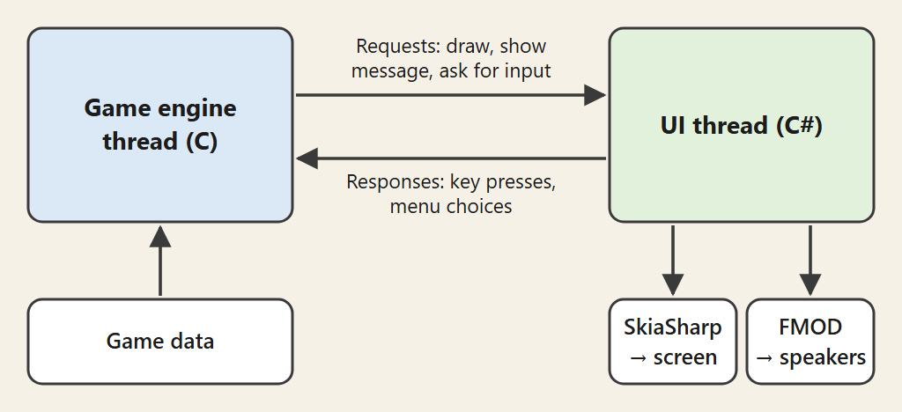

> 👉 **GnollHack is NetHack's C game engine running inside one C# app that is built for six platforms, with its own servers and websites around it.**

## 🏗️ The Big Picture

GnollHack has three parts:

- **The game** on the player's device, which is one app with a game engine inside it.
- **The content** the game is built from: tiles, sounds, music, voiceovers, and level descriptions.
- **The services** the game talks to over the internet, such as the account server and the AI advisor.

The game itself is built in layers, listed here from the bottom up:

| Layer | What it does | Technology |
| :---- | :----------- | :--------- |
| **Game engine** | Holds the rules of the game | C |
| **Native bridge** | Lets C# code and C code call each other | P/Invoke |
| **Shared client** | The screens, menus, settings, and the game view, the same on every platform | C# and XAML |
| **UI backend** | Creates the windows, buttons, and text boxes of each operating system | [.NET MAUI](https://dotnet.microsoft.com/en-us/apps/maui), [Avalonia UI](https://avaloniaui.net/) |
| **Drawing and sound** | Puts tiles on the screen and plays sounds | [SkiaSharp](https://github.com/mono/SkiaSharp), [FMOD](https://www.fmod.com/) |

*The engine and the UI run side by side and pass requests and responses to each other.*

## 🧠 The Game Engine

The game engine is written in C. It was forked from [NetHack](https://www.nethack.org/) 3.6.2 in July 2019 and has about 500,000 lines of code today. It holds all the rules: what a monster does on its turn, what a potion does when you drink it, and how a level is generated. For each platform, the engine is compiled into a native library, which is a file of machine code that another program loads and calls.

The engine was kept in C and not rewritten in C#. NetHack's rules describe thousands of interactions between items, monsters, and dungeon features, and writing them again would have taken years and introduced bugs into mechanics that players have relied on for decades. C also compiles for every platform that GnollHack supports, so the same engine runs on all of them.

## 🔀 How C and C# Work Together

The rest of the app is written in C#. C# code calls the engine through P/Invoke, the .NET feature for calling functions in a native library.

The engine draws nothing itself. When it wants to show a message, draw a tile, open a menu, or wait for a key, it calls one of about 60 functions that the client handed to it at startup. Such a function is called a callback. This is NetHack's "window port" idea: the engine only says what should happen, and a separate part of the program decides how it looks.
The engine and the user interface run on separate threads. A thread is a sequence of work that the program runs at the same time as its other threads. The two threads pass requests and responses to each other through queues, so a long turn in the engine never freezes the screen.

What happens when you press a key:

1. The UI thread receives the key press and puts it in the response queue.
2. The engine thread, which was waiting for input, takes the key and works out the turn: your character acts, and then the monsters do.
3. As it works, the engine puts requests in the request queue: print this message, draw this tile here, play this sound.
4. The UI thread reads the requests, SkiaSharp draws the changed map on the next frame, and FMOD plays the sounds.

## 💻 One Client, Six Platforms

The client is one code base of about 180,000 lines of C# and XAML, a markup language for describing screens. It began as a Xamarin.Forms app in 2021 and moved to .NET MAUI, Microsoft's framework for building one app for several platforms, by April 2025.

.NET MAUI runs the app on Android, iOS, and Windows. It has no Linux backend, so on Linux, the Steam Deck, and macOS the same app runs on Avalonia UI, another cross-platform UI framework. This is a build setting, not a second code base. The [[/Development/Avalonia Port]] page has the details.

| Platform | UI technology | Graphics API | Where it is released |
| :------- | :------------ | :----------- | :------------------- |
| **Android** | .NET MAUI | OpenGL ES | Google Play |
| **iOS** | .NET MAUI | Metal or OpenGL ES | App Store |
| **Windows** | .NET MAUI on WinUI 3 | Direct3D, through ANGLE | Steam |
| **Linux** | .NET MAUI on Avalonia UI | OpenGL | Steam, and an AppImage on GitHub |
| **Steam Deck** | .NET MAUI on Avalonia UI | OpenGL | Steam |
| **macOS** | .NET MAUI on Avalonia UI | Metal | Steam |

A graphics API is the interface a program uses to give work to the graphics processor (GPU). ANGLE is a library that translates OpenGL ES calls to Direct3D.

## 🎨 Graphics and Sound

The art and the audio are made in their own repositories and compiled into files that the game loads. Single tile images are joined into sprite sheets, which are large images that hold many small ones side by side. Sounds are built into sound banks, FMOD's file format for packed audio.

| Part | Technology | What it does |
| :--- | :--------- | :----------- |
| **Drawing** | SkiaSharp, the .NET version of Google's Skia graphics library | Draws the map, the text, and the user interface. It uses the GPU by default and has a CPU mode |
| **Tiles** | Sprite sheets | Hold over 23,000 base tiles of 64×96 pixels |
| **Audio** | FMOD, a sound middleware, which is a ready-made library that a game uses to play and mix audio | Plays sound effects, music, and voiceovers from six sound banks, built in a desktop and a mobile flavor |

## 📦 Game Data

Levels and dungeons are not written in C. They are text files in small description languages of their own, and tools turn them into the data the game loads. This happens when the game is built, not when it runs.

| Step | Tool | Result |
| :--- | :--- | :----- |
| **Describe** | A text editor | Description files for the special levels and for the layout of the dungeon |
| **Compile** | The level compiler and the dungeon compiler | Binary level and dungeon files |
| **Generate** | A generator program | Header files for the engine and further data files |
| **Pack** | An archiver | One data archive that ships with the game |

The two compilers are themselves generated with Lex and Yacc, classic tools that produce a parser, the code that reads a text format, from a description of its grammar.

## 🌍 Servers and Websites

Playing GnollHack needs none of the services below. A [[GnollHack Account]] turns on the online features, such as top scores, shared bones files, [[save transfers|Save Transfer System]], and the AI advisor.

| Service | What it does | Built with |
| :------ | :----------- | :--------- |
| **GnollHack Account** (`account.gnollhack.com`) | Player accounts, top scores, recent games, statistics, shared bones files, save file tracking, and a game log feed for [NetHack Scoreboard](https://nethackscoreboard.org/) and [Junethack](https://junethack.net/) | ASP.NET Core Razor Pages with a Web API, ASP.NET Identity, and SQL Server through Entity Framework Core |
| **Gnoll Overseer** (`overseer.gnollhack.com`) | The AI advisor: a chat that looks facts up in the game data, the source code, and the wikis | ASP.NET Core with SignalR for streaming, an Angular front end in TypeScript, Lucene.NET for wiki search, and the APIs of Anthropic, Google, and OpenAI |
| **GnollBench** | The benchmark that tests AI models for the Overseer. It is a part of the Overseer application, for administrators | The same as the Overseer |
| **Shared database** | The three services above share one database and one data library | SQL Server, Entity Framework Core |
| **Cloud storage** | Holds replays, and saved games in transit between devices | Azure Blob Storage |
| **gnollhack.com** | The game's website | ASP.NET Core Razor Pages |
| **This wiki** (`wiki.gnollhack.com`) | The documentation, kept as Markdown files in Git | [Gollum](https://github.com/gollum/gollum/), with its own configuration for search, clean URLs, and caching |
| **Content delivery network** | Serves the static files of the website and the wiki from servers near the reader | Azure Front Door |
| **Crash reporting** | Collects errors from the game, in C and in C#, and from the servers | [Sentry](https://sentry.io/) |
| **Discord** | Game events posted to a channel as they happen, if the player turns it on | Discord webhooks |

ASP.NET Core is Microsoft's web framework, a library that handles the common work of a web server so that the developer writes only the pages and the logic. The server software is about as large as the game engine: about 480,000 lines of code, not counting its tests.

The [[Gnoll Overseer]] is a web application that the game shows in a web view, a browser window inside the app. When a chat starts, the game sends a text snapshot of the game state to the Overseer server. The server, not the game, talks to the AI providers. [[GnollBench]] tests candidate models with the same prompt and tools that the live advisor uses.

## 🗄️ Repositories

Each part lives in its own public repository on GitHub:

| Repository | What it holds | Main technology |
| :--------- | :------------ | :-------------- |
| [GnollHack](https://github.com/hyvanmielenpelit/GnollHack) | The game: the C engine, the C# client, and the build tools | C, C#, .NET MAUI |
| [GnollHackTileSet](https://github.com/hyvanmielenpelit/GnollHackTileSet) | Every tile as its own PNG file | PNG |
| [TileSetCompiler](https://github.com/hyvanmielenpelit/TileSetCompiler) | The program that joins the tiles into sprite sheets | C# |
| [GnollHackSoundSet](https://github.com/hyvanmielenpelit/GnollHackSoundSet) | The FMOD Studio project with the sounds, music, and voiceovers, which is built into the sound banks | FMOD Studio |
| [MobileGnollHackLogger](https://github.com/hyvanmielenpelit/MobileGnollHackLogger) | The server software: GnollHack Account, the Gnoll Overseer, and GnollBench | ASP.NET Core, Angular, SQL Server |
| [OverseerKnowledgeBase](https://github.com/hyvanmielenpelit/OverseerKnowledgeBase) | The articles that the Gnoll Overseer reads about the app | Markdown |
| [GnollHackWiki](https://github.com/hyvanmielenpelit/GnollHackWiki) | The pages of this wiki, as Markdown files | Markdown |
| [GnollHackWikiConfig](https://github.com/hyvanmielenpelit/GnollHackWikiConfig) | The configuration of Gollum, the wiki software | Ruby |
| [GnollHackMarketingWebsite](https://github.com/hyvanmielenpelit/GnollHackMarketingWebsite) | The gnollhack.com website | ASP.NET Core Razor Pages |
| [SharedAgentSkills](https://github.com/hyvanmielenpelit/SharedAgentSkills) | The rules and skills that the coding agents follow in every repository | Markdown, PowerShell |

MobileGnollHackLogger is a historical name. The repository began as the server that logged games played on mobile devices, and it now holds all of the server software. The same repositories are listed by type on [[/Development/Related Repositories]].

## 🛠️ Tooling

| Tool | Used for |
| :--- | :------- |
| **Visual Studio** | Building and debugging both the C and the C# code |
| **Windows Subsystem for Linux** | Compiling the engine for Android and Linux, and the game data |
| **A Mac reached over SSH** | Compiling the engine for iOS and macOS, and signing the Mac app |
| **Lex and Yacc** | Generating the level and dungeon compilers |
| **FMOD Studio** | Mixing sounds and building the sound banks |
| **Tile Set Compiler** | Joining single tile images into sprite sheets |
| **Git and GitHub** | Version control and releases. GitHub Actions runs a set of the client's automated tests |
| **Sentry** | Finding the cause of crashes reported from players' devices |
| **Automated tests** | xUnit for the server and website code, Vitest and Playwright for the browser code |
| **Coding agents** | Most of the C#, TypeScript, and website code is written by AI coding agents under human review. Agents also build the game from source and create the small reproduction projects that go with bug reports to framework projects. The C engine, the art, the music, and the voiceovers are made by people. See the [[AI Usage Policy]] |

## 💡 Summary

GnollHack keeps NetHack's rules in C and builds everything else around them in C#. The engine and the client talk through a fixed set of callbacks and two queues, which is what lets one engine run behind six platforms. Tiles, sounds, and levels are made as separate source files and compiled into the files the game loads. The account server, the AI advisor, and the websites are separate ASP.NET Core applications, and the game is playable without any of them.

## 📖 Learn More

- [[Technological Features]]
- [[Shipping a Cross-Platform Roguelike and Its AI Advisor with .NET MAUI, Avalonia UI, and Frontier AI Models|/Guides/GnollHack, Gnoll Overseer, and GnollBench for Software Engineers]]
- [[/Development/Design Details]]
- [[/Guides/Technological Overview of Gnoll Overseer]]
- [[Development Information]]
