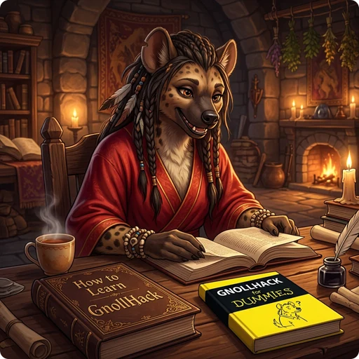

GnollHack is a traditional turn-based roguelike, so its controls and mechanics can feel unfamiliar if you have never played one before. A few choices on the main menu and in [[Settings]] make the game much easier to learn.

## 🕹️ Choose a Non-Permadeath Mode

On the main menu before pressing **Play Game**, leave **Classic Mode** off. With Classic Mode off, your character resurrects at the starting altar (or another checkpoint) instead of dying permanently.

Leave **Casual Mode** off for [[Modern Mode]] (the default: No permadeath, and saves are deleted when loaded), or turn **Casual Mode** on for [[Casual Mode]] if you also want to reload the same save multiple times. See [[Choosing the Right Gameplay Mode]] for a full comparison.

## 🌟 Pick the Standard Difficulty

When starting a new game, pick [[/Difficulties/Standard]], the easiest of the seven [[difficulty levels]]. On Standard difficulty, monsters deal 35% of normal damage while you deal 350%, you start with extra identification items and manuals, dungeon level 1 has no traps, levels 1–2 have no secret passages, and prayer confirmation prevents accidental prayers. See [[Choosing the Right Difficulty Level]] for details on all seven levels.

## 💡 Use In-Game Hints

In-game hints appear automatically on [[/Difficulties/Standard]] through [[/Difficulties/Veteran]] and whenever you play in [[Modern Mode]] or [[Casual Mode]]. They explain mechanics and causes of death as they come up during play.

## 🐺 Ask the Gnoll Overseer

The [[Gnoll Overseer]] is a free, optional in-game AI advisor that you can open from the game menu whenever you want something explained for your current situation. It requires a free [[GnollHack Account]] and an internet connection. See [[/Guides/Introduction to Gnoll Overseer]] for how to open and use it.

## 🏁 Next Steps

Once you are ready for basic gameplay concepts, continue with [[Starting Guide for Beginners]].
