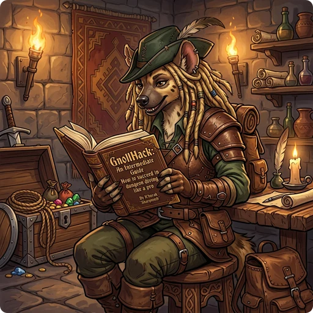

> 👉 **Once you leave the first few levels, collect resistances, carry a cure for stoning and sickness, and fight paralyzing monsters from a distance.**

## 🗺️ Navigating the Dungeon

### Dungeon Branches

Several branches split off from the main dungeon. [[Dungeon Layout]] shows all of them, level by level.

| Branch or Level | Entrance | Description |
|:---|:---|:---|
| **[[/Dungeon/Dungeons of Doom]]** | Where you start | The main dungeon. You start on level 1 and go down to find the [[/Items/Amulet of Yendor]]. Stay on it at first; monsters get harder the deeper you go. |
| **[[/Dungeon/Gnomish Mines]]** | [[/Dungeon/Dungeons of Doom]], levels 2-4 | Mostly unlit caves, where most of the inhabitants are gnomes and dwarves. |
| **[[/Dungeon/Mine Town]]** | [[/Dungeon/Gnomish Mines]], levels 5-8 | A town level that is always there, with several [[/Rooms/Shops]] and a [[/Rooms/Temple]] with a priest. A good place to identify items and buy gear. |
| **[[/Dungeon/Sokoban]]** | [[/Dungeon/Dungeons of Doom]], levels 6-10 | A puzzle branch: you push boulders into pits to get through each level. Finishing it gives you a [[/Items/bag of holding]] or an [[/Items/amulet of reflection]]. |
| **[[/Dungeon/Quest]]** | [[/Dungeon/Dungeons of Doom]], levels 11-16 | A branch of its own for each role (see [[Character Classes]]). You need experience level 14 to enter. |
| **[[/Dungeon/Gehennom]]** | [[/Dungeon/Dungeons of Doom]], levels 25-29 | The late-game branch. Unlike NetHack, GnollHack has taken the mazes out of Gehennom, so it is much quicker to get through. |

### NPCs and Merchants

Several NPCs identify items for a fee or buy gear you have no use for.

| NPC | Where | Services |
|:---|:---|:---|
| **General storekeeper** | [[/Rooms/Shops]] | Buys and sells all kinds of items, and identifies any item for a fee. |
| **Specialized shopkeeper** | [[/Rooms/Shops]] | Runs a shop such as a bookstore, and identifies only the kinds of items it sells. |
| **Artificer** | [[/Rooms/Laboratory]] | Buys spellbooks, including expensive ones your role cannot use. |
| **Geologist** | [[/Rooms/Workshop]] | Buys gems. Identify your valuable gems first, then sell them here. |
| **Oracle** | [[/Dungeon/Delphi]] | Identifies items for a fee and gives hints about the game. |
| **Priest** | [[/Rooms/Temple]] | Blesses and curses items for a fee. If you donate a large sum, the priest gives you protection, which improves your AC. |
| **Smith** | [[/Rooms/Smithy]] | Identifies weapons and armor for a fee, and offers other paid services, such as repairs and quality upgrades. |

## 🤝 Companions and Mercenaries

### Hiring Mercenaries

You can Chat (`Shift+c`) with a peaceful monster and hire it as a mercenary. Mercenaries want gold, but a few heavily armed soldiers on your side make the early and middle game much easier.

### Pet Management

The [[Starting Guide for Beginners]] tells you to rely on your pet. To keep it alive in the middle game, you have to look after it and help it grow stronger.

- A pet has a hunger timer. If it goes too long without eating, it becomes confused and weak, and in the end it starves to death.
- Intelligent pets with hands can wield weapons and wear armor. You hand them equipment with Chat (`Shift+c`).
- Like you, pets gain intrinsic resistances, such as fire, cold, shock, or poison resistance, by eating the right corpses.
- If your pet wanders off, Yell (`Alt+y`) calls it back to you.

## ⚔️ Combat, Dangers and Resistances

### Dangerous Early-Game Monsters

| Monster | Danger | What to Do |
|:---|:---|:---|
| **[[/Monsters/Cockatrice]]** | Touching it turns you to stone, and you die. | Never touch one bare-handed: put on gloves before you fight it in melee. Do not eat its corpse. If you wield a cockatrice corpse as a weapon, falling into a pit makes you touch it, and you turn to stone even with gloves on. |
| **[[/Monsters/Floating eye]]** | Hitting it in melee paralyzes you for many turns, while other monsters attack you. | Shoot it with arrows, darts, or spells. If you must hit it, apply a blindfold first: it cannot paralyze you if you cannot see it. |
| **[[/Monsters/Gelatinous cube]]** | Paralyzes you when it hits you and when you hit it in melee, for many turns each time. | Keep your distance and use ranged weapons or attack wands. |
| **[[/Monsters/Ghast]]** | Its hits can paralyze you for several turns and give you a terminal illness that kills you quickly unless you cure it. | Kill it from a distance. Have a noncursed [[/Items/unicorn horn]], a [[/Items/fig]], or a [[/Items/jar of medicinal salve]] ready, or know the [[/Spells/Cure sickness]] spell, and cure the illness at once. |
| **[[/Monsters/Ghoul]]** | Its hits can paralyze you for several turns. | Kill it before it gets into melee range. |
| **[[/Monsters/Nymphs]]** | They steal your items and teleport away. | Kill them with ranged attacks before they get close. |

Four of these six can paralyze you, and paralysis stays deadly for the whole game, because monsters keep hitting you while you cannot move. Get free action as early as you can. The rest are on [[Monsters]].

### Key Resistances

An intrinsic resistance is your own and does not come from an item; an extrinsic one is granted by an item. [[Resistances and Saving Throws]] gives the exact rates and the saving throw rules.

| Resistance | Effect | Intrinsic Sources | Extrinsic Sources |
|:---|:---|:---|:---|
| **Poison Resistance** | Protects against poison darts and traps, poisonous monster attacks, and poisonous corpses such as kobolds. | Starting as certain races or roles, for example an [[/Races/Orc]], a [[/Roles/Barbarian]], or a [[/Roles/Healer]], or gaining levels in some roles. | [[/Items/Amulet versus poison]], [[/Items/ring of poison resistance]], or [[/Items/green dragon scale mail]]. |
| **Sleep Resistance** | Wands and traps cannot put you to sleep. | Eating corpses such as an [[/Monsters/elf]] or an [[/Monsters/orange dragon]], starting as a [[/Roles/Monk]], or reaching experience level 3 as an [[/Races/Elf]]. | [[/Items/Orange dragon scale mail]]. |
| **Free Action** | Makes you immune to paralysis attacks. | Reaching experience level 6 as an [[/Races/Elf]]. | [[/Items/Ring of free action]] or [[/Items/orange dragon scale mail]]. |
| **Death Resistance** | Protects you from the instant-death attacks of the late game, such as the [[/Spells/Finger of death]] spell or a [[/Items/wand of death]]. | Reaching experience level 19 as a [[/Roles/Priest]]. | [[/Items/Ring of protection from undeath]], [[/Items/amulet versus undeath]], [[/Items/gown of the archbishops]], or [[/Items/black dragon scale mail]]. |
| **Magic Resistance** | Protects you from polymorph traps and most monster spells, but not from death attacks. | ❌ | [[/Items/Cloak of magic resistance]], [[/Items/gray dragon scale mail]], or certain artifacts. |
| **Reflection** | Bounces rays, such as dragon breath and wand zaps, back the way they came. | ❌ | [[/Items/Amulet of reflection]], [[/Items/shield of reflection]], or [[/Items/silver dragon scale mail]]. |

## 💎 Item Quality and Upgrades

Weapons, armor, and wands can come in a quality tier above normal:

| Quality Tier | Weapons | Body Armor | Wands | Restrictions |
|:---|:---|:---|:---|:---|
| **Exceptional** | 2x base damage | -4 AC, +1 MC | 2x base damage | None |
| **Elite** | 3x base damage | -8 AC, +2 MC | 3x base damage | None |
| **Celestial / Primordial / Infernal** | 4x base damage | -12 AC, +4 MC | — | Lawful / Neutral / Chaotic only |

Shields, boots, gloves, and other armor pieces also get better AC and MC with quality; [[Exceptional, Elite, Celestial, Primordial, and Infernal Items]] has the numbers. A smith will repair damaged gear, rustproof items, and raise the quality of weapons and armor, all for gold.

Weapons and armor can also carry random affixes, which [[Mythic and Legendary Items]] describes. See also [[Items]], [[Weapons]], and [[Armor]].

## 🩹 Status Conditions and Curing

| Condition | Cure or Prevention |
|:---|:---|
| **Mummy Rot / Sickness** | Eat a [[/Items/fig]], use a [[/Items/jar of medicinal salve]], apply a noncursed [[/Items/unicorn horn]], or cast [[/Spells/Cure sickness]]. |
| **Stoning / Petrification** | Delayed stoning kills you after 5 turns. Eat a [[/Monsters/lizard]] corpse or a noncursed [[/Items/dragon fruit]], or use a [[/Items/jar of basilisk blood]]. Keep one in your main inventory, not in a container. |
| **Lycanthropy** | Eat a [[/Items/sprig of wolfsbane]], drink holy water, or pray. Wolfsbane is poisonous, so without poison resistance it also costs you Strength and hit points. |
| **Intelligence Drain** | A helmet blocks 90% of these attacks, and a [[/Items/nose ring of cerebral safeguarding]] or a [[/Items/ring of sustain ability]] also protects you. To get lost Intelligence back, drink a [[/Items/potion of restore ability]] or eat a [[/Items/cloudberry]]. |

[[How to Cure Various Conditions]] covers every other harmful status, and [[Conditions]] explains how sickness, stoning, blindness, and the rest work.
