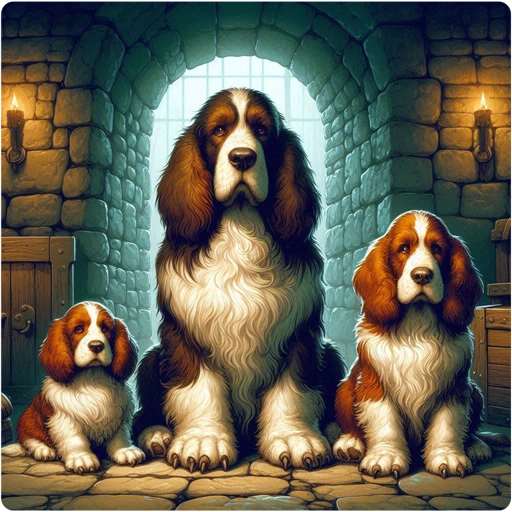

## All Pets and Certain Canines

- [[/Monsters/Little Dog]] ⇒ [[/Monsters/Dog]] ⇒ [[/Monsters/Large Dog]]
- [[/Monsters/Kitten]] ⇒ [[/Monsters/Housecat]] ⇒ [[/Monsters/Large Cat]]
- [[/Monsters/Pony]] ⇒ [[/Monsters/Horse]] ⇒ [[/Monsters/Warhorse]]
- [[/Monsters/Ram]] ⇒ [[/Monsters/Large Ram]] ⇒ [[/Monsters/Warram]]
- [[/Monsters/Direwolf Cub]] ⇒ [[/Monsters/Direwolf]] ⇒ [[/Monsters/Large Direwolf]]
- [[/Monsters/Small Luggage]] ⇒ [[/Monsters/Medium Luggage]] ⇒ [[/Monsters/Large Luggage]] ⇒ [[/Monsters/Giant Luggage]]
- [[/Monsters/Hell Hound Pup]] ⇒ [[/Monsters/Hell Hound]]
- [[/Monsters/Winter Wolf Cub]] ⇒ [[/Monsters/Winter Wolf]]

## All Dragons and Dracoliches

- Dragon hatchlings grow into normal dragons, and normal dragons grow into ancient dragons
- [[/Monsters/Dracolich]] ⇒ [[/Monsters/Elder Dracolich]]

## Nagas

- [[/Monsters/Red Naga Hatchling]] ⇒ [[/Monsters/Red Naga]]
- [[/Monsters/Black Naga Hatchling]] ⇒ [[/Monsters/Black Naga]]
- [[/Monsters/Golden Naga Hatchling]] ⇒ [[/Monsters/Golden Naga]]
- [[/Monsters/Guardian Naga Hatchling]] ⇒ [[/Monsters/Guardian Naga]]

## Cockatrices, Liches, and Vampires

- [[/Monsters/Chickatrice]] ⇒ [[/Monsters/Cockatrice]] ⇒ [[/Monsters/Giant Cockatrice]] ⇒ [[/Monsters/Gargantuan Cockatrice]]
- [[/Monsters/Lich]] ⇒ [[/Monsters/Demilich]] ⇒ [[/Monsters/Master Lich]] ⇒ [[/Monsters/Arch-Lich]]
- [[/Monsters/Vampire]] ⇒ [[/Monsters/Vampire Lord]] ⇒ [[/Monsters/Vampire King]]

## Mercenaries, Kops, and Watchmen

- [[/Monsters/Soldier]] ⇒ [[/Monsters/Sergeant]] ⇒ [[/Monsters/Lieutenant]] ⇒ [[/Monsters/Captain]]
- [[/Monsters/Keystone Kop]] ⇒ [[/Monsters/Kop Sergeant]] ⇒ [[/Monsters/Kop Lieutenant]] ⇒ [[/Monsters/Kop Kaptain]]
- [[/Monsters/Watchman]] ⇒ [[/Monsters/Watch Captain]]

## Certain Humanoids

- [[/Monsters/Kobold]] ⇒ [[/Monsters/Large Kobold]] ⇒ [[/Monsters/Kobold Lord]]
- [[/Monsters/Gnome]] ⇒ [[/Monsters/Gnome Lord]] ⇒ [[/Monsters/Gnome King]]
- [[/Monsters/Dwarf]] ⇒ [[/Monsters/Dwarf Lord]] ⇒ [[/Monsters/Dwarf King]]
- [[/Monsters/Gnoll]] ⇒ [[/Monsters/Gnoll Lord]] ⇒ [[/Monsters/Gnoll King]]
- [[/Monsters/Gnoll Warden]] ⇒ [[/Monsters/Gnoll Supreme Warden]]
- [[/Monsters/Flind]] ⇒ [[/Monsters/Flind Lord]]
- [[/Monsters/Tentacled One]] ⇒ [[/Monsters/Elder Tentacled One]]
- [[/Monsters/Orc]] / [[/Monsters/Hill Orc]] / [[/Monsters/Black Orc]] / [[/Monsters/Great Orc]] ⇒ [[/Monsters/Orc-Captain]]
- [[/Monsters/Ogre]] ⇒ [[/Monsters/Ogre Lord]] ⇒ [[/Monsters/Ogre Overlord]] ⇒ [[/Monsters/Ogre King]]
- [[/Monsters/Ogre Mage]] ⇒ [[/Monsters/Ogre Archmage]]
- [[/Monsters/Elf]] / [[/Monsters/Woodland-Elf]] / [[/Monsters/Green-Elf]] / [[/Monsters/Grey-Elf]] ⇒ [[/Monsters/Elf-Lord]] ⇒ [[/Monsters/Elvenking]]
- [[/Monsters/Quantum Mechanic]] ⇒ [[/Monsters/Elder Quantum Mechanic]]

## Miscellaneous Monsters

- [[/Monsters/Sewer Rat]] ⇒ [[/Monsters/Giant Rat]]
- [[/Monsters/Cave Spider]] ⇒ [[/Monsters/Giant Spider]] ⇒ [[/Monsters/Phase Spider]]
- [[/Monsters/Bat]] ⇒ [[/Monsters/Giant Bat]]
- [[/Monsters/Small Mimic]] ⇒ [[/Monsters/Large Mimic]] ⇒ [[/Monsters/Giant Mimic]] ⇒ [[/Monsters/Chaos Mimic]]
- [[/Monsters/Baby Long Worm]] ⇒ [[/Monsters/Long Worm]] ⇒ [[/Monsters/Elder Long Worm]]
- [[/Monsters/Baby Purple Worm]] ⇒ [[/Monsters/Purple Worm]]
- [[/Monsters/Baby Crocodile]] ⇒ [[/Monsters/Crocodile]]
- [[/Monsters/Treant]] ⇒ [[/Monsters/Elder Treant]]
- [[/Monsters/Manes]] ⇒ [[/Monsters/Lemure]]

## Quest Guardians

- Quest guardians can grow into the monster corresponding to the player role (e.g., [[/Monsters/Apprentice]] into a [[/Monsters/Wizard]]).

## Modrons

- Modrons drones can grow up to the next level modron drone, except for [[/Monsters/Modron Pentadrone]].
- Hierarch modrons can grow up to the next level hierarch modron, except for [[/Monsters/Modron Secundus]] and [[/Monsters/Modron Primus]].

## Level Limit

A monster that gains levels by killing other monsters stops at one and a half times its base level, rounded down. The base level is the hit dice shown on the monster's page; the level at the top of the page is the monster's difficulty, which can differ. A [[/Monsters/ki-rin]], with 16 hit dice, stops at level 24. There are three exceptions: the limit is never below level 5, a monster that can still grow up into a bigger form can always reach that form's level, and a monster of one of the player roles, such as a valkyrie, can reach level 50. A [[/Items/potion of gain level]] that is not cursed, or a [[/Monsters/wraith]] corpse eaten by a pet, can raise a monster's level past the limit; a monster of one of the player roles still stops at level 50, and a pet gains levels from a wraith corpse only up to 15 levels above its base level.
