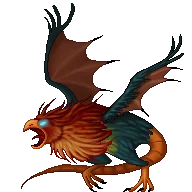

## Level 35 gigantic magical bird with petrifying touch

- **Hit dice:** 20
- **Move:** 18"
- **Armor class:** -2
- **Magic cancellation:** 8 (65%)
- **Magic resistance:** 30%
- **Alignment:** Neutral
- **Size:** Gigantic
- **Number of attacks:** 3
1. Bite, physical 4d6
2. Touch, petrifying (-6 MC penalty)
3. Passive defense, petrifying (-6 MC penalty)

## Attribute scores

St:22 Dx:9 Co:22 In:1 Wi:1 Ch:1

## Innate abilities

1. Poison resistance
2. Stoning resistance

## Classifications

1. Handless
2. Animal
3. Oviparious
4. Carnivore
5. Herbivore
6. Cockatrice
7. Bird or bird-like monster

## Notable

1. Eschews cursed items

## Corpse properties

1. Touching petrifies
2. Eating it turns you to stone and kills you at once, unless you have stoning resistance or are polymorphed into a golem, which turns into a stone golem instead
3. May confer poison resistance (100% chance)

## Picture

