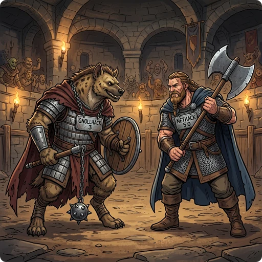

> 👉 **GnollHack split off from NetHack 3.6.2 in July 2019, and since then it and the official NetHack, now at 5.0, have been developed separately.**

## 🧬 How They Are Related

NetHack 5.0 is the direct continuation of the 1987 original. GnollHack is a variant, or fork, of the older NetHack 3.6.2 code. The two still share the basic dungeon structure and monster classes, but GnollHack rebuilt the engine for graphics, music, sound effects, voiceovers, touch controls, and mobile operating systems.

*GnollHack Release 3* is the series of GnollHack versions 3.x. Each of them also has a core version number: version 3.N is core version 4.3.0 Build N, so version 3.1 is 4.3.0 Build 1. The releases on GitHub are named by the core version.

## 💻 Availability

| Topic | NetHack 5.0 | GnollHack Release 3 |
| :--- | :--- | :--- |
| **Release Date** | May 2, 2026 | July 11, 2026 (version 3.1) |
| **Official Builds** | • Windows (also MS-DOS and Amiga) • Linux and macOS: source code only1 | • Android • iOS • Linux • macOS • Windows |
| **Store Availability** | ❌ Not in stores; free download from nethack.org | • **Steam** (Linux, macOS, and Windows) • **Google Play Store** (Android) • **Apple App Store** (iOS and macOS) |

- 1 Some Linux distributions package NetHack in their repositories; whether a distribution has 5.0 depends on that distribution.

## ⚖️ Main Differences

| Feature | NetHack 5.0 | GnollHack Release 3 |
| :--- | :--- | :--- |
| **Difficulty and Permadeath** | One difficulty. A death ends the game, except in the non-scoring explore mode, where you can refuse to die. | 7 [[difficulty levels]]. Permadeath is optional in [[Casual Mode]] and [[Modern Mode]]. |
| **Graphics** | Text characters, or static 2D tiles. | High-resolution animated graphics with over 23,000 base tiles, in a UI made for both desktop and mobile. |
| **Audio** | A few sound effects (musical instruments, squeaky boards, gaining or losing a level), and no music. | 14 original and 23 additional music tracks, sound effects, and over 5,000 voiceovers. |
| **Controls** | Keyboard commands, such as Quaff (`q`) and Read (`r`). Selecting an item in the inventory opens a menu of actions for it. | Point-and-click commands, context menus, and touch controls. |
| **In-Game Information** | Item stats and damage numbers are not shown, so players look them up on wikis and spoilers. | Examine (`Alt+x`) shows an item's stats, magical effects, and base damage, and messages show the exact damage of each hit. |
| **Spells** | About 40 spells, learned from spellbooks. A spell is forgotten about 20,000 turns after you last read its book. | Over 200 spells. Most are prepared with Mix (`Shift+x`) from [[reagents]], casting has armor penalties and cooldowns, and spells are never forgotten. |

NetHack 5.0 has a tutorial level, and GnollHack does not. GnollHack has an in-game AI advisor instead, the optional [[Gnoll Overseer]], which reads your live game state and the game's data.

Gold, loot, equipment slots, ranged combat, pets, and the smaller rule changes are compared on [[How GnollHack differs from NetHack]]. Comparisons with other games are listed on [[Comparisons to Other Games]].

## 🌐 Online Play and Leaderboard Support

NetHack 5.0 and GnollHack can both be played in a terminal over SSH on public servers, and games played there appear on the [NetHack Scoreboard](https://nethackscoreboard.org/), an online leaderboard for NetHack variants. The GnollHack servers run the text version of the game, which came before the graphical clients; see [[Public Servers]]. Only GnollHack also sends games played in its own clients to the scoreboard, through the [[GnollHack Account]] server.

## 💡 Which One to Play

NetHack 5.0 is the official game: one difficulty, permadeath, mostly keyboard play, and a tutorial level to learn it with. GnollHack Release 3 is the better fit if you want to choose a difficulty level or play without permadeath, or if you play on a phone or tablet. The price is more to manage: 22 [[equipment slots]], more loot to sort, and reagents to mix before you can cast.

## 📅 Validity

This comparison is valid for NetHack 5.0.0 and GnollHack 3.39 (4.3.0 Build 39). It was checked on November 8, 2026.
