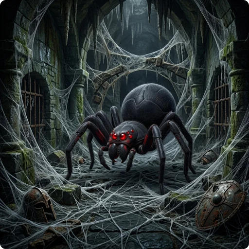

> 👉 **Poison resistance makes you immune to most poisoning effects in GnollHack; without it, poison drains your attributes and hit points.**

## 🍎 Eating Poisonous Food

This applies to poisonous food and corpses, and to objects you eat while polymorphed into a metallivore. Ordinary poisonous food costs you 1–4 points of Strength and 1–15 HP. Deadly poisonous food is worse: 2–12 points of Strength and 5–100 HP. With poison resistance, neither does anything ("You seem unaffected by the poison.").

## 🗡️ Monster Attacks

### 🐍 Bites and Stings

A poisonous natural attack, such as a bite or a sting, drains Strength, Dexterity, or Constitution, depending on its damage type. The poison damage and the chance to lose points of that stat grow with the monster's level:

| Monster level | Poison damage | Chance to lose the stat | Points lost |
| :--- | :--- | :--- | :--- |
| 1–2 | 1d6 | 5% | 1 |
| 3–5 | 2d6 | 10% | 1 |
| 6–8 | 3d6 | 15% | 1 |
| 9 and higher | 3d6, or a [[deadly poison|#deadly-poison]] strike (10%) | 15%, always on a deadly strike | 1–3 |

If you are poison resistant, you take only the attack's normal damage ("The poison doesn't seem to affect you.").

### 🏹 Poisoned Weapons

A poisoned weapon, thrown (arrows, darts) or used in melee (such as an orcish dagger), deals 2d6 (2–12) poison damage and has a 10% chance to take 1 point of Strength. Neither kind ever causes a deadly poison strike. Poison resistance cancels the poison completely.

## 🕳️ Traps

Poisoned [[dart|/Items/Dart]] traps, poisoned needles, and spiked pits with poisoned spikes deal 2d6 (2–12) poison damage. Darts and needles also have a 10% chance to take 1 point of Constitution, and spiked pits a 10% chance to take 1 point of Strength. Poison resistance stops the poison, but you still take the physical damage of the dart or the spikes.

## ☁️ Poison Gas Clouds

The gas that billows from a trapped container deals 2d6 (2–12) poison damage and has a 10% chance to take 1 point of Strength. A lingering poison gas cloud, such as one from a [[/Items/scroll of stinking cloud]], damages you every turn you stay inside it, but does not drain Strength. With poison resistance, you can walk through the gas without taking any damage.

## ⛲ Poisoned Fountains

Drinking from a fountain tainted with poison costs you 2–5 points of Strength and 1–10 HP. If you are poison resistant, the water only tastes bitter.

## 🧪 Potion of Poison

Quaffing a [[/Items/Potion of poison]] deals poison damage and drains a random stat, such as Strength or Dexterity, by 1–12 points depending on the potion's BUC status. When one shatters near you, the vapors take up to 5 HP, but never bring you below 1 HP. Poison resistance protects you from both ("However, you are unaffected by the poison."). Quaffing one cures hallucination and lycanthropy whether or not you are resistant.

## 📖 Contact-Poisoned Spellbooks

Failing to read a cursed or very difficult spellbook can poison you through the cover. You lose 3–6 points of Strength and take 2–20 HP of damage. Poison resistance reduces this to 1–2 points of Strength and 1–6 HP.

## ☠️ Deadly Poison

In GnollHack, deadly poison no longer kills you outright. It deals poison damage instead, and you die only if this takes you below 1 HP ("The poison was deadly...").

- A monster of level 9 or higher has a 10% (1 in 10) chance to make its poisonous bite or sting deadly. The strike deals 7d6 + 10 (17–52) damage. Monsters of level 8 or lower cannot make a deadly strike.
- When you are polymorphed into a poisonous monster, your own poisonous attack has a 10% chance to deal 6d6 + 10 (16–46) to the monster you hit.
- Poisoned [[darts|/Items/Dart]], [[arrows|/Items/Arrow]] and other weapons, and traps of every kind (darts, needles, spiked pits, gas clouds), never make a deadly strike. Their ordinary poison damage can still kill you when your hit points are low.

## 🛡️ Acquiring Poison Resistance

Get poison resistance early. Without it, a deadly strike or the steady damage from poisoned [[darts|/Items/Dart]], spiked pits, and monster attacks can kill you. You can get it from an [[/Items/Amulet versus poison]] or a [[/Items/Ring of poison resistance]]. Some roles, such as [[Healers|/Roles/Healer]] and [[Barbarians|/Roles/Barbarian]], start with it or gain it as they level up. Some corpses also grant it, but many of those are poisonous themselves, so eat them only when you can survive the poison, for example while wearing one of the items above.
