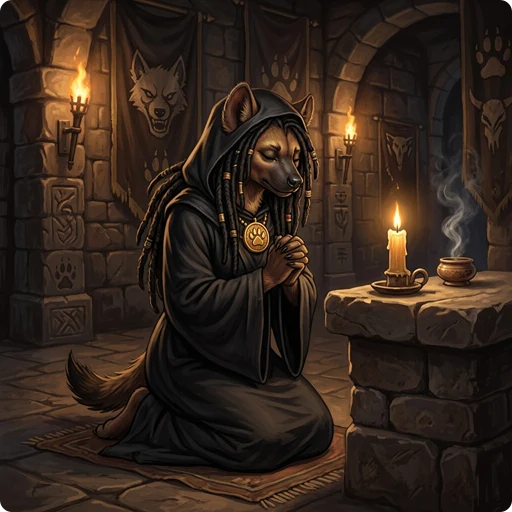

> 👉 **A prayer at the right time gets your god to fix your troubles and sometimes grants a special favor, while a prayer too soon or to an angry god gets you punished.**

You can pray at any time with Pray (`Alt+p`). What happens depends on your troubles, your alignment record, your Luck and how long ago you last prayed.

## Prayer Timeout

Whether a prayer is safe depends mostly on your **prayer timeout**, a hidden counter that goes down by 1 every turn. It starts at 300, or at 150 for Priests. Each successful prayer sets it to a new random value based on 350, or 175 for Priests; see [[Prayer Timeout Randomization|#prayer-timeout-randomization]] below.

### Troubles

How low the timeout must be depends on your troubles. If a prayer sets it to 350, you can pray again for a **major trouble** after 150 turns, when it is down to 200. With **no trouble** you have to wait the full 350 turns, until it reaches 0.

| Trouble Level | Condition | Safe Timeout Threshold |
| :--- | :--- | :--- |
| **Major Trouble** | You are facing a life-threatening situation. | Timeout $\le$ 200 |
| **Minor Trouble** | You are facing a severe but non-lethal issue. | Timeout $\le$ 100 |
| **No Trouble** | You are not in any immediate danger. | Timeout $\le$ 0 |

Once you have killed the Wizard of Yendor, and again once you have been [[crowned|Crowning]], every successful prayer adds roughly another 1000 turns to the new timeout, or 500 for Priests, for each of the two.

### Prayer Timeout Randomization

After a successful prayer, the base value is either multiplied or divided by a random factor, with even odds. The largest factor the game can roll grows as your character gains levels, so at high levels the timeout can land further from the base value.

Those large factors come up rarely, under 5% of the time, so they do not change the 95th percentile. At every experience level from 1 to 50, 95% of successful prayers leave a timeout of at most 1229 turns, or 614 for Priests. That is the wait until the timeout reaches 0, which a prayer with no trouble needs; with a [[major or minor trouble|#troubles]] you can pray once it is down to 200 or 100.

> 💡 **Tip:** A blessed [[/Items/holy symbol]] or a blessed [[/Items/prayerstone]] shimmers while it is safe to pray.

### Unsafe Conditions

These make a prayer fail even when the timeout is low enough:

- **Too Naughty**: Your Luck is negative, your god's anger is above 0, or your alignment record is negative.
- **Gehennom**: Prayers never work in Gehennom. Your god will not hear you, and praying there might anger them.
- **Wrong Altar**: You pray on an altar of a god of another alignment than yours.
- **Vile Creature**: You are polymorphed into an undead monster and pray on a Lawful altar, or on a Neutral altar with a 10% chance.

## Types of Troubles

Your god fixes your worst trouble first. Major troubles are worse than minor ones, and each table below lists its troubles from worst to least bad.

### Major Troubles

| Trouble | Description |
| :--- | :--- |
| **Stoned** | You are turning into stone. |
| **Slimed** | You are turning into green slime. |
| **Strangled** | You are wearing an [[/Items/amulet of strangulation]]. |
| **Lava** | You are trapped in lava. |
| **Sick** | You have a terminal illness. |
| **Food Poisoned** | You have food poisoning. |
| **Mummy Rot** | You have mummy rot. |
| **Starving** | Your hunger status is Weak or worse. |
| **Region** | You are trapped in a stinking cloud. |
| **Hit** | Your HP is critically low: 5 or less, or at most one third of your maximum HP, where the maximum counts as no more than 15 times your experience level. |
| **Lycanthrope** | You have contracted lycanthropy. |
| **Collapsing** | You are severely overencumbered and losing strength. |
| **Stuck in Wall** | You are phased or stuck inside a solid wall. |
| **Cursed Eyeglasses** | You are wearing cursed [[/Items/eyeglasses of hallucination]]. |
| **Cursed Levitation** | You are wearing cursed [[/Items/levitation boots]] or a cursed [[/Items/ring of levitation]]. |
| **Unusable Hands** | Your hands are stuck. |
| **Cursed Blindfold** | You are wearing a cursed [[/Items/blindfold]]. |

### Minor Troubles

| Trouble | Description |
| :--- | :--- |
| **Punished** | You have a [[/Items/heavy iron ball]] chained to you. |
| **Teleportitis** | You suffer from uncontrollable teleportation. |
| **Fumbling** | You are wearing fumbling gear. |
| **Laughing** | You are wearing a [[/Items/shirt of uncontrollable laughter]]. |
| **Cursed Items** | You are wearing or wielding cursed items. |
| **Saddle** | You are stuck on a cursed [[/Items/saddle]]. |
| **Blind** | You are blinded or deafened. |
| **Poisoned** | Your attributes have been drained by poison. |
| **Wounded Legs** | Your legs are wounded. |
| **Hungry** | Your hunger level is at Hungry. |
| **Stunned** | You are stunned. |
| **Confused** | You are confused. |
| **Hallucination** | You are hallucinating. |

## Prayer Outcomes

### Negative Outcomes

An unsafe prayer ends in one of these ways:

- **Vile Creature**: You are forced back into your normal form and take 1d20 damage.
- **Gehennom**: Your god states they cannot help you. If your Alignment Record is 0 or less, your god will become angry.
- **Too Soon**: Your prayer fails. Your god's anger grows by one, your Luck decreases by 3, and your angry god punishes you. The punishment grows harsher with your god's anger and your bad Luck, from a feeling that your god is displeased to cursed items, a lost experience level or a bolt of lightning. Your prayer timeout is then set anew to a random value of around 300, or around 150 for Priests, which can also come out much larger.
- **Too Naughty**: You pray while your Luck is negative, your god is angry, or your alignment record is negative. On an altar of another alignment your record counts for half, and on an altar of the opposing alignment it counts against you. Your prayer fails, your angry god punishes you in the same way, and your prayer timeout is set anew in the same way. The failed prayer does not lower your Luck or add to your god's anger by itself.
- **Wrong Altar**: The altar may curse [[water|/Items/potion of water]] and [[holy symbols|/Items/holy symbol]] placed upon it. If so, you incur the same penalties as praying "Too Soon".

### Positive Outcomes

A safe prayer pleases your god. On an altar of your own god, your god also blesses one [[holy symbol|/Items/holy symbol]] or [[prayerstone|/Items/prayerstone]] you carry that is not yet blessed, and any [[water|/Items/potion of water]] or [[holy symbols|/Items/holy symbol]] lying on the altar.

How many troubles get fixed is decided by a random roll, which is higher with good Luck and on an altar:

| Action Level | Result |
| :----------: | :----- |
| **1** | Fixes your worst trouble once. |
| **2** | Fixes your worst trouble up to 10 times. |
| **3** | Fixes your worst trouble once, then does Action Level 2. |
| **4** | Fixes your worst trouble until all troubles are completely gone. |
| **5** | Fixes all troubles entirely and grants a **Special Favor**. |

> 💡 **Tip:** If you are not on an altar, the maximum Action Level you can achieve is 3. If your Alignment Record is below 4 (Strident), the maximum Action Level is 1.

### Special Favors

You get a special favor on Action Level 5, or when you pray with no troubles at all and an alignment record of at least 14 (Devout).

Which favor you get is a random roll from 0 to ⌊(Luck + 6) / 2⌋ − 1:

| Roll | Effect |
| :--: | :----- |
| **0** | Nothing. |
| **1** | Repairs and uncurses or blesses your wielded weapon. |
| **2** | Increases your max HP by 5 (or restores a drained level), heals you to full HP, cures blindness and hunger, and resets negative Luck to 0. |
| **3** | Gives a hint for the Castle tune if you still need one; otherwise the same as roll 2. |
| **4** | Uncurses all cursed items in your inventory. |
| **5** | Grants intrinsic Telepathy, Speed, Stealth, or Protection. |
| **6** | Grants a spellbook (preferring unknown spells). |
| **7 or 8** | Crowns you, if your alignment record is at least 20 (Pious) and you have not been crowned yet; otherwise the same as roll 6. [[Crowning]] describes the intrinsics and gifts. |
