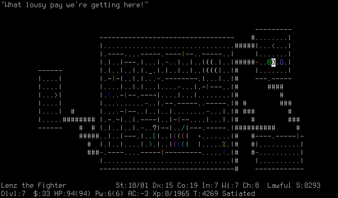
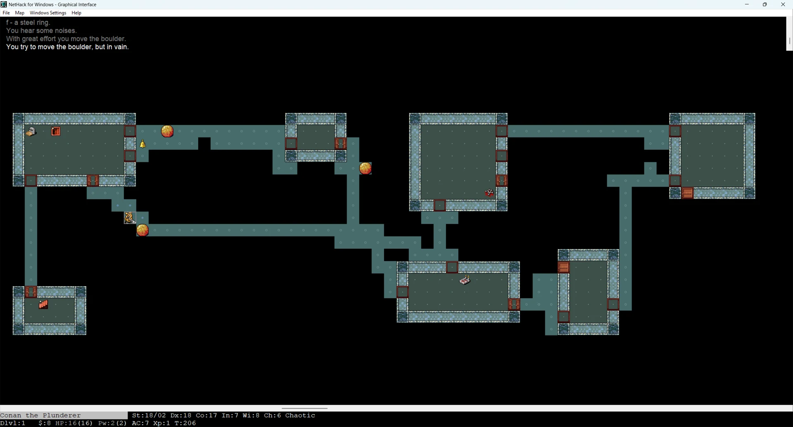
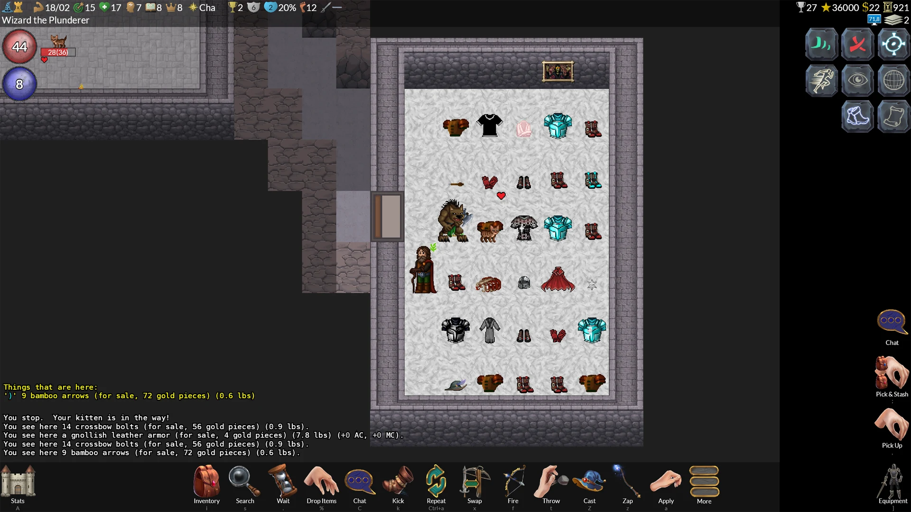
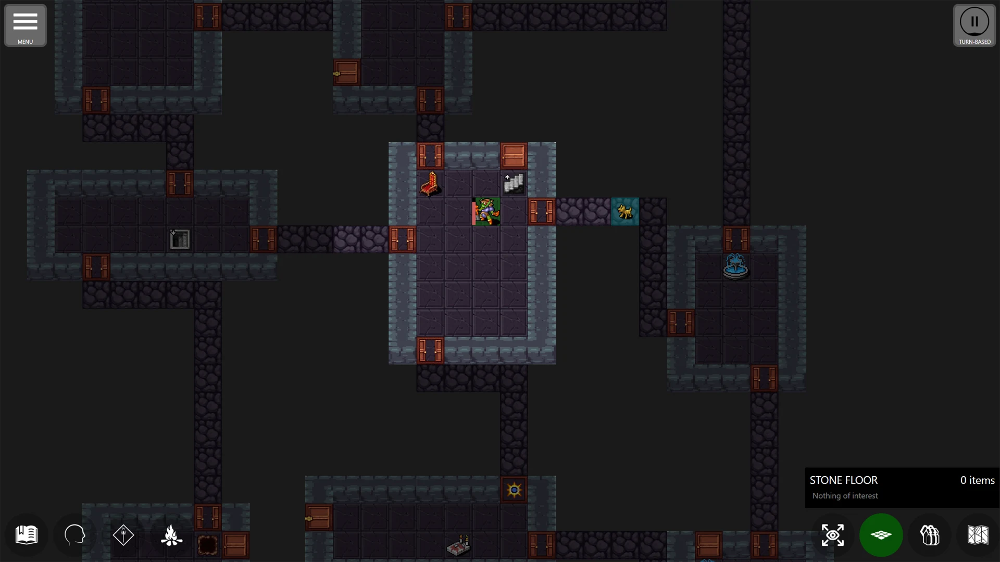
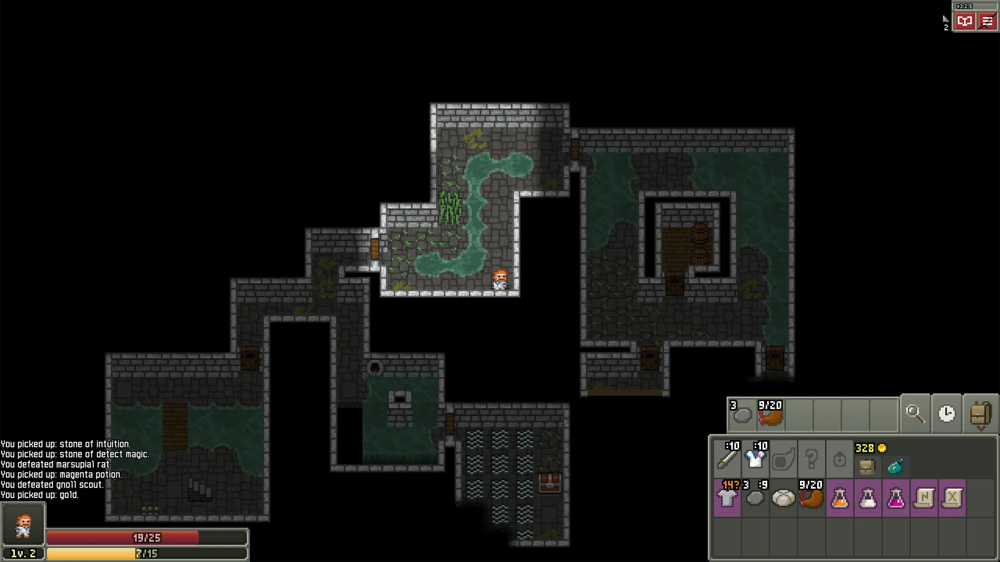

> 👉 **NetHack, GnollHack, Pathos, and Shattered Pixel Dungeon differ in depth, presentation, and the players they are made for.**

## 📖 Overview

| Game | Description | Audience |
|------|-------------|----------|
| **[NetHack](https://www.nethack.org/)** | A complex roguelike first released in 1987. Its items interact in countless ways, which leaves room for emergent strategies. | Hardcore players who want a traditional, challenging text-based game, where survival depends on discovering its many secrets over multiple runs. |
| **[GnollHack](https://gnollhack.com/)** | A modern remaster of NetHack 3.6.2. It keeps the original game's ruleset and adds graphical tiles, animations, a full soundtrack, voiceovers, and difficulty settings. | Hardcore-to-midcore players who want NetHack's depth with modern presentation and touch-friendly mobile controls. |
| **[Pathos](https://pathos-game.onrender.com/)** | An adaptation of the NetHack ruleset, coded from scratch for modern devices. It simplifies the user interface and inventory management but keeps the challenging core mechanics, and it has standard graphical tiles and touch controls. | Midcore players who want an easy way into classic roguelike mechanics on mobile or PC. |
| **[Shattered Pixel Dungeon](https://shatteredpixel.com/)** | A standalone roguelike from the Brogue lineage, with streamlined gameplay, distinct hero classes with customizable skill trees, and pixel-art graphics. | Midcore-to-casual players who want an intuitive roguelike with a balanced difficulty curve. |

## 📊 Feature Comparison

### 📦 Availability

#### Stores

| Platform | Store | NetHack | GnollHack | Pathos | Shattered Pixel Dungeon |
| :------- | :---- | :------ | :-------- | :----- | :---------------------- |
| **Android** | **Google Play** | ❌ | ✅🆓 | ✅🆓 | ✅🆓 |
| **iOS** | **App Store** | ✅🆓 Unofficial (iNetHack2) | ✅🆓 | ✅🆓 | ✅💲 |
| **Linux** | **Steam** | ✅💲 Unofficial (NetHack: Legacy) | ✅🆓 | ⚠️💲 Through Proton | ✅💲 |
| **macOS** | **App Store** | ❌ | ✅🆓 | ✅🆓 | ✅💲 |
| **macOS** | **Steam** | ✅💲 Unofficial (NetHack: Legacy) | ✅🆓 | ❌ | ✅💲 |
| **Windows** | **Steam** | ✅💲 Unofficial (NetHack: Legacy) | ✅🆓 | ✅💲 | ✅💲 |
| **Steam Deck** | **Steam** | ✅💲 Unofficial (NetHack: Legacy) | ✅🆓 | ⚠️💲 Through Proton | ✅💲 |

- 🆓 Free
- 💲 Paid
- ⚠️ Not a native version: the Windows version runs through Proton

> ℹ️ **Note:** Most Windows games on Steam can also be played on Linux and the Steam Deck through **Proton**, Valve's compatibility layer for running Windows games, but not on macOS. Pathos's Steam version is Windows-only, so it can be played on Linux and the Steam Deck this way, but not on a Mac. GnollHack's Windows version does not run on Proton, but GnollHack has a native [[Linux Version]] on Steam, which is also the version the Steam Deck runs. Pathos's Steam edition was released on November 4, 2026; its other versions remain free.

#### GitHub

All GitHub downloads are free.

| Platform | NetHack | GnollHack | Pathos | Shattered Pixel Dungeon |
| :------- | :------ | :-------- | :----- | :---------------------- |
| **Android** | ✅ Unofficial | ❌ | ❌ | ✅ |
| **iOS** | ❌ | ❌ | ❌ | ❌ |
| **Linux** | ✅ Unofficial | ✅ | ✅ Unofficial | ✅ |
| **macOS** | ✅ Unofficial | ❌ | ❌ | ✅ |
| **Windows** | ✅ Unofficial | ✅ | ❌ | ✅ |
| **Steam Deck** | ❓ | ❌ Get it on Steam | ❓ | ✅ |

#### Website

| Platform | NetHack | GnollHack | Pathos | Shattered Pixel Dungeon |
| -------- | :-----: | :-------: | :----: | :---------------------: |
| **Android** | ❌ | ❌ | ✅ | ❌ |
| **iOS** | ❌ | ❌ | ❌ | ❌ |
| **Linux** | ❌ | ❌ | ❌ | ❌ |
| **macOS** | ❌ | ❌ | ❌ | ❌ |
| **Windows** | ✅ | ❌ | ✅ | ❌ |

### 🌐 Localization

| Feature | NetHack | GnollHack | Pathos | Shattered Pixel Dungeon |
|---------|:-------:|:---------:|:------:|:-----------------------:|
| **Multilingual** | ❌ | ❌ | ✅ | ✅ |

### ✨ Features

| Feature | NetHack | GnollHack | Pathos | Shattered Pixel Dungeon |
|---------|:-------:|:---------:|:------:|:-----------------------:|
| **Graphics** | ✅1  | ✅ | ✅ | ✅ |
| **Real animations** | ❌ | ✅ | ✅ | ✅ |
| **Sound effects and music** | ❌ | ✅ | ✅ | ✅ |
| **Voiceovers** | ❌ | ✅ | ❌ | ❌ |
| **Difficulty levels** | ❌ | ✅ | ❌ | ❌ |
| **In-game item information** | ❌ | ✅ | ✅ | ✅ |
| **In-game hints** | ✅2  | ✅ | ✅ | ✅ |
| **Full mobile UI**3 | ❌ | ✅ | ✅ | ✅ |
| **Game Advisor** | ❌ | ✅4 | ❌ | ❌ |

- 1 Support varies by platform and solution.
- 2 But consulting the [[/Monsters/Oracle]] costs gold.
- 3 No on-screen keyboard.
- 4 The [[Gnoll Overseer]] uses frontier AI models for its advice.

### 🎮 Controller Support

A game has real controller support when it reads the controller itself and has an interface built for it. A game without it can often still be played with a controller on Steam, because Steam Input can map the buttons to keys and the mouse, but then the controller merely *works*: you move a mouse cursor with a stick and press buttons that stand in for keys.

| Game | Controller Support | Details |
| :--- | :----------------- | :------ |
| **NetHack** | ❌ None | Keyboard and mouse only. NetHack: Legacy on Steam has no controller support either. |
| **GnollHack** | ✅ Dedicated | Radial menus, on-screen button hints, and controller navigation of every menu, the settings, this wiki, and the [[Gnoll Overseer]]. Works with the Steam Deck's built-in controls and with controllers such as Xbox controllers on Windows, Linux, and macOS. Not available on Android or iOS. See [[Steam Deck Controls]]. |
| **Pathos** | ⚠️ Partial | Steam lists partial controller support, and the Steam page mentions controller support on the Steam Deck. The interface is designed for touch first. |
| **Shattered Pixel Dungeon** | ✅ Dedicated | Built into the game since 2022, with an analog stick cursor, button bindings, and radial menus. |

### 🎯 Audience and History

| Topic | NetHack | GnollHack | Pathos | Shattered Pixel Dungeon |
| :---- | :-----: | :-------: | :----: | :---------------------: |
| **Game complexity** | Hardcore | Hardcore–Midcore | Midcore | Midcore–Casual |
| **Codebase based on** | Hack | NetHack 3.6.2 | Coded from scratch | Pixel Dungeon |
| **Graphical user interface release year** | 2002 | 2023 | 2015 | 2012 |
| **Main inspiration for game design** | Rogue | NetHack | NetHack | Brogue |

## 🖼️ Screenshots

### 🏛️ NetHack

#### NetHack's Traditional ASCII UI

A screenshot of NetHack's traditional ASCII (text-based) UI:

#### NetHack Windows GUI

A screenshot of NetHack Windows GUI with the Nevanda tileset (32x32-pixel tiles):

### 🐺 GnollHack

A screenshot of GnollHack's modern Windows client:

### ⚔️ Pathos

A screenshot of Pathos on Windows:

### 💎 Shattered Pixel Dungeon

A screenshot of Shattered Pixel Dungeon on Windows:

## 📖 See Also

- **[[GnollHack vs. Pathos vs. NetHack]]**
- **[[Comparisons to Other Games]]**
