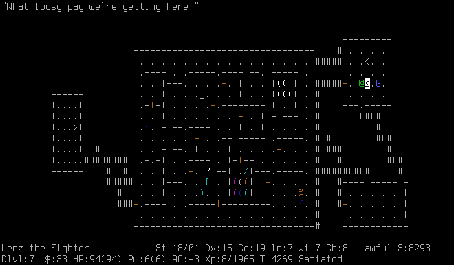
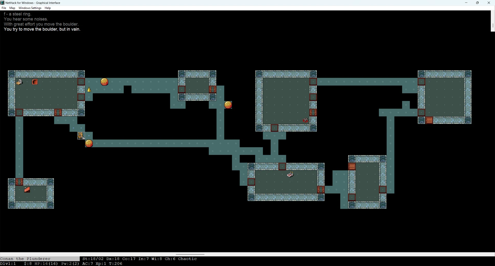
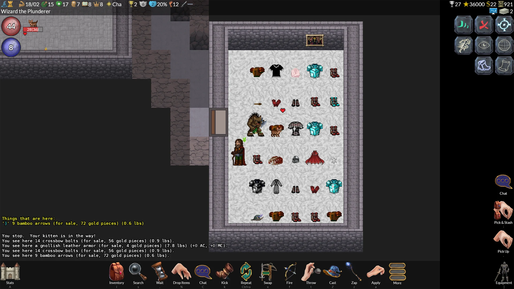
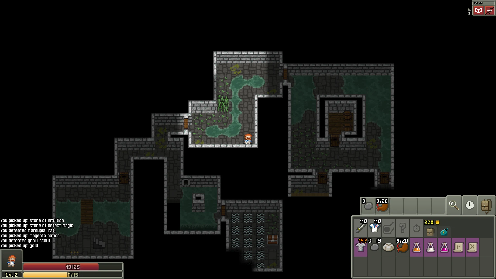

> 👉 **GnollHack is a fork of NetHack 3.6.2 and runs NetHack's own code. Pathos (2015) was written from scratch, with monsters and items from NetHack and SLASH'EM but rules of its own. Shattered Pixel Dungeon (2014) and Dungeon Crawl Stone Soup (2006) are forks of Pixel Dungeon and Linley's Dungeon Crawl, games written independently of NetHack.**

## 📖 Overview

| Game | First Release | Based On | Main Inspiration |
| :--- | :------------ | :------- | :--------------- |
| **[NetHack](https://www.nethack.org/)** | 1987 | [Hack](https://en.wikipedia.org/wiki/Hack_(video_game)) | [Rogue](https://en.wikipedia.org/wiki/Rogue_(video_game)) |
| **[GnollHack](https://gnollhack.com/)** | • 2023: Mobile • 2025: Desktop • 2026: Steam Deck | A fork of NetHack 3.6.2 | NetHack |
| **[Pathos](https://pathos-game.onrender.com/)** | 2015 | Written from scratch, with [[its own rules|GnollHack vs. Pathos vs. NetHack]] | NetHack and [SLASH'EM](https://nethackwiki.com/wiki/SLASH%27EM) |
| **[Shattered Pixel Dungeon](https://shatteredpixel.com/)** | 2014 | A fork of [Pixel Dungeon](https://en.wikipedia.org/wiki/Pixel_Dungeon) | [Brogue](https://en.wikipedia.org/wiki/Brogue_(video_game)) |
| **[Dungeon Crawl Stone Soup](https://crawl.develz.org/)** | 2006 | A fork of Linley's Dungeon Crawl | [Moria](https://en.wikipedia.org/wiki/Moria_(1983_video_game)), Hack, and NetHack |

| Game | Graphics | Complexity |
| :--- | :------- | :--------- |
| **NetHack** | ASCII text; tiles in [[some interfaces|Graphical NetHack Ports and Variants]], such as the [[Windows GUI|Comparison of NetHack GUIs]], released in 2002 | Hardcore |
| **GnollHack** | [[Animated|Animations]] high-resolution tiles | Hardcore–Midcore |
| **Pathos** | 2D tiles; the Steam edition has four tile sets: two in pixel art, one semi-realistic, and one ASCII-style | Midcore |
| **Shattered Pixel Dungeon** | Pixel art | Midcore–Casual |
| **Dungeon Crawl Stone Soup** | ASCII text in the console version; 2D tiles in the tiles version and in a web browser | Hardcore–Midcore |

## 📦 Availability

### Stores

#### Mobile

| Game | Android (Google Play) | iOS (App Store) | Notes |
| :--- | :-------------------: | :-------------: | :---- |
| **NetHack** | ❌ | ✅🆓 | Unofficial iOS port: [iNethack2](https://apps.apple.com/us/app/inethack2/id962114968) |
| **GnollHack** | ✅🆓 | ✅🆓 | |
| **Pathos** | ✅🆓 | ✅🆓 | |
| **Shattered Pixel Dungeon** | ✅🆓 | ✅💲 | |
| **Dungeon Crawl Stone Soup** | ✅🆓 | ❌ | Also on [F-Droid](https://f-droid.org/packages/org.develz.crawl/) |

#### Desktop and Console

| Game | Steam: Windows | Steam: macOS | Steam: Linux | Steam Deck |
| :--- | :------------: | :----------: | :----------: | :--------: |
| **NetHack**1 | ✅💲 | ✅💲 | ✅💲 | ✅💲 |
| **GnollHack** | ✅🆓 | ✅🆓 | ✅🆓 | ✅🆓 |
| **Pathos**2 | ✅💲 | ❌ | ⚠️💲 | ⚠️💲 |
| **Shattered Pixel Dungeon** | ✅💲 | ✅💲 | ✅💲 | ✅💲 |
| **Dungeon Crawl Stone Soup** | ❌ | ❌ | ❌ | ❌ |

- 🆓 Free
- 💲 Paid
- ⚠️ Not a native version: the Windows version runs through Proton
- 1 An unofficial port, [NetHack: Legacy](https://store.steampowered.com/app/837200/NetHack_Legacy/).
- 2 Pathos also runs on Xbox.

### GitHub

All GitHub downloads are free.

| Game | Windows | macOS | Linux | Steam Deck | Android |
| :--- | :-----: | :---: | :---: | :--------: | :-----: |
| **NetHack** | ✅1 | ✅1 | ✅1 | ❓ | ✅1 |
| **GnollHack** | ✅ | ✅ | ✅ | ❌2 | ❌ |
| **Pathos** | ❌ | ❌ | ⚠️3 | ❓ | ❌ |
| **Shattered Pixel Dungeon** | ✅ | ✅ | ✅ | ✅ | ✅ |
| **Dungeon Crawl Stone Soup** | ✅ | ✅ | ✅ | ❓ | ❌ |

- 1 Unofficial builds.
- 2 Get it on Steam.
- 3 An unofficial build that runs the Windows version with Wine.

### Website

All website downloads are free. None of the five games has an iOS download outside the App Store.

| Game | Windows | macOS | Linux | Android |
| :--- | :-----: | :---: | :---: | :-----: |
| **NetHack** | ✅ | ❌ | ❌ | ❌ |
| **GnollHack** | ❌ | ❌ | ❌ | ❌ |
| **Pathos** | ✅ | ❌ | ❌ | ✅ |
| **Shattered Pixel Dungeon** | ❌ | ❌ | ❌ | ❌ |
| **Dungeon Crawl Stone Soup**1 | ✅ | ✅ | ✅2 | ❌ |

- 1 The website's download links point to its GitHub releases.
- 2 Also its own package repository for Debian and Ubuntu.

### Web Browser

Three of the five games can be played in a web browser for free, with nothing to install.

| Game | Web Browser | Where to Play |
| :--- | :---------: | :------------ |
| **NetHack** | ✅ | On public servers such as [NAO](https://alt.org/nethack/) and [Hardfought](https://www.hardfought.org/), in a web terminal |
| **GnollHack** | ❌ | |
| **Pathos** | ✅ | On its website |
| **Shattered Pixel Dungeon** | ❌ | |
| **Dungeon Crawl Stone Soup** | ✅ | In WebTiles, on public servers [listed on its website](https://crawl.develz.org/play.htm), such as [crawl.akrasiac.org](https://crawl.akrasiac.org/) and [cbro.berotato.org](https://cbro.berotato.org/) |

## ✨ Features

### Presentation

| Game | Animations | Music | Voiceovers | Several Languages | Full Mobile UI1 |
| :--- | :--------: | :---: | :--------: | :---------------: | :------------------------: |
| **NetHack** | ❌ | ❌2 | ❌ | ❌ | ❌ |
| **GnollHack** | ✅ | ✅ | ✅ | ❌ | ✅ |
| **Pathos** | ✅ | ✅ | ❌ | ✅ | ✅ |
| **Shattered Pixel Dungeon** | ✅ | ✅ | ❌ | ✅ | ✅ |
| **Dungeon Crawl Stone Soup** | ⚠️3 | ❌4 | ❌ | ⚠️5 | ❌ |

- 1 No on-screen keyboard.
- 2 [[NetHack 5.0|NetHack 5.0 vs. GnollHack Release 3]] has only a few sound effects (musical instruments, squeaky boards, gaining or losing a level), and no music. GnollHack, Pathos, and Shattered Pixel Dungeon have both sound effects and music.
- 3 Animations for spells, ranged attacks, and abilities, and animated water, altars, and torches, but the monster and character tiles are still images.
- 4 No music, and no sound effects out of the box: a player can set the game to play their own sound files when chosen messages appear.
- 5 Partial translations into 19 languages, mostly of longer texts such as god and monster descriptions. The rest of the text stays in English.

### Help and Guidance

| Game | Item Information | In-Game Hints | Game Advisor |
| :--- | :--------------: | :-----------: | :----------: |
| **NetHack** | ❌ | ✅1 | ❌ |
| **GnollHack** | ✅ | ✅ | ✅2 |
| **Pathos** | ✅ | ✅ | ❌ |
| **Shattered Pixel Dungeon** | ✅ | ✅ | ❌ |
| **Dungeon Crawl Stone Soup** | ✅ | ✅3 | ❌ |

- 1 But consulting the [[/Monsters/Oracle]] costs gold.
- 2 The [[Gnoll Overseer]] uses frontier AI models for its advice.
- 3 A tutorial, and a hints mode that gives help as you play.

### Ways to Play

| Game | Difficulty Levels | Party Play and Co-op | Real-Time Mode | Map Editor |
| :--- | :---------------: | :------------------: | :------------: | :--------: |
| **NetHack** | ❌ | ❌ | ❌ | ❌ |
| **GnollHack** | ✅1 | ❌ | ❌ | ❌ |
| **Pathos** | ❓2 | ✅3 | ✅ | ✅ |
| **Shattered Pixel Dungeon** | ❌ | ❌ | ❌ | ❌ |
| **Dungeon Crawl Stone Soup** | ❌ | ❌ | ❌ | ❌ |

- 1 Seven [[difficulty levels]], from [[/Difficulties/Standard]] to [[/Difficulties/Grand Master]].
- 2 Steam lists Pathos under Adjustable Difficulty, but its store pages do not describe a difficulty setting.
- 3 A party of up to six heroes, split-screen co-op, and co-op over a network.

GnollHack also lets you choose whether death is permanent, with two toggles in its settings:

| Mode | Permadeath | Saved Game Loading |
| :--- | :--------: | :----------------- |
| [[Modern Mode]] | ❌1 | Only once |
| [[Casual Mode]] | ❌1 | Multiple times |
| [[Classic Mode]] | ✅ | Only once |
| [[Casual-Classic Mode]] | ✅ | Multiple times |

- 1 A character who dies resurrects at the starting altar or another checkpoint.

## 🎮 Controller Support

A game has real controller support when it reads the controller itself and has an interface built for it. A game without it can often still be played with a controller on Steam, because Steam Input can map the buttons to keys and the mouse, but then the controller merely *works*: you move a mouse cursor with a stick and press buttons that stand in for keys.

| Game | Controller Support | Details |
| :--- | :----------------- | :------ |
| **NetHack** | ❌ None | Keyboard and mouse only. NetHack: Legacy on Steam has no controller support either. |
| **GnollHack** | ✅ Dedicated | Radial menus, on-screen button hints, and controller navigation of every menu, the settings, this wiki, and the [[Gnoll Overseer]]. Works with the Steam Deck's built-in controls, with controllers such as Xbox controllers on Windows, Linux, and macOS, and with USB, Bluetooth, and clip-on controllers on Android and iOS since version 3.42. See [[Steam Deck Controls]]. |
| **Pathos** | ⚠️ Partial | Steam lists partial controller support, and the [Steam page](https://store.steampowered.com/app/5062560/Pathos/) mentions controller support on the Steam Deck. The interface is designed for touch first. |
| **Shattered Pixel Dungeon** | ✅ Dedicated | Built into the game since 2022, with an analog stick cursor, button bindings, and radial menus. |
| **Dungeon Crawl Stone Soup** | ❌ None | Keyboard and mouse on desktop, and touch with a virtual keyboard on Android. |

## 🖼️ Screenshots

### NetHack

The Windows GUI with the Nevanda tileset, which has 32x32-pixel tiles:

### GnollHack

### Pathos

### Shattered Pixel Dungeon

### Dungeon Crawl Stone Soup

<small>***Source:** The tiles version 0.27.1 on Windows. Screenshot by Darkwolf812, [CC BY-SA 4.0](https://creativecommons.org/licenses/by-sa/4.0/), from [Wikimedia Commons](https://commons.wikimedia.org/wiki/File:DCSS_Tiles_Screenshot.png), converted to WebP.*</small>

## 📖 See Also

- **[[Comparisons to Other Games]]**

## 📅 Validity

The GnollHack details are valid for GnollHack 3.39 (4.3.0 Build 39), checked on November 8, 2026, except for controller support, which is as of version 3.43, checked on November 21, 2026. The store listings, prices, and platforms of NetHack, Pathos, and Shattered Pixel Dungeon were checked on the same day. The Pathos features follow its developer's list of differences from NetHack, as of November 20, 2026. The Dungeon Crawl Stone Soup details are valid for version 0.34.1, checked on November 21, 2026.
