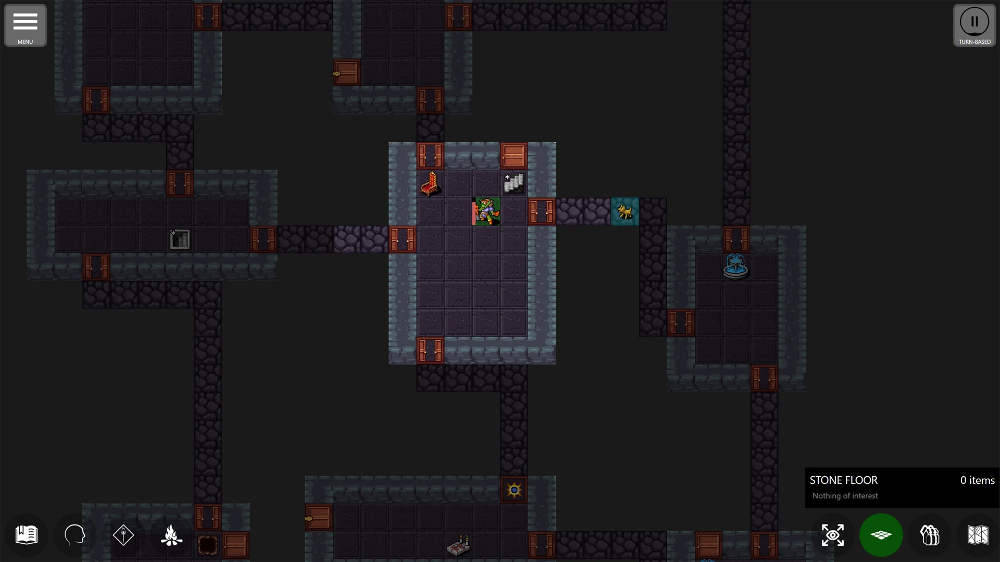
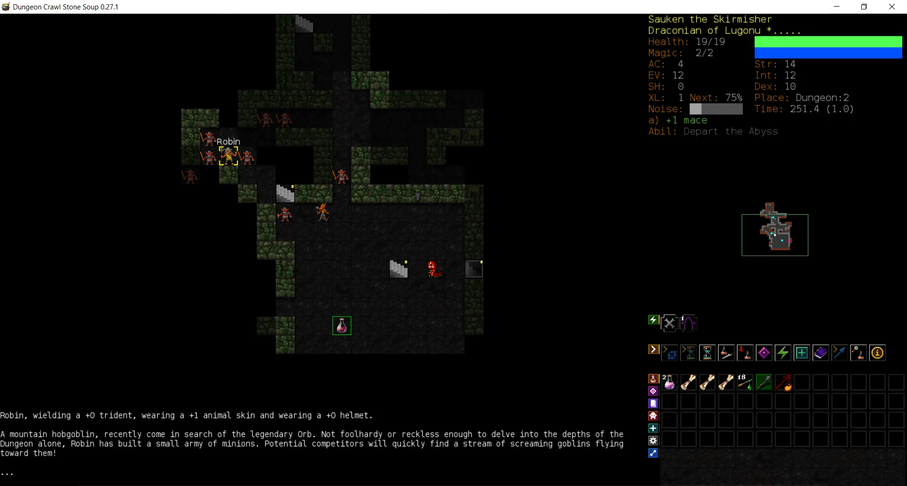

> 👉 **GnollHack runs on NetHack's own code, Pathos borrows only its monsters and items, and Shattered Pixel Dungeon and Dungeon Crawl Stone Soup come from other families of games, Pixel Dungeon and Linley's Dungeon Crawl.**

## 📖 Overview

| Game | First Release | Based On | Main Inspiration |
| :--- | :------------ | :------- | :--------------- |
| **[NetHack](https://www.nethack.org/)** | 1987 | Hack | Rogue |
| **[GnollHack](https://gnollhack.com/)** | 2023, on mobile; developed since July 2019 | A fork of NetHack 3.6.2 | NetHack |
| **[Pathos](https://pathos-game.onrender.com/)** | 2015 | Written from scratch, with [[its own rules|GnollHack vs. Pathos vs. NetHack]] | NetHack and SLASH'EM |
| **[Shattered Pixel Dungeon](https://shatteredpixel.com/)** | 2014 | A fork of Pixel Dungeon | Brogue |
| **[Dungeon Crawl Stone Soup](https://crawl.develz.org/)** | 2006 | A fork of Linley's Dungeon Crawl | Moria, Hack, and NetHack |

| Game | Graphics | Complexity |
| :--- | :------- | :--------- |
| **NetHack** | ASCII text; tiles in some interfaces, such as the Windows GUI, released in 2002 | Hardcore |
| **GnollHack** | Animated high-resolution tiles | Hardcore–Midcore |
| **Pathos** | 2D tiles; the Steam edition has four tile sets: two in pixel art, one semi-realistic, and one ASCII-style | Midcore |
| **Shattered Pixel Dungeon** | Pixel art | Midcore–Casual |
| **Dungeon Crawl Stone Soup** | ASCII text in the console version; 2D tiles in the tiles version and in a web browser | Hardcore–Midcore |

Shattered Pixel Dungeon has six heroes, each with two subclasses and over 25 talents to spend points on.

## 📦 Availability

### Stores

| Game | Android (Google Play) | iOS (App Store) | Notes |
| :--- | :-------------------: | :-------------: | :---- |
| **NetHack** | ❌ | ✅🆓 | Unofficial iOS port: iNethack2 |
| **GnollHack** | ✅🆓 | ✅🆓 | |
| **Pathos** | ✅🆓 | ✅🆓 | |
| **Shattered Pixel Dungeon** | ✅🆓 | ✅💲 | |
| **Dungeon Crawl Stone Soup** | ✅🆓 | ❌ | Also on F-Droid |

| Game | Steam: Windows | Steam: macOS | Steam: Linux | Steam Deck |
| :--- | :------------: | :----------: | :----------: | :--------: |
| **NetHack**1 | ✅💲 | ✅💲 | ✅💲 | ✅💲 |
| **GnollHack** | ✅🆓 | ✅🆓 | ✅🆓 | ✅🆓 |
| **Pathos** | ✅💲 | ❌ | ⚠️💲 | ⚠️💲 |
| **Shattered Pixel Dungeon** | ✅💲 | ✅💲 | ✅💲 | ✅💲 |
| **Dungeon Crawl Stone Soup** | ❌ | ❌ | ❌ | ❌ |

- 🆓 Free
- 💲 Paid
- ⚠️ Not a native version: the Windows version runs through Proton
- 1 An unofficial port, NetHack: Legacy.

Pathos's Steam edition was released on November 4, 2026. Pathos is free on Google Play, the App Store, the Microsoft Store, and its website, and it also runs on Xbox.

> ℹ️ **Note:** **Proton**, Valve's compatibility layer, runs most Windows games from Steam on Linux and the Steam Deck, but not on macOS. GnollHack's Windows version does not run on Proton; the Steam Deck runs its native [[Linux Version]] instead.

### GitHub

All GitHub downloads are free.

| Game | Windows | macOS | Linux | Steam Deck | Android |
| :--- | :-----: | :---: | :---: | :--------: | :-----: |
| **NetHack** | ✅1 | ✅1 | ✅1 | ❓ | ✅1 |
| **GnollHack** | ✅ | ✅ | ✅ | ❌2 | ❌ |
| **Pathos** | ❌ | ❌ | ⚠️3 | ❓ | ❌ |
| **Shattered Pixel Dungeon** | ✅ | ✅ | ✅ | ✅ | ✅ |
| **Dungeon Crawl Stone Soup** | ✅ | ✅ | ✅ | ❓ | ❌ |

- 1 Unofficial builds.
- 2 Get it on Steam.
- 3 An unofficial build that runs the Windows version with Wine.

### Website

- None of the five games has an iOS download outside the App Store.
- NetHack, Pathos, and Dungeon Crawl Stone Soup also offer downloads on their own websites:
    - NetHack for Windows.
    - Pathos for Windows and Android, along with a version that runs in a web browser.
    - Dungeon Crawl Stone Soup for Windows, macOS, and Linux, from its GitHub releases, along with its own package repository for Debian and Ubuntu.

## ✨ Features

### Presentation

| Game | Animations | Music | Voiceovers | Several Languages |
| :--- | :--------: | :---: | :--------: | :---------------: |
| **NetHack** | ❌ | ❌1 | ❌ | ❌ |
| **GnollHack** | ✅ | ✅ | ✅ | ❌ |
| **Pathos** | ✅ | ✅ | ❌ | ✅ |
| **Shattered Pixel Dungeon** | ✅ | ✅ | ❌ | ✅ |
| **Dungeon Crawl Stone Soup** | ⚠️2 | ❌3 | ❌ | ⚠️4 |

### Help and Guidance

| Game | Item Information | In-Game Hints | Game Advisor | Difficulty Levels |
| :--- | :--------------: | :-----------: | :----------: | :---------------: |
| **NetHack** | ❌ | ✅5 | ❌ | ❌ |
| **GnollHack** | ✅ | ✅ | ✅6 | ✅ |
| **Pathos** | ✅ | ✅ | ❌ | ❓7 |
| **Shattered Pixel Dungeon** | ✅ | ✅ | ❌ | ❌ |
| **Dungeon Crawl Stone Soup** | ✅ | ✅8 | ❌ | ❌ |

### Ways to Play

| Game | Full Mobile UI9 | Web Browser | Party Play and Co-op | Real-Time Mode | Map Editor |
| :--- | :------------------------: | :---------: | :------------------: | :------------: | :--------: |
| **NetHack** | ❌ | ✅10 | ❌ | ❌ | ❌ |
| **GnollHack** | ✅ | ❌ | ❌ | ❌ | ❌ |
| **Pathos** | ✅ | ✅ | ✅11 | ✅ | ✅ |
| **Shattered Pixel Dungeon** | ✅ | ❌ | ❌ | ❌ | ❌ |
| **Dungeon Crawl Stone Soup** | ❌ | ✅12 | ❌ | ❌ | ❌ |

- 1 NetHack 5.0 has only a few sound effects (musical instruments, squeaky boards, gaining or losing a level), and no music. GnollHack, Pathos, and Shattered Pixel Dungeon have both sound effects and music.
- 2 Animations for spells, ranged attacks, and abilities, and animated water, altars, and torches, but the monster and character tiles are still images.
- 3 No music, and no sound effects out of the box: a player can set the game to play their own sound files when chosen messages appear.
- 4 Partial translations into 19 languages, mostly of longer texts such as god and monster descriptions. The rest of the text stays in English.
- 5 But consulting the [[/Monsters/Oracle]] costs gold.
- 6 The [[Gnoll Overseer]] uses frontier AI models for its advice.
- 7 Steam lists Pathos under Adjustable Difficulty, but its store pages do not describe a difficulty setting.
- 8 A tutorial, and a hints mode that gives help as you play.
- 9 No on-screen keyboard.
- 10 On public servers such as NAO and Hardfought, in a web terminal.
- 11 A party of up to six heroes, split-screen co-op, and co-op over a network.
- 12 In WebTiles, on public servers such as crawl.akrasiac.org and cbro.berotato.org.

## 🎮 Controller Support

A game has real controller support when it reads the controller itself and has an interface built for it. A game without it can often still be played with a controller on Steam, because Steam Input can map the buttons to keys and the mouse, but then the controller merely *works*: you move a mouse cursor with a stick and press buttons that stand in for keys.

| Game | Controller Support | Details |
| :--- | :----------------- | :------ |
| **NetHack** | ❌ None | Keyboard and mouse only. NetHack: Legacy on Steam has no controller support either. |
| **GnollHack** | ✅ Dedicated | Radial menus, on-screen button hints, and controller navigation of every menu, the settings, this wiki, and the [[Gnoll Overseer]]. Works with the Steam Deck's built-in controls and with controllers such as Xbox controllers on Windows, Linux, and macOS. Not available on Android or iOS. See [[Steam Deck Controls]]. |
| **Pathos** | ⚠️ Partial | Steam lists partial controller support, and the Steam page mentions controller support on the Steam Deck. The interface is designed for touch first. |
| **Shattered Pixel Dungeon** | ✅ Dedicated | Built into the game since 2022, with an analog stick cursor, button bindings, and radial menus. |
| **Dungeon Crawl Stone Soup** | ❌ None | Keyboard and mouse on desktop, and touch with a virtual keyboard on Android. |

## 🖼️ Screenshots

### NetHack

The Windows GUI with the Nevanda tileset, which has 32x32-pixel tiles:

### GnollHack

### Pathos

### Shattered Pixel Dungeon

### Dungeon Crawl Stone Soup

The tiles version 0.27.1 on Windows. Screenshot by Darkwolf812, [CC BY-SA 4.0](https://creativecommons.org/licenses/by-sa/4.0/), from [Wikimedia Commons](https://commons.wikimedia.org/wiki/File:DCSS_Tiles_Screenshot.png), converted to WebP:

## 📖 See Also

- **[[Comparisons to Other Games]]**

## 📅 Validity

The GnollHack details are valid for GnollHack 3.39 (4.3.0 Build 39), checked on November 8, 2026. The store listings, prices, and platforms of NetHack, Pathos, and Shattered Pixel Dungeon were checked on the same day. The Pathos features follow its developer's list of differences from NetHack, as of November 20, 2026. The Dungeon Crawl Stone Soup details are valid for version 0.34.1, checked on November 21, 2026.
