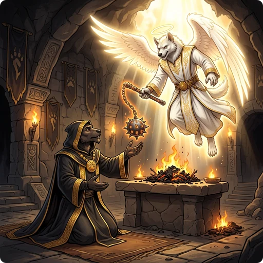

> 👉 **A sacrifice gift is a reward from your god for offering a fresh, acceptable corpse at an altar.**

The gift is usually an artifact. When no suitable artifact is left, your god gives you a powerful ordinary item instead.

## 📜 Requirements for a Gift

Gifts come only from an altar of your own alignment. A sacrifice on a cross-aligned altar never gives one, whether or not it converts the altar. You also need:

- experience level 3 or higher
- Luck 0 or higher, not counting luckstones and other items that change Luck
- a prayer timeout of 0; while it is above 0, the sacrifice reduces the timeout instead
- a god who is not angry and an alignment record that is not negative, because the sacrifice goes toward fixing those first

When all of these hold, the chance of a gift is:

$\cfrac{1}{10 + (2 × \text{Gifts} × \text{Artifacts})}$

where

- $\text{Gifts}$ is the number of previous gifts.
- $\text{Artifacts}$ is the total number of artifacts generated in the game.

The first gift is a 1 in 10 chance. After that, the chance drops with both the number of gifts you have received and the number of artifacts in the game. A sacrifice that gives no gift raises your Luck instead; see [[Sacrifice Offering]].

## ✨ The Gift's Properties

Your god says *"Use my gift wisely!"* and the item appears at your feet.

- It is never cursed.
- Weapons, armor and weapon-tools are made erosion-proof.
- An artifact keeps its normal random enchantment, except that a negative one is raised to +0. A replacement item comes fully charged, and with a positive enchantment if it can be enchanted.
- A bow, crossbow or sling comes with **50 blessed silver arrows, crossbow bolts or sling bullets**. They are erosion-proof and enchanted +0 to +3.
- The skill of a gifted weapon becomes unrestricted, so you can train it even if your role could not before.

## 👑 Guaranteed First Gifts

A few roles have an artifact that their god always picks first, as long as it does not exist yet. The artifact must match the altar's alignment, so only characters of that alignment get it:

| Role | Alignment | Guaranteed Gift |
| :--- | :--- | :--- |
| **Barbarian** | Neutral | [[/Artifacts/Cleaver]] |
| **Samurai** | Lawful | [[/Artifacts/Snickersnee]], then [[/Artifacts/the Kusanagi]] |
| **Valkyrie** | Neutral | [[/Artifacts/Mjollnir]] |
| **Wizard** | Neutral | [[/Artifacts/Magicbane]] |

A chaotic Barbarian or Wizard and a lawful Valkyrie get random gifts. A Samurai gets the Kusanagi as soon as Snickersnee exists, so it is the second gift, or the first if Snickersnee was already found elsewhere.

Gnolls have no guaranteed sacrifice gift. The [[/Artifacts/Howling Flail]] is a Gnoll [[crowning]] gift; by sacrifice it is only one of the random unaligned gifts.

### Monk Weapon Restriction

A Monk's god never gives a weapon artifact. Only the non-weapon artifacts can be chosen: [[/Artifacts/the Holy Grail]], the four artifact rings, and [[/Artifacts/the Rod of Disjunction]], which is a wand.

None of these is neutral, so a Neutral Monk's first gift comes from the unaligned ones, which other characters can get only from their second gift on. The possible first gifts are:

| Alignment | Possible First Gifts |
| :--- | :--- |
| **Lawful** | [[/Artifacts/The Holy Grail]] |
| **Neutral** | [[/Artifacts/The Rod of Disjunction]], [[/Artifacts/The Ring of Conflict]], [[/Artifacts/The Ring of Three Wishes]], [[/Artifacts/The Ruling Ring of Yendor]] |
| **Chaotic** | [[/Artifacts/The Serpent Ring of Set]] |

## ⚖️ Eligible Sacrifice Gifts by Alignment

Without a guaranteed gift, your god picks a random artifact that does not exist yet. Your first gift is one of your alignment's artifacts if any is left. From the second gift on, unaligned artifacts can be picked too.

Your god also skips artifacts tied to a race that yours hates. Humans and elves never get [[/Artifacts/Grimtooth]], the [[/Artifacts/Crossbow of the Gnoll Lords]] or the [[/Artifacts/Howling Flail]], and orcs never get [[/Artifacts/Orcrist]] or [[/Artifacts/Sting]].

### Lawful Gifts

- [[/Artifacts/Demonbane]] (Silver long sword)
- [[/Artifacts/Grayswandir]] (Silver saber)
- [[/Artifacts/Snickersnee]] (Katana)
- [[/Artifacts/Sunsword]] (Long sword)
- [[/Artifacts/The Katana of Masamune]] (Katana)
- [[/Artifacts/The Kusanagi]] (Tsurugi)
- [[/Artifacts/The Mace of Saint Cuthbert]] (Mace)
- [[/Artifacts/The Holy Grail]] (Grail of healing)

### Neutral Gifts

- [[/Artifacts/Cleaver]] (Battle axe)
- [[/Artifacts/Mjollnir]] (Heavy war hammer)
- [[/Artifacts/Magicbane]] (Athame)
- [[/Artifacts/Orcrist]] (Elven broadsword)
- [[/Artifacts/Sting]] (Elven runedagger)
- [[/Artifacts/Vorpal Blade]] (Long sword)
- [[/Artifacts/The Emerald Sword]] (Two-handed sword)

### Chaotic Gifts

- [[/Artifacts/Stormbringer]] (Runesword)
- [[/Artifacts/Mournblade]] (Runesword)
- [[/Artifacts/Grimtooth]] (Orcish dagger)
- [[/Artifacts/The Serpent Ring of Set]] (Ring)
- [[/Artifacts/The Nine Lives Stealer]] (Long sword)

### Unaligned Gifts (Eligible from the 2nd Gift onwards)

- [[/Artifacts/Frost Brand]] (Long sword)
- [[/Artifacts/Fire Brand]] (Long sword)
- [[/Artifacts/Dragonbane]] (Broadsword)
- [[/Artifacts/Werebane]] (Silver saber)
- [[/Artifacts/Giantslayer]] (Long sword)
- [[/Artifacts/Ogresmasher]] (War hammer)
- [[/Artifacts/Trollsbane]] (Morning star)
- [[/Artifacts/Crossbow of the Gnoll Lords]] (Repeating heavy crossbow; not for humans or elves)
- [[/Artifacts/Howling Flail]] (Runed flail; not for humans or elves)
- [[/Artifacts/Luck Blade]] (Ornate broadsword)
- [[/Artifacts/The Ruling Ring of Yendor]] (Ring)
- [[/Artifacts/The Ring of Three Wishes]] (Ring)
- [[/Artifacts/The Ring of Conflict]] (Ring)
- [[/Artifacts/The Rod of Disjunction]] (Wand)
- [[/Artifacts/The Staff-Sling of the Ancients]] (Staff-sling)
- [[/Artifacts/The Mattock of the Titans]] (Dwarvish mattock)
- [[/Artifacts/The Maul of the Titans]] (Two-handed club)

## 🧰 Replacement Items

When a gift is due but no suitable artifact is left, for example because all the eligible ones already exist, or because you are a Monk and every non-weapon artifact is taken, you get a replacement item. The game goes through this list in order and stops at the first row whose condition you meet and whose 50% roll succeeds:

| Order | Condition | Item |
| :---: | :--- | :--- |
| **1** | Strength below 19, and you carry no belt of giant strength | [[/Items/Belt of storm giant strength]] |
| **2** | No reflection, and you carry no item that gives it | [[/Items/Bracers of reflection]] |
| **3** | No magic resistance, and you carry no cloak of magic resistance | [[/Items/Cloak of magic resistance]] |
| **4** | Not very fast, and you carry no gloves of haste or speed boots | [[/Items/Gloves of haste]] or [[/Items/Speed boots]] |
| **5** | No life saving, and you carry no amulet of life saving | [[/Items/Amulet of life saving]] |
| **6** | No flying, and you carry no wings of flying | [[/Items/Wings of flying]] |
| **7** | No death resistance, and you carry nothing that protects from undeath | [[/Items/Ring of protection from undeath]] |

If none of these is given, you get one of the following at random:

- [[/Items/Belt of storm giant strength]] (if your Strength is below 24 and you do not carry one)
- [[/Items/Wand of death]] or [[/Items/Wand of disintegration]]
- [[/Items/Magic marker]]
- [[/Items/Potion of gain level]]
- [[/Items/Potion of lightning speed]] or [[/Items/Potion of greater regeneration]]
