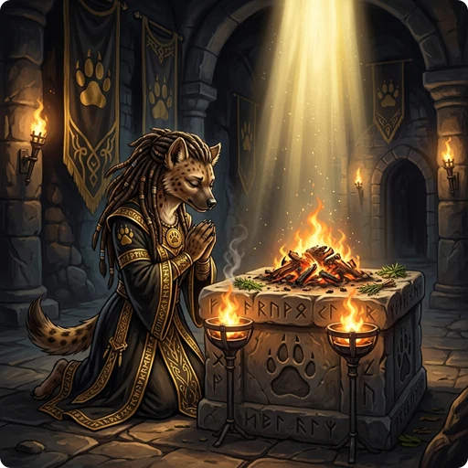

> 👉 **Standing on an altar, you can Offer (`Alt+o`) a fresh corpse to calm your god, shorten your prayer timeout, raise your Luck, convert the altar, or receive a gift.**

## 📖 Overview

Apart from the Amulet of Yendor and its fakes, only **corpses** can be sacrificed, and only fresh ones, killed within the last 50 turns1. Anything else is refused or has no effect.

| Attempted Offering | Condition | Message Seen by Player | Result |
| :--- | :--- | :--- | :--- |
| **Fresh Corpse** | Corpse killed within 50 turns1 | *Depends on character state (see below)* | Corpse is consumed; effects applied |
| **Old Corpse** | Corpse killed more than 50 turns ago1 | *"Nothing happens."* | Corpse is not consumed; action ends |
| **Invalid Item** | Any item that is not a corpse | *"You can't sacrifice that!"* | Item is not consumed; action ends |

- 1 Lizard and lichen corpses do not rot for eating purposes, but they still become too old to be sacrificed after 50 turns. Acid blob corpses are the only corpses that are accepted as fresh regardless of age.

## 🧟 Rotten vs. Fresh Corpses

"Rotten" and "fresh" are separate questions. Rotten is about eating: an undead corpse (a zombie, vampire or mummy, for example) always counts as rotten and makes you sick, however recently it was killed. Fresh is about sacrificing and depends only on age: killed within the last 50 turns.

So a newly killed undead corpse is rotten to eat but fresh to sacrifice. It gives its full value, plus the bonus for Lawful and Neutral characters, with no penalty.

## 💨 Offering Consumption Messages

An accepted corpse disappears with one of these messages:

| Alignment | Blind | Hallucinating | Message Seen by Player |
| :--- | :---: | :---: | :--- |
| **Any** | Any | ✅ | 1. *"Your sacrifice sprouts wings and a propeller and roars away!"*   2. *"Your sacrifice puffs up, swelling bigger and bigger, and pops!"*   3. *"Your sacrifice collapses into a cloud of dancing particles and fades away!"* |
| **Lawful** | ✅ | ❌ | *"Your sacrifice disappears!"* |
| **Lawful** | ❌ | ❌ | *"Your sacrifice is consumed in a flash of light!"* |
| **Neutral** or **Chaotic** | Any | ❌ | *"Your sacrifice is consumed in a burst of flame!"* |

## 🎚️ Corpse Value

Every effect below scales with the corpse's value:

| Corpse State / Condition | Sacrifice Value | Notes |
| :--- | :--- | :--- |
| **Fresh Corpse** | `Difficulty + 1` | Any corpse killed within the last 50 turns. |
| **Old Corpse** | `0` | Any corpse killed more than 50 turns ago. Usually does nothing; [[undead corpses|#undead-corpses]] are the exception. |
| **Partially Eaten Corpse** | Scaled proportionally | Value is reduced based on the remaining nutrition of the corpse. |
| **Maximum Value** | Capped at `24` | |

### 🧟 Undead Corpses

Lawful and Neutral characters get 1 extra point for an undead corpse, even an old one:

| Player Alignment | Corpse Freshness | Final Sacrifice Value | Outcome / Result |
| :--- | :--- | :--- | :--- |
| **Lawful or Neutral** | Fresh (≤ 50 turns) | `Difficulty + 2` | **Success** (Base `Difficulty + 1` + `1` bonus) |
| **Lawful or Neutral** | Old (> 50 turns) | `1` | **Success** (Base `0` + `1` bonus; corpse is consumed) |
| **Chaotic** | Fresh (≤ 50 turns) | `Difficulty + 1` | **Success** (Standard base calculation; no bonus) |
| **Chaotic** | Old (> 50 turns) | `0` | **Failure** (*"Nothing happens."*; corpse is ignored) |

## 🛐 Sacrificing on a Co-Aligned Altar

On an altar of your own alignment, the sacrifice goes to the first of steps 1 to 5 that applies. Step 6 can happen on top of step 3 or step 5.

### 1. Decreasing Anger

If your god is angry, the anger drops by:

$\text{Anger Reduction} = \frac{\text{Corpse Value} \times (2 \text{ if Chaotic else } 3)}{24}$

The message tells you whether any anger is left.

| Outcome | Message Seen by Player | Hallucinating Message | Luck Effect |
| :--- | :--- | :--- | :--- |
| **Anger reduced, but still > 0** | *"[God Name] seems slightly mollified."* | *"[God Name] seems groovy."* | Luck +1 (if negative) |
| **Anger reduced to 0** | *"[God Name] seems mollified."* | *"[God Name] seems cosmic (not a new fact)."* | Luck reset to 0 (if negative) |
| **Anger not reduced** | *"You have a feeling of inadequacy."* | *"The gods seem tall."* | None |

### 2. Decreasing Alignment Penalty

If your god is not angry but your alignment record is negative, the record rises by the corpse's value, but not above 0, and you *"feel partially absolved."*

### 3. Decreasing Prayer Timeout

Otherwise, if your prayer timeout is above 0, it drops by:

$\text{Timeout Reduction} = \frac{\text{Corpse Value} \times (500 \text{ if Chaotic else } 300)}{24 \times (2 \text{ if Priest else } 1)}$

| Character Class | Character Alignment | Max Turn Reduction (Value 24) | Turn Reduction per Value Point |
| :--- | :--- | :--- | :--- |
| **Priest** | Chaotic | 250 turns | 10.4 turns |
| **Priest** | Lawful / Neutral | 150 turns | 6.25 turns |
| **Non-Priest** | Chaotic | 500 turns | 20.8 turns |
| **Non-Priest** | Lawful / Neutral | 300 turns | 12.5 turns |

You can tell from the message whether it reached 0.

| Outcome | Message Seen by Player | Hallucinating Message | Luck Effect |
| :--- | :--- | :--- | :--- |
| **Timeout reduced, but still > 0** | *"You have a hopeful feeling."* | *"You realize that the gods are not like you and I."* | Luck +1 (if negative) |
| **Timeout reduced to 0** | *"You have a feeling of reconciliation."* | *"Overall, there is a smell of fried onions."* | Luck reset to 0 (if negative) |

### 4. Divine Gifts

With no anger, an alignment record that is not negative and no prayer timeout, you may get a gift if you are experience level 3 or higher and your Luck is 0 or more, not counting a [[/Items/luckstone]] or any other item you carry that changes Luck. [[Sacrifice Gifts]] has the odds and the possible items.

### 5. Increasing Luck

If no gift comes, your Luck rises by:

$\text{Luck Increase} = \frac{\text{Corpse Value} \times 10}{48}$

A corpse value of 5 or more raises it by at least 1, and you see one of these messages:

- **Normal:** *"You glimpse a four-leaf clover at your feet."*
- **Blind:** *"You think something brushed your foot."*
- **Hallucinating:** *"You see crabgrass at your feet. A funny thing in a dungeon."*

| Corpse Value | Required Monster Difficulty | Luck Increase |
| :----------: | :-------------------------: | :-----------: |
| **0 to 4** | 0 to 3 (or not fresh) | 0 (No message shown) |
| **5 to 9** | 4 to 8 | +1 |
| **10 to 14** | 9 to 13 | +2 |
| **15 to 19** | 14 to 18 | +3 |
| **20 to 23** | 19 to 22 | +4 |
| **24** | 23+ | +5 |

### 6. Blessing Special Items

When the sacrifice goes to your prayer timeout (step 3) or to your Luck (step 5), the first unblessed special praying item in your inventory, such as a [[/Items/holy symbol]] or a [[/Items/prayerstone]], becomes blessed: *"[Item] softly glows with a [light blue] aura."* This does not happen when the sacrifice calms an angry god, fixes a negative alignment record or brings a gift.

## ⚖️ Sacrificing on a Cross-Aligned Altar

On an altar of another alignment, your alignment record decides what you try: with a record of 0 or more you try to convert the altar, and with a negative record you try to convert yourself.

### 🔄 Converting the Altar to Your Alignment

The chance of converting the altar depends on your experience level:

$\text{Success Chance} = \frac{\text{Level} + 2}{\text{Level} + 8}$

Unaligned "godless" altars outside Gehennom always convert. On an aligned altar, both outcomes start with *"You sense a conflict between [Your God] and [Altar God]."*

| Outcome | Effect | Message Addition |
| :--- | :--- | :--- |
| **Success** | • Altar converts to your alignment.   • Luck increases by 1.   • Any cross-aligned priest present becomes angry. | *"...You feel the power of [Your God] increase. The altar glows [white/gray/black]."* |
| **Failure** | • Altar remains unconverted.   • Luck decreases by 1. | *"...Unluckily, you feel the power of [Your God] decrease."* |

| Character Level | Altar Conversion Success Chance |
| :-------------: | :-----------------------------: |
| **1** | 33.3% |
| **2** | 40.0% |
| **3** | 45.5% |
| **5** | 53.8% |
| **10** | 66.7% |
| **15** | 73.9% |
| **20** | 78.6% |
| **30** | 84.2% |

### 🔄 Converting Yourself to the Alignment of the Altar

You try this when your alignment record is negative, and always when you sacrifice at Moloch's altar in Gehennom. There is no roll. You succeed if you have never converted before and the altar belongs to an aligned god. You fail if you have converted before or the altar is Moloch's. On a godless altar, nothing happens and the corpse stays.

| Outcome | Effect | Message |
| :--- | :--- | :--- |
| **Successful Conversion** | • Alignment base becomes the altar's alignment.   • Luck decreases by 3.   • Prayer timeout increases by 300 turns (150 for Priests). | *"You have a strong feeling that [Your God] is angry... [Altar God] accepts your allegiance."* |
| **Failed Conversion** | • God's anger increases by 3.   • Alignment record decreases by 5.   • Luck decreases by 5.   • Wisdom drops by 2.   • Outside Gehennom, your god smites you (see [[Divine Anger and Smite Outcomes|#divine-anger-smite-outcomes]]). | *"[Altar God] rejects your sacrifice!"*   *"Suffer, infidel!"* |

## 🦄 Special Sacrifices

### 🧑‍🤝‍🧑 Sacrificing Your Own Race

Depending on your alignment and the altar's, a corpse of your own race can bring your god's punishment, destroy the altar, or summon a demon lord who may be hostile. [[Same-Race Sacrifice]] covers the details.

### 🐕 Sacrificing Pets

Offering the corpse of a tame creature gives *"So this is how you repay loyalty?"* Your alignment record drops by 3, you aggravate monsters permanently, and the corpse value becomes -1, which angers the altar's god.

### 🦄 Sacrificing Unicorns

The result depends on how the unicorn's alignment compares with the altar's and yours:

| Altar Alignment | Unicorn Alignment | Outcome | Message |
| :--- | :--- | :--- | :--- |
| **Same as Unicorn** | Any | Wisdom drops by 1 and the corpse value becomes -5, which angers the altar's god. | *"Such an action is an insult to [law/balance/chaos]!"* |
| **Same as Player** | Different from Altar & Player | Alignment record rises by 5 and the corpse value by 3. | *"You feel appropriately [lawful/neutral/chaotic]."* (or *"You feel you are thoroughly on the right path."* when your alignment record is at its limit) |
| **Different from Player** | Same as Player | Your alignment record is set to -1 and the corpse value to 1, so you try to [[convert yourself|#converting-yourself-to-the-alignment-of-the-altar]] to the altar's alignment. | *None* |
| **Any** | Cross-aligned to both Altar and Player | Ordinary sacrifice. Corpse value is increased by 3. | *None* |

## ⚡ Divine Anger & Smite Outcomes

A god smites you after an offering it finds offensive (such as a pet, a unicorn of the altar's alignment, or a fake Amulet you know is fake), a failed attempt to convert yourself, or a same-race sacrifice by a Lawful or Neutral character. A failed prayer can do the same; see [[Praying]].

The god rolls a number from 0 to one less than its maximum anger. Maximum anger is at least 1 and at most 15, and it is calculated differently for your own god and for a cross-aligned god.

### Angering a Cross-Aligned God

$\text{Maximum Anger} = \left\lfloor \frac{\text{Alignment Record}}{2} \right\rfloor + L$

Where $L$ is the Luck modifier:

$L = \begin{cases} - \lfloor \frac{\text{Luck}}{3} \rfloor & \text{if } \text{Luck} > 0 \\ - \text{Luck} & \text{if } \text{Luck} \le 0 \end{cases}$

### Angering Your Own God

$\text{Maximum Anger} = (3 \times \text{God's Anger}) + L$

Where $L$ is the Luck modifier:

$L = \begin{cases} - \lfloor \frac{\text{Luck}}{3} \rfloor & \text{if } \text{Luck} > 0 \text{ or Alignment Record} \ge 4 \text{ (Strident)} \\ - \text{Luck} & \text{otherwise} \end{cases}$

### Outcome

The roll decides what the god does:

| Roll Result | Effect | Message |
| :--: | :--- | :--- |
| **0 or 1** | God is displeased. No stat or mechanical penalty. | *"You feel that [God Name] is displeased."* (or *"bummed"*) |
| **2 or 3** | You lose 1 Wisdom and 1 experience level. | *"Thou hast strayed from the path/art arrogant, [mortal/creature]. Thou must relearn thy lessons!"* |
| **4 or 5** | Random items in your inventory are cursed, and a black glow surrounds you. | *"Thou hast angered me."* |
| **6** | You are punished: a heavy iron ball is chained to your leg. If you already are, random items are cursed instead. | *"Thou hast angered me."* |
| **7 or 9** | A hostile minion is summoned. This happens only if the god is that of your original alignment and you have converted away; otherwise the roll counts as 8. | *"Thou hast strayed from the path, [mortal/creature]. Thou shalt pay for thine indiscretion!"* |
| **8** | A hostile minion is summoned. | *"Thou durst scorn/call upon me? Then die, [mortal/creature]!"* |
| **10+** | A lightning bolt strikes you, then a wide-angle disintegration beam. Reflection or shock immunity stops the bolt, and disintegration resistance stops the beam; otherwise each one kills you. | *"Thou hast angered me."* |

## 👑 The Amulet of Yendor

You win the game by sacrificing the real Amulet of Yendor on the right altar:

| Altar Type & Location | Altar Alignment | Amulet Consumed? | Game Outcome | Key Messages & Effects |
| :--- | :--- | :---: | :--- | :--- |
| **Astral Plane High Altar** | Co-Aligned | ✅ | **Win (Ascended)** | You are bathed in radiance. An invisible choir sings, and you ascend to Demigod/Demigoddess status. |
| **Astral Plane High Altar** | Cross-Aligned | ✅ | **Escape (No Win)** | The opposing god gains dominion over your god, but permits you to live. You escape the dungeon. |
| **Moloch's High Altar** (in the Sanctum) | Moloch (Unaligned) | ✅ | **Death (Game Over)** | Moloch shrugs, retains dominion, and mercilessly snuffs out your life. |
| **Normal Altar** | Co-Aligned | ❌ | **Game Continues** | You are prevented from sacrificing.   *"You feel an urge to return to the surface."* (or *"homesick"* if hallucinating). |
| **Normal Altar** | Cross-Aligned | ❌ | **Game Continues** | You are prevented from sacrificing.   *"You feel ashamed."* (or *"homesick"* if hallucinating). |
| **Normal Altar** | Moloch (Unaligned) | ❌ | **Game Continues** | You are prevented from sacrificing. Moloch gets upset. |

### 🪙 Fake Amulet of Yendor

A fake Amulet of Yendor is **never consumed**. What happens depends on whether you **know** it is a fake (it is identified as a "cheap plastic imitation") or offered it believing it was real (it is unidentified):

| Altar Type | Fake Amulet Identified? | Amulet Consumed? | Game Outcome | Key Effects & Consequences | Message |
| :--- | :---: | :---: | :--- | :--- | :--- |
| **Normal Altar** | ❌ | ❌ | **Game Continues** | Treated as if you offered the real Amulet on a normal altar (see above). No thunderclap or penalty. | *"You feel an urge to return..."* or *"You feel ashamed."* |
| **Normal Altar** | ✅ | ❌ | **Game Continues** | Thunderclap. Luck -3, alignment -1, god's anger +3. Your god gets upset. | *"You hear a nearby thunderclap."*   *(plus "Oh, no." if deaf)* |
| **High Altar** | ❌ | ❌ | **Game Continues** | Thunderclap. You identify the fake amulet and realize your mistake. Luck -1. | *"You hear a nearby thunderclap."*   *"You realize you have made a mistake."* (or *"boo-boo"* if hallucinating) |
| **High Altar** | ✅ | ❌ | **Game Continues** | Thunderclap. Luck -3, alignment -1, god's anger +3. Your god gets upset. On a cross-aligned high altar, the altar's god also strikes you with lightning and a disintegration beam, as for desecrating a high altar. | *"You hear a nearby thunderclap."*   *(plus "Oh, no." if deaf)* |
