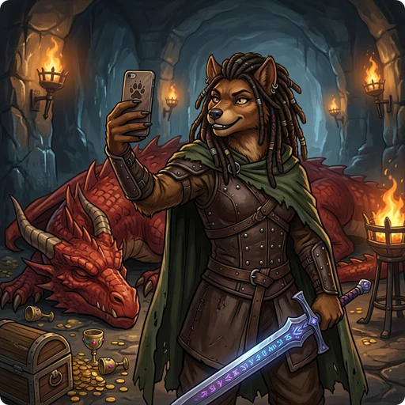

> 👉 **GnollHack can post your progress to Discord, send top scores and bones files to the GnollHack Account server, and export snapshots and replays that you can share anywhere.**

## 🌍 GnollHack Discord Server

The **[GnollHack Discord Server](https://discord.gg/cQuExnzUQy)** is where the community and the developers meet. Its main channels:

| Channel | Purpose |
| :--- | :--- |
| **#playing-gnollhack** | Gameplay discussions and advice |
| **#memes-and-pics** | Sharing memes, funny images, and videos |
| **#snapshots** | Sharing in-game snapshots, screenshots, and dumplogs |
| **#player-log** | Automated live feed of player deaths, achievements, and level-ups |

## ⚙️ Built-in Sharing Features

Progress posts, top scores and bones files go out automatically once you turn them on. Snapshots and replays are shared only when you choose to.

| Feature | What it Shares | Requirements | How to Enable / Use |
| :--- | :--- | :--- | :--- |
| **Automated Progress** | Live game log updates (levels, achievements, deaths) | None | Enable **Post Game Progress** under **Forum Posting Settings** in [[Settings]]. |
| **Top Scores** | High scores, final stats, and HTML dumplogs | [[GnollHack Account]] | Enable **Post Top Scores** under **Server Posting Settings** in [[Settings]]. |
| **Bones Files** | Dead character's inventory, stats, and ghost | [[GnollHack Account]] | Enable **Share Bones Files** under **Server Posting Settings** in [[Settings]]. |
| **In-Game Snapshots** | Active game stats, inventory, and full HTML log | None | Use extended command `#snapshot` or **Take Snapshot** in the game menu. View via **Vault** → **Snapshots** and tap **Share**. |
| **Replays** | Recorded gameplay inputs and logs | None | Enable **Record Game** under **Replay Settings** in [[Settings]]. View via **Vault** → **Replays** and tap **Share**. |

### Automated Discord Game Progress

With **Post Game Progress** on, the game posts your character's major events, such as levels gained, achievements unlocked, and the cause of death, to the **#player-log** channel on the GnollHack Discord. [[Share Your Progress to Discord Server Channel]] has the setup steps.

### Posting Top Scores and Scoreboards

When your game ends:

- If you have registered a [[GnollHack Account]] and turned on **Post Top Scores** under **Server Posting Settings**, the game sends your score and final stats to the GnollHack Account server.
- The server makes the results public, so the [NetHack Scoreboard](https://nethackscoreboard.org) and [Junethack](https://junethack.net) pick up and display your games automatically.
- On the account website, you and other players can look at recent games, overall win rates, and the full HTML dumplogs.

> ℹ️ **Note:** External scoreboards track a game properly only if server posting was enabled from its start.

### Bones Sharing

When your character dies in Classic mode, the body, inventory, and ghost can be uploaded to the server as a "bones file". Other players may then download it and meet your ghost in their own games.

Uploading needs a [[GnollHack Account]] and **Share Bones Files** turned on under **Server Posting Settings**. [[Bones Sharing]] explains how ghost levels work.

### In-Game Snapshots

A snapshot is a detailed log of the game you are playing: your inventory, attributes, status effects, conducted actions, and the recent message log. You can take one at any time, and it shares your game state without recording a full replay.

- To take one, use the extended command `#snapshot` or press **Take Snapshot** in the **Game Menu**.
- To view your snapshots, go to **Vault** on the main screen and tap **Snapshots**. Tapping a snapshot opens its HTML dumplog.
- To share one, tap **Share** at the bottom of the snapshot viewer. Your device's sharing sheet opens, and you can send the file to Discord, Reddit, email, or another app.

### Replays

You can record your games and share the replays, or download and watch other players' runs. To record, turn on **Record Game** under **Replay Settings** in [[Settings]].

You can share a replay through cloud storage or as a ZIP file.

**Cloud storage**

To share:

- Set up a custom **Cloud Storage** connection and turn on **Auto-Upload to Cloud** in [[Settings]], and replays upload automatically.
- Or go to **Vault** → **Replays**, select a local replay, and tap **Upload**.

To watch:

- Go to **Vault** → **Replays** and pick **Cloud** in the folder picker.
- Select the replay you want and tap **Download**.
- Switch the folder picker back to **Downloaded** and play the run from there.

**ZIP file**

To share:

- Go to **Vault** → **Replays**.
- Select the local replay and tap **Share**. The game packs it into a `.zip` archive and opens your device's sharing sheet.

To watch:

- Download the shared `.zip` file to your device.
- On the main screen, go to **About** → **Manage Files** and tap **Import Replays**.
- Select the `.zip` file. The game extracts and validates the replay.
- Back on the main screen, open **Vault** → **Replays** and select the imported replay.

> ⚠️ **Warning:** Replay files should generally match your current game version. Older replays may not play correctly on newer versions.

## 📷 Taking Screenshots

You can also take a screenshot yourself, for example with `Win+Shift+S` on Windows or your mobile device's usual buttons, and post it in the `#playing-gnollhack`, `#snapshots`, or `#memes-and-pics` channel of the GnollHack Discord server. Two settings help:

- **Hide Message History** under **System Settings** in [[Settings]] temporarily hides the message box, so more of the map and UI shows.
- Status bar settings such as **Show Score** and **Show XP** let you choose how much information the screenshot shows.

If you are asking for help, make sure the inventory or stats that matter to your question are visible.
