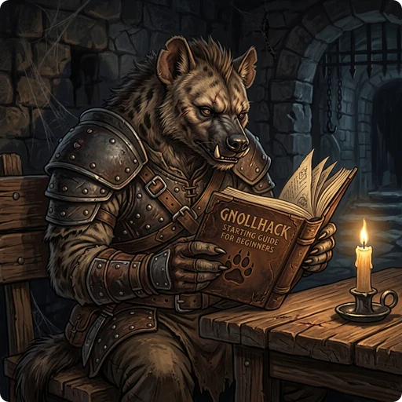

> 👉 **Like NetHack, GnollHack is a dungeon-exploration role-playing game: you go down to the bottom of the dungeon, take the Amulet of Yendor from the sanctuary of Moloch, and bring it back to your god.**

On the way down you collect items, gain experience, and learn new skills. You also run into traps, puzzles, and many dangerous monsters, such as Medusa, whose gaze alone turns you to stone.

## 🗺️ Starting Your Journey

### 💀 Permadeath

The modern version of GnollHack has two modes that decide what happens when you die; both are described, together with casual mode, in [[Choosing the Right Gameplay Mode]].

| Mode | Description |
|---|---|
| 🟢 **Modern Mode** | You respawn at a certain altar when you die. This is the default mode, and the best one for beginners. |
| 🔴 **Classic Mode** | Death is permanent. Once dead, you will need to start the game again from the beginning. |

### 🌟 Difficulty

We recommend that you start on **[[/Difficulties/Standard]]**, the easiest of the seven difficulty levels. On Standard, monsters deal 35% of normal damage and you deal 350%, and you start with four scrolls of identify, a scroll of remove curse, and a wand of probing. When you want a harder game, [[Choosing the Right Difficulty Level]] helps you pick one.

## 🎭 Character Creation

You choose a class (role), a race, and an alignment for your character.

### 🛡️ Classes (Roles)

GnollHack has the same classes as NetHack, often called _roles_.

| Class | Combat Style | Alignment | Description |
| :---- | :----------- | :-------- | :---------- |
| **[[/Roles/Archaeologist]]** | Miscellaneous | Lawful, Neutral | A lightly armored explorer, who starts with a pick-axe and a touchstone. Often considered difficult to play. |
| **[[/Roles/Barbarian]]** | Melee | Neutral, Chaotic | A strong melee warrior, who starts with poison resistance. |
| **[[/Roles/Caveman]]** | Melee | Lawful, Neutral | A strong melee warrior that uses basic weapons, such as clubs and slings. He can practice cannibalism without divine punishment. |
| **[[/Roles/Healer]]** | Spell-Caster | Neutral | A lightly equipped physician, who starts with lots of money, healing spells, healing items, and a wand of sleep. |
| **[[/Roles/Knight]]** | Melee | Lawful | A heavily armored warrior, who is able to ride on his horse and use a lance for jousting his enemies. Follows a special conduct of honor. |
| **[[/Roles/Monk]]** | Miscellaneous | Any | A martial artist with movement spells. Body armor gives a -30 to-hit penalty, and body armor or a shield takes away the Monk's AC and MC bonuses. Loses alignment for eating meat. Gains resistances as they level up. |
| **[[/Roles/Priest]]** | Spell-Caster | Any | An armored zealot skilled in clerical and healing spells. Can naturally identify an item's blessed/uncursed/cursed status on inspection. A lawful Priest can cast [[Celestial spells]], a neutral Priest [[Nature spells]], and a chaotic Priest [[Necromancy spells]]. |
| **[[/Roles/Ranger]]** | Ranged | Neutral, Chaotic | A lightly armored archer, who is adept at ranged combat, searching, and disarming traps. |
| **[[/Roles/Rogue]]** | Melee & Ranged | Chaotic | A lightly armored and cunning thug skilled at both melee and ranged combat, poison, and disarming traps. Can backstab fleeing monsters. |
| **[[/Roles/Samurai]]** | Melee & Ranged | Lawful | A strong melee warrior, who is also adept at ranged combat. [Some item names show up in Japanese](https://nethackwiki.com/wiki/Samurai#Japanese_names_for_items). |
| **[[/Roles/Tourist]]** | Miscellaneous | Neutral | A lightly equipped wanderer starting with darts, a golf club, and an expensive camera. Usually considered a hard class. |
| **[[/Roles/Valkyrie]]** | Melee | Lawful, Neutral | A strong female melee warrior, who starts with cold resistance and stealth. |
| **[[/Roles/Wizard]]** | Spell-Caster | Neutral, Chaotic | A mighty spell-caster proficient in arcane and enchantment spells. Starts with a considerable amount of magic items and spells. |

### 🧑 Races

There are five races, each with its own attribute maximums and special abilities.

| Race | Playable Classes | Max Attributes | Alignment | Special Abilities |
| :--- | :--------------- | :------------- | :-------- | :---------------- |
| **[[/Races/Human]]** | Any | All: 18 (Str 18/100) | Any | None. |
| **[[/Races/Dwarf]]** | Archaeologist, Caveman, Knight, Valkyrie | Dex: 20, Con: 20, Int: 16, Wis: 16, Cha: 16 | Lawful | Infravision. Most dwarves are peaceful. |
| **[[/Races/Elf]]** | Priest, Ranger, Wizard | Con: 16, Int: 20, Wis: 20 | Neutral | Infravision. Most elves are peaceful. |
| **[[/Races/Gnoll]]** | Barbarian, Caveman, Healer, Priest, Rogue, Ranger | Dex: 19, Con: 19, Int: 16, Wis: 16, Cha: 16 | Neutral, Chaotic | Smell rotten food, triple nutrition from tripe, immune to lycanthropy. Most gnolls and dwarves are peaceful. |
| **[[/Races/Orc]]** | Barbarian, Ranger, Rogue, Wizard | Str: 18/50, Int: 16, Wis: 16, Cha: 16 | Chaotic | Poison resistance, infravision, unpunished cannibalism. Most orcs are peaceful. |

### ⚖️ Alignment

There are three alignments. Not every class and race can take every alignment; the tables above show which ones they can.

| Alignment | Conduct Rules | Peaceful Monsters |
| :-------- | :------------ | :---------------- |
| **[[Lawful]]** | Cannot murder peaceful humans or use poisoned weapons. Penalties for "evil" actions like genociding. | Angelic beings, dwarves, titans. |
| **[[Neutral]]** | Cannot murder peaceful humans. | Gnomes, some animals. |
| **[[Chaotic]]** | Mostly no penalties for committing "evil" actions. | Some chaotic monsters, like orcs. |

## 🎒 Survival Fundamentals

### 🕹️ Commands & Interface

The bottom command row shows some of the commands, and the More Commands icon opens a command launcher. GnollHack has plenty of commands available, so don't be overwhelmed by them but learn them at a steady pace. The **Simple Command Layout** option in the settings controls how many commands you see; turn it off to get more of them.

> ℹ️ **Note:** Keyboard shortcuts on this wiki are written in lowercase. A single letter, such as `e`, is the normal key, and combinations are joined with a plus sign: `Shift+e`, `Alt+e`, `Alt+Shift+e`.

### 🎒 Survival Tips

- You start with a pet: a little dog, a kitten, or a pony. On the first levels it is stronger than you, so let it do the fighting. It grows stronger as it eats the monsters it kills.
- GnollHack is turn-based, and nothing happens until you move. In a dangerous spot, stop and think through your options, inventory, and spells.
- When your health is low, find a room, close the door, and rest (`.`) until you recover.
- Explore the whole level and pick up its items before you go down to the next one.
- Never put on or wield an item you have not identified, unless you are ready to be stuck with it if it is cursed.
- Carrying too much makes you Burdened, Stressed, or Strained ([[encumbrance]]). That slows you down a lot, and fast monsters catch you easily. Leave heavy things you do not need in a safe spot, such as a chest.
- Engrave (`Shift+e`) the word `Elbereth` on the floor, and many monsters will be too frightened to attack you in melee while you stand on it. Writing in the dust with your fingers works, but an engraving made with a hard item lasts longer. `Elbereth` is one of the [[Runewords]].

## ⚔️ Combat & Mechanics

### 🛡️ Armor Class and Magic Cancellation

Armor lowers your Armor Class (AC), which makes it harder for monsters to hit you. **Lower AC is better**: -5 AC is much better than 10 AC.

Armor also gives Magic Cancellation (MC), a chance to resist special monster attacks such as lycanthropy or level draining. MC does nothing against spells. Some items give [[magic resistance]], which makes you immune to many spells.

The details are on [[Armor]], [[Armor Class (AC) and Magic Cancellation (MC)]], and [[Resistances and Saving Throws]].

### 🔍 Item Identification

[[Items]] in GnollHack can be *blessed*, *uncursed*, or *cursed*. A cursed weapon you wield, or a cursed item you put on, sticks to you and cannot be removed, and items can also have hidden negative effects. So **identify items before you use them**.

- Drop an item on the ground where your pet walks. Pets avoid stepping on cursed items, and when a pet has to step over one anyway, the game says it does so "reluctantly".
- Any altar, including the one in a [[/Rooms/temple]], shows the status of items dropped on it at once: a black flash means cursed, an amber flash blessed, and no flash uncursed.
- Read a [[/Items/scroll of identify]] or zap a [[/Items/wand of identify]] to identify one or more items.
- Shopkeeper will identify items for a fee, and so will [[the Oracle|/Monsters/Oracle]]. Experienced players can also guess an item's identity from its price in [[/Rooms/shops]].
- Applying a [[/Items/touchstone]] to a gem identifies the gem, as long as the touchstone has charges left; each identification uses one charge. Its blessed or cursed status does not matter for this, but a cursed touchstone shatters the gem instead about one time in five.

### ⚔️ Combat

If you move into a monster, you attack it with your melee [[weapon|Weapons]].

You can fire missiles and throw weapons in the 8 basic directions. To fire, wield the matching launcher: a bow for arrows, a crossbow for bolts, a sling for sling stones. Put the ammunition in your quiver with Quiver (`Shift+q`), then shoot with Fire (`f`). Throw (`t`) throws a weapon from your inventory, and the item's examine information shows how far it can be thrown.

Keep your melee weapon in one weapon set and your ranged weapon in the other. Swap (`x`) switches between them and does not cost a turn.

Your chance to hit depends on the range. At melee range the penalty is large: -40 for fired and thrown weapons, and -32 for crossbows. By default you pick up your fired missiles and thrown weapons automatically.

### 🍗 Eating & Nutrition

You become hungry over time, so eat the corpses of the monsters you kill (a Monk loses alignment for eating meat). **Most corpses rot quickly, so eat them immediately.** A corpse that has been dead too long is tainted: eating it gives you food poisoning, which kills you within 10 to 19 turns unless you Pray (`Alt+p`) to your god.

Some monsters, such as [[kobolds|/Monsters/Kobold]], are poisonous, and you need poison resistance to eat them. The table lists common cases; the [[Eating Guide]] has many more.

| 🟢 Safe / Beneficial | 🔴 Dangerous / Harmful |
|---|---|
| **Normal animals:** [[Jackals|/Monsters/Jackal]], [[sewer rats|/Monsters/Sewer rat]] | **[[Cockatrices|/Monsters/Cockatrice]]:** Do not eat or touch without gloves (instant petrification) |
| **Fruits:** Good vegetarian food | **[[Zombies|/Monsters/Human zombie]] & [[Mummies|/Monsters/Human mummy]]:** Always rotten |
| **Mushrooms:** Some are safe, others poisonous | **[[Bats|/Monsters/Bat]]:** Makes you stunned |
| **Acidic corpses:** Safe, but you lose a few HP | **Teleporting monsters:** Gives teleportitis |
| **Wraith corpses:** Grants an experience level | **Shapeshifters:** Makes you polymorph |
| **[[Floating Eye|/Monsters/Floating eye]] / [[Panther Cap|/Items/Panther cap]]:** Grants blind telepathy | **Your own race:** Unless you are a Caveman or Orc (cannibalism) |
| **[[Lizards|/Monsters/Lizard]]:** Cures petrification, never rots | |

> ⚠️ **Warning:** Do not eat when you are Satiated. You can choke to death.

## 🔮 Magic, Skills & Religion

### ✨ Spell Casting

Spells in GnollHack require a material component. First you Mix spells (`Shift+x`), which gives you a number of castings, and then you Cast spell (`Shift+z`).

Whether a spell succeeds depends on your experience level, the spell's level, your skill in its magic school, your Intelligence, Wisdom, or Charisma, and your armor, since heavy armor penalizes casting (see [[Spell Casting]]).

| Key | Action | Use |
|:---:|---|---|
| `Shift+x` | Mix spells | Prepare spells. |
| `Shift+z` | Cast spell | Cast prepared spells. |
| `r` | Read | Read spellbooks. |
| `Alt+z` | View spell | Manage spells and check their effects. |
| `Shift+s` | Skills | Increase skill levels in magic schools. |
| `.` | Target yourself | Target yourself when casting. |

Spell levels go from minor cantrip (c) and major cantrip (C) up to levels 1–12. You never forget a spell once you know it. To cast the spells of a magic school you usually need at least Basic skill in it, so fighter-type classes with no access to magic schools have little reason to learn spells, except maybe some cantrips.

### 📈 Skills

You gain **1 skill slot** every time you level up, and you spend slots on [[skills]] with the Skills (`Shift+s`) command. Before you can advance a skill, you must train it by fighting with weapons of that skill or by casting spells. Magic school skills are the exception: each of their levels has a minimum experience level, and reaching it is enough, so you do not necessarily need to train them by casting.

There are 6 skill levels: **Unskilled**, **Basic**, **Skilled**, **Expert**, **Master**, and **Grand Master**. Not all classes can reach the top level in every skill. Higher weapon skills generally give better to-hit and damage bonuses. Each level of a magic school adds +100% to your casting chance and lowers the mana cost, and reaching Basic removes the casting penalties.

The number of skill slots an advancement costs depends on the kind of skill:

| Advancement | Normal Weapons, Dual-Weapon, Two-Handed, Wands | Magic Schools, Dodge, Shield, Digging, Riding, Disarm Trap | Bare-Handed Combat | Martial Arts |
|---|:---:|:---:|:---:|:---:|
| **Unskilled → Basic** | 1 | 1 | 1 | 2 |
| **Basic → Skilled** | 2 | 1 | 1 | 3 |
| **Skilled → Expert** | 3 | 2 | 1 | 3 |
| **Expert → Master** | 4 | 2 | 2 | 3 |
| **Master → Grand Master** | 5 | 3 | 2 | 4 |

When you have enough training and free skill slots, a green skill icon or a green "Skill" text appears on your screen.

### 🙏 Praying and Altars

In an emergency, such as low health, sickness, or petrification, you can Pray (`Alt+p`) to your god for help. [[Praying]] explains when it is safe.

> 🛑 **Caution:** Praying is not always safe, because of a delay called the prayer timeout. The first safe time to pray is usually turn 301, and you must wait 50–1000 turns between prayers.

Altars can belong to any alignment, and the starting room on dungeon level 1 always has one of yours. On an altar of your own alignment, Offer (`Alt+o`) fresh monster corpses to please your god. This can raise your luck, or your god may give you a powerful artifact weapon ([[sacrifice gifts]]). A [[/Items/wand of create monster]] is very useful for this.

Sacrificing on an altar of another alignment might convert it to your god. The chance is 50% at experience level 4 and about 70–85% at higher experience levels.

To make holy water, drop uncursed [[potions of water|/Items/potion of water]] on your own altar and pray. Dip (`Alt+d`) an item into holy water to bless it or remove its curse.

## 📖 Further Reading

- [[Intermediate Guide]]
- [[Gnoll Overseer]]

