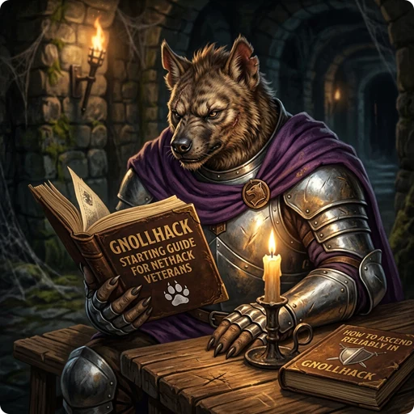

> 👉 **GnollHack changes enough of NetHack 3.6.2 that a veteran should know the new interface, combat, magic, and equipment rules before the first game.**

## 🎖️ Transitioning to GnollHack

### ❓ Why Play GnollHack?

GnollHack is a modern port with a graphical user interface (GUI) for both desktop and mobile devices. It has high-resolution graphics, a multi-layered tile engine, animations, a full musical score, thousands of sound effects and voiceovers.

It is also a faster game. The leveling curve is quicker, and because Gehennom has no mazes outside its special levels, you reach its boss monsters much sooner.

You can dual-wield artifacts, and there are 22 equipment slots. Besides the classic ones, you can equip [[Bracers]], wear [[Robes]] over your body armor, and wear up to 5 [[Miscellaneous Items]] at once, such as belts, earrings, eyeglasses or wings. Many more powerful items turn up as loot, among them [[mythic and legendary items]] with prefix and suffix powers, and [[weapons of higher quality|Exceptional, Elite, Celestial, Primordial, and Infernal Items]]. Examine (`Alt+x`) shows an item's exact stats, damage formulas and magical effects.

For a first game, try a spellcaster such as a [[/Roles/Wizard]], or a hybrid such as an [[/Roles/Archaeologist]], who now starts with a [[/Items/hand crossbow]]. Either one shows you the new spell system and ranged combat. The new [[/Races/Gnoll]] race has its own starting gear.

### 🕹️ Gameplay Mode

The modern interface offers several [[gameplay modes|Choosing the Right Gameplay Mode]]. A new game may start in Modern Mode by default, where a character who dies comes back to life at the starting altar.

For permanent death as in NetHack, set **Classic Mode** to On and leave **Casual Mode** Off when you create the character. Only [[Classic Mode]] games are recorded on the [NetHack Scoreboard](https://nethackscoreboard.org/).

### 🌟 Difficulty

Start somewhere between Adept and Expert.

| Difficulty | Description | Recommended starting point? | 
| :--------- | :---------- | :-------------------------- | 
| [[/Difficulties/Standard]] | Very easy, provides many hints | ❌ No, too easy. |
| [[/Difficulties/Experienced]] | Very easy | ❌ No, too easy. |
| [[/Difficulties/Adept]] | Much easier than NetHack | ✅ Yes, good while you are learning new mechanics. |
| [[/Difficulties/Veteran]] | Easier than NetHack | ✅ Yes, good while you are learning new mechanics. |
| [[/Difficulties/Expert]] | Slightly easier than NetHack | ✅ Yes, required for [NetHack Scoreboard](https://nethackscoreboard.org/) along with the [[Classic Mode]]. |
| [[/Difficulties/Master]] | Harder than NetHack | ❌ No, too hard. |
| [[/Difficulties/Grand Master]] | Very hard | ❌ No, too hard. |

GnollHack's late game is harder than NetHack's.

## 📱 Interface & Controls

Keyboard shortcuts on this wiki are written in lowercase. A single letter, such as `e`, is the plain key, and combinations are written with a plus sign: `Shift+e`, `Alt+e`, `Alt+Shift+e`.

### 🎒 Action Menus and Quick Looting

Open the Inventory (`i`) and click an item or press its letter to get a menu of the actions that apply to it.

Apply (`a`) on a bag is also the quick way to move items between the bag and the floor, and it works when the bag is on the ground, in a chest or inside another bag. After applying the bag, press Drop (`d`) to drop items from the bag straight onto the ground, or Pick up (`p`) to pick up items from the ground straight into the bag.

### ⌨️ Important Command Changes

Swap weapons (`x`) no longer costs a turn. Handedness (`Alt+h`) sets whether it switches both your weapon and shield or only your right-hand weapon.

| Command | Type | Description |
| :--- | :--- | :--- |
| Examine (`Alt+x`) | New | Shows detailed stats and effects of an item. |
| Save (`Alt+s`) | Changed | Moved from `Shift+s`. |
| Skills (`Shift+s`) | Changed | Replaces the NetHack save key. |
| Take off many (`Alt+t`) | Changed | Replaces the old shortcut. |
| Dual weapon mode (`Ctrl+x`) | Changed | Toggle dual-wielding. |
| Chat (`Shift+c`) | Changed | Talk to NPCs. Use Name (`Shift+n` or `Alt+Shift+n`) for naming. |
| Mix spells (`Shift+x`) | New | Prepare spells using material components. |
| View spell (`Alt+z`) | New | View details about your spells. |
| Spell menu (`+`) | New | Open the spell management menu. |
| Abilities (`Shift+a`) | New | View your statistics, attributes, skills, and special abilities, as well as quests, achievements, and the dungeon overview. |
| Character details (`}`) | New | View detailed stats, including alignment. |
| Handedness (`Alt+h`) | New | Toggle whether Swap weapons (`x`) swaps both your weapon and shield or only your right-hand weapon. |
| Dig (`Ctrl+g`) | New | Quick command for digging. |
| Commands menu (`Alt+c`) | New | Open a menu of additional actions. |
| Yell for pets (`Ctrl+y` / `Alt+y`) | New | Call your pets to your location. |

For every key, see [[Keyboard Shortcuts]] and [[Keyboard Command Changes from NetHack]].

## 💪 Character Progression & Magic

### 🧬 Attributes and Abilities

[[Attribute Scores]] no longer go up through exercise. You raise them, and gain other abilities, by eating instead. Ogre corpses give Constitution, nymphs give Charisma (and no longer teleportitis), and giants are worth eating too. Some fruits, such as [[bananas|/Items/banana]] and pomegranates, also grant attribute points; Examine (`Alt+x`) a fruit to see what it does.

- A change in an attribute shows up in your hit points and mana at once. An item that raises your Constitution raises your maximum HP immediately.
- Dexterity adds to your Armor Class. Players and monsters generally have more HP, deal more damage and reach better AC than in NetHack.
- Hit points and mana regenerate much faster.
- The [[experience level]] cap is 50, and levels need much less experience: level 30 takes 204,000 XP, against 100 million in NetHack.

### 🔮 Spell Casting

GnollHack has more [[spells]] than NetHack. Most of them must be prepared with Mix (`Shift+x`) from material components, and each preparation gives you a set number of castings of that spell.

Armor penalizes spells with a somatic component. In heavy armor you cannot cast them reliably, and the penalty can stop you from casting them at all. Priests can generally cast in armor, but Wizards cannot, so a Wizard should wear light armor or robes. [[Spell Casting]] has the casting chances and the armor penalties.

## ⚔️ Combat & Tactical Changes

### 🏹 Ranged Combat Enhancements

Bows and crossbows are good enough to be your main weapons. Firing or throwing at an enemy next to you, however, carries a to-hit penalty of 40 (32 with a crossbow). Shoot while monsters approach, and when they reach you, change to your melee weapon with Swap weapons (`x`).

Missiles such as arrows rarely break. An uncursed one has a 5% chance, and a blessed one breaks only if the target's passive effect damages it.

[[Polearms]] are much better than in NetHack: they hit enemies two squares away in **all** directions, whatever your skill level. A spear can also hit two squares away when applied, once you have at least Basic skill in Spears.

## 🎒 Items, Equipment & Economy

### 🛡️ Items and Equipment

[[Magic Cancellation (MC)|Armor Class (AC) and Magic Cancellation (MC)]] is completely overhauled. It ranges from 0 to 25 instead of 0 to 3, and MC from different items **stacks**. Because of the wider scale, most special attacks from monsters are more dangerous until you build up your MC.

Items can also give a spellcasting penalty, or sometimes a bonus, and heavier armor usually gives a larger penalty. Dragon scale mail is heavier than in NetHack and carries a spellcasting penalty, so it suits Wizards less well. [[/Items/Crystal plate mail]] now grants reflection and is a better body armor for a Wizard.

[[Robes]] have their own slot. A robe's AC and MC do not add to those of your body armor (the game uses the better value), but you can wear both to get their magical properties, for example a [[/Items/robe of magic resistance]] over [[/Items/silver dragon scale mail]].

> ⚠️ **Warning:** Magic resistance no longer protects you from death spells and other instant-death attacks. You need death resistance, which items such as the [[/Items/gown of the archbishops]], the [[/Items/ring of protection from undeath]] and the [[/Items/amulet versus undeath]] give. [[Resistances and Saving Throws]] explains how to gain resistances.

- A blessed [[/Items/scroll of identify]] can no longer identify your whole inventory.
- A [[/Items/touchstone]] identifies gems even when it is uncursed.
- The [[/Items/jinxstone]] is a new cursed gray stone. Kicking is no longer enough to identify every stone, so use a pet to test them safely.
- Wands deal set amounts of damage; a [[/Items/wand of cold]] does `12d6`. You can also Apply (`a`) a wand to an item.
- Among the [[artifacts]], [[/Artifacts/Cleaver]]'s arc attack no longer hits peaceful or tame monsters, and [[/Artifacts/Stormbringer]] will not hit tame creatures.
- [[/Artifacts/Excalibur]] can only be obtained from magic fountains, which are the original NetHack fountains.
- Figurines have been removed from the game.
- [[Unicorn horns|/Items/unicorn horn]] now have charges, but they always work when applied.
- Conflict is no longer a permanent extrinsic, and items that grant it use up charges.
- Some mushrooms are poisonous.

### 🏁 Starting Items

The starting inventory of almost every role has changed. Every role now has a container, such as a sack, a backpack or a leather bag, and everyone gets at least one [[/Items/scroll of identify]]; how many depends on the [[difficulty level|Difficulty Levels]].

[[Rogues|/Roles/Rogue]] get a [[/Items/bag of treasure hauling]], which they need because gold weighs a lot in GnollHack, and [[Wizards|/Roles/Wizard]] a [[/Items/bag of wizardry]]. [[Tourists|/Roles/Tourist]] start with an enchanted [[/Items/golf club]], because throwing darts at an adjacent enemy now takes the heavy to-hit penalty. Some roles have elementally enchanted weapons: Valkyries a cold-enchanted dagger, and Archaeologists lightning-enchanted crossbow bolts for the [[/Items/hand crossbow]] that replaces their boomerang. Healers get new healing salves and a [[/Items/beak mask of sickness resistance]], and Cavemen a [[/Items/prayerstone]].

If you play the new [[/Races/Gnoll]] race, your starting swords and maces become flails, bows become crossbows, and standard armor becomes gnollish gear.

### 🏪 Shops and Economy

Pets can no longer steal from shops, but you find more money over a game, so buy what you need. You will also find many expensive spellbooks, and the ones you do not need are worth selling.

Several kinds of NPCs identify items for you. General storekeepers identify all item types, and other [[shopkeepers|/Rooms/Shops]] the types they sell. The Smith in a [[/Rooms/smithy]], the Geologist in a [[/Rooms/workshop]] and the Artificer in a [[/Rooms/laboratory]] identify certain item types too. Geologists also buy gems and Artificers buy spellbooks, so selling them your unwanted gems and high-level spellbooks brings in a lot of gold in the early and middle game.

In [[temples|/Rooms/Temple]], priests give blessings and sell protection for donations.

## 👹 Dungeon, Monsters & Companions

### 🗺️ Dungeon Features

Your starting room always contains an altar of your own alignment and a stash, a [[/Items/magic chest]] holding 2 to 3 random items. The dungeon generates far more items overall than NetHack does.

The Dungeons of Doom are slightly shorter. Gehennom is shorter too, and it has **no mazes** except on special levels (see [[Dungeon Layout]]).

- There are several types of [[fountains]]. Dip a potion into one to find out which type it is.
- Sinks can be used to [[dilute potions|Diluted Potions]].
- Disarming traps yields items, and magical traps usually yield wands.
- Engraving the new [[rune word|Runewords]] `Gilthoniel` keeps monsters from picking up items or looting containers on that square, which makes it a good place for a stash.

### 👹 Monster Changes

- [[High priests|/Monsters/High priest]], such as the High Priest in the Sanctum, can cast the touch of death. Magic resistance no longer protects you from it. Death resistance makes you immune; without it, only a successful Magic Cancellation (MC) check saves you.
- Liches and other high-level mage casters, including the [[/Monsters/Wizard of Yendor]], can no longer cast the touch of death, so you do not need death resistance against them.
- Only the Wizard of Yendor is still covetous: no other monster teleports to you to steal artifacts or teleports to the stairs to heal. Boss monsters are generally easier in this respect, but they often have new abilities and more HP to make up for it.
- Hitting a monster with a wielded [[/Monsters/cockatrice]] corpse petrifies it only if the effect gets past the monster's MC.
- Undead and mindless monsters are immune to fear. Garlic, Elbereth and scrolls of scare monster still drive undead away.
- The "summon nasties" monster spell has been heavily nerfed.
- As you go deeper, higher-level monsters show up sooner than in NetHack.
- You can hire peaceful monsters to join your party. With high Charisma, this is a good way to get strong allies.

### 🐾 Pets and Companions

Pets find their way with the same pathfinding as the travel command, so they no longer get permanently stuck on the other side of the map. They also attack high-level monsters, which makes them more useful and more likely to die.

You can give items to a pet and tell it to equip, take off or drop them. You can also tell it to stay put, for example to keep it from eating a particular corpse. Your pet's HP and other statistics are shown on the status lines.

### 🏆 Scoring Changes

The [[scoring]] system is completely redesigned. Unlike in NetHack, hoarding gold, gems, artifacts or amulets earns you **no** score, with a few role exceptions: Rogues score for gold and gems, Archaeologists for artifacts, and Cavemen for amulets. Your score comes mainly from how deep you go, the achievements you complete and the difficulty you chose, and, if you ascend, from your conducts and your turn count, where fewer turns are better.

## 📖 Further Reading

- [[How GnollHack differs from NetHack]]
- [[Comparison to Other NetHack Variants]]
- [[Items]]
- [[Monsters]]
- [[How to Cure Various Conditions]]
