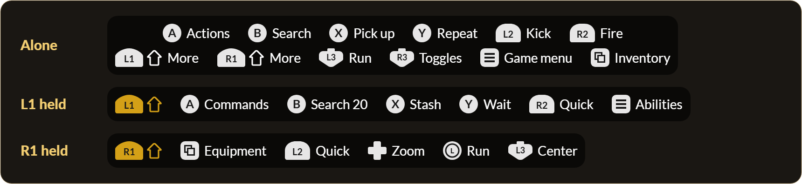
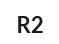
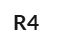
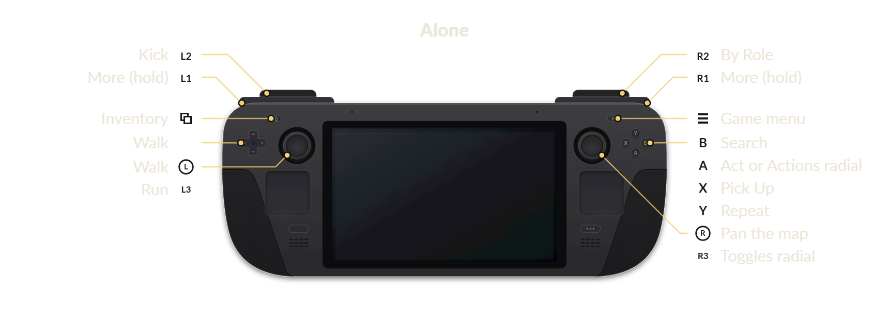
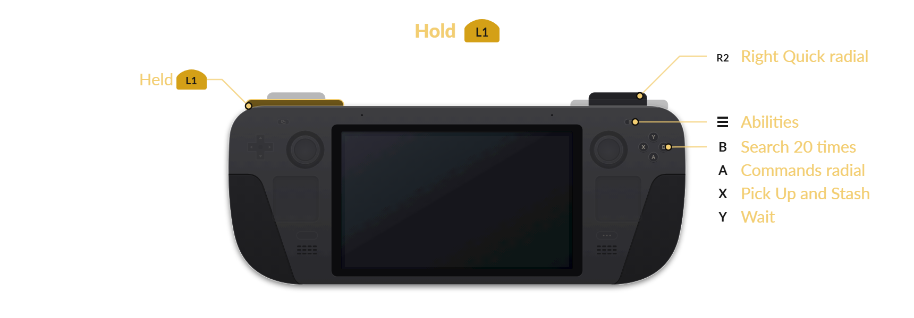
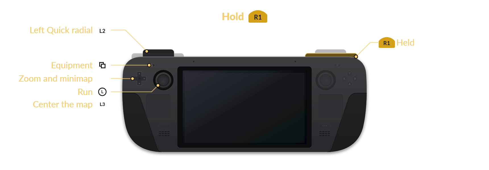
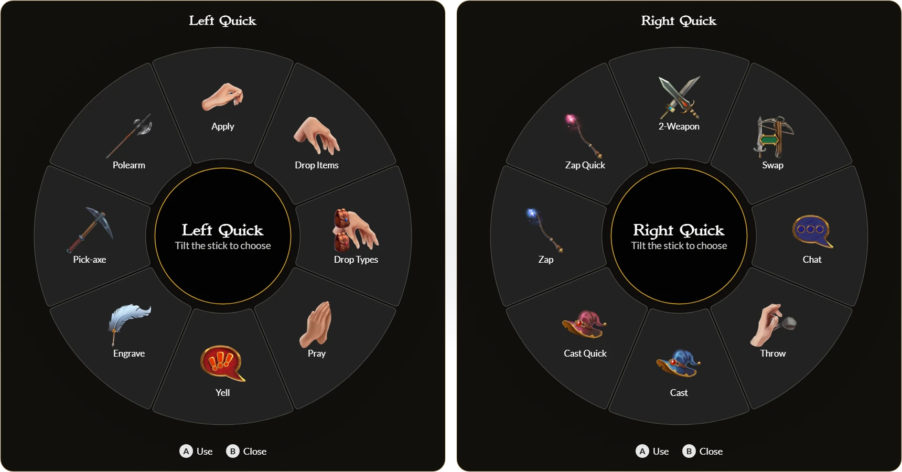
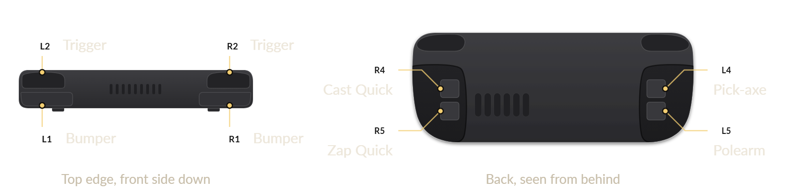
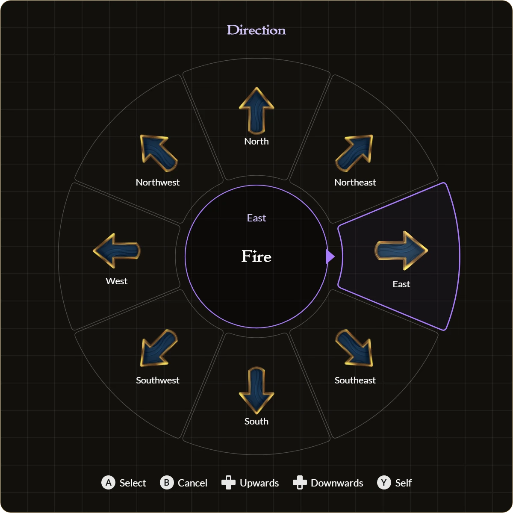
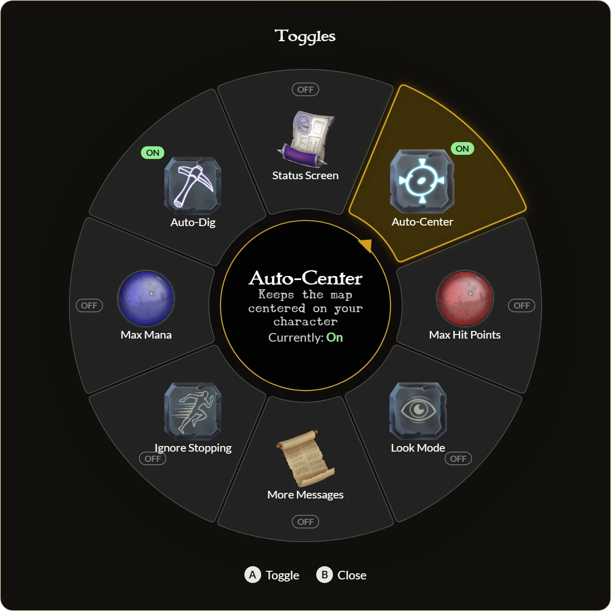

> 👉 **GnollHack can be played with the Steam Deck's built-in controls starting from version 3.32, and with a game controller, such as an Xbox controller, on Windows, Linux, and macOS.**

*Controls of the Steam Deck.*

Button names on this page follow the Steam Deck; see [[Button Names on Other Controllers|#button-names-on-other-controllers]]. A strip of button hints at the bottom of the screen always shows what each button does at the moment, and it changes when you hold L1 or R1.

Touching the screen, using the mouse, or pressing a keyboard key returns the game to its usual on-screen buttons until you use the controller again.

## 🏁 Setting Up the Steam Deck

The **Use Controller** setting is on by default, so you only need to install GnollHack from Steam and start it. The setting is in [[Settings]], under Controller.

GnollHack reads the controls through Steam Input. If the controls do nothing in the game:

1. Press the Steam button and open **Controller Settings**.
2. Select the **Gamepad with Mouse Trackpad** template.

If Steam Input is turned off for the game, turn it on in the game's Properties in Steam, under Controller.

The back grips and the left trackpad's click need GnollHack's own Steam Input layout. The Gamepad with Mouse Trackpad template also sends the right trackpad's click as R3, which opens the Toggles radial menu, rather than as a mouse click. Everything else works with the template.

## 🎮 Controllers on Windows, Linux, and macOS

You can also play with a game controller on the [[Modern Windows Version]], the [[Linux Version]] on a desktop computer, and the [[macOS Version]] from Steam. The controls are the same as on the Steam Deck. Connect the controller and press any button, and the game switches to controller mode. The Controller section of [[Settings]] appears once the game has detected a controller.

| Controller | Windows | Linux | macOS |
| :--------- | :------ | :---- | :---- |
| **Xbox and other XInput controllers** | ✅ Supported | ✅ Supported | ✅ Supported |
| **PlayStation controllers** | Only if Steam presents them as XInput controllers; not tested | Should work; not tested | ✅ Supported |
| **Nintendo controllers** | Only if Steam presents them as XInput controllers; not tested | Should work; not tested | Not tested |
| **Other gamepads** | Only XInput controllers | Should work if the gamepad reports standard gamepad controls; not tested | Controllers that macOS supports as gamepads |

If a controller does nothing on Windows, it may not be an XInput controller. On Linux, your user account may not have permission to read the controller. On macOS, pair a wireless controller in System Settings → Bluetooth first.

Some features are available only on the Steam Deck:

- **Back grips:** Paddles on other controllers, such as the Xbox Elite controllers, are not read.
- **On-screen keyboard:** When the game asks you to type text, such as a wish or a name, type it on a keyboard.

The Android and iOS versions do not have controller support yet, and neither does the iOS version running on a Mac. For more details, see [[/Development/Gamepad Support]].

### 🏷️ Button Names on Other Controllers

The buttons work by position: A is the bottom face button, B the right, X the left, and Y the top. The button hints at the bottom of the screen show the labels of the controller you are using, such as Cross and Circle on a PlayStation controller.

| Button | Steam Deck | Xbox | PlayStation | Nintendo |
| :----- | :--------- | :--- | :---------- | :------- |
| **Face buttons** |     A, B, X, Y |     A, B, X, Y |     Cross, Circle, Square, Triangle |     B, A, Y, X |
| **Bumpers** |   L1, R1 |   LB, RB |   L1, R1 |   L, R |
| **Triggers** |   L2, R2 |   LT, RT |   L2, R2 |   ZL, ZR |
| **Stick clicks** |   L3, R3 |   LS, RS |   L3, R3 |   L3, R3 |
| **Back grips** |     L4, L5, R4, R5 |     P3, P4, P1, P2 |     L4, L5, R4, R5 |     L4, L5, R4, R5 |
| **View and Menu** |   View, Menu |   View (Back), Menu (Start) |   Create, Options |   Minus, Plus |

On Nintendo controllers, the letters follow the buttons' positions, so the bottom face button reads B.

## 🗺️ Controls on the Map

L1 and R1 do nothing on their own. They are hold modifiers that change what the other buttons do. The game's commands and their keyboard shortcuts are listed in [[Commands]].

| Control | Alone | With L1 Held | With R1 Held |
| :------ | :---- | :----------- | :----------- |
|  **A** | The action available on your square; opens the Actions radial menu if there are several | Commands radial menu | |
|  **B** | Search (`s`); first closes an open overlay, and interrupts an ongoing activity | Search 20 times | |
|  **X** | Pick Up (`,`) | Pick Up and Stash (`;`) | |
|  **Y** | Repeat (`Ctrl+a`) | Wait (`.`) | |
|  **R2** | R2's command, by default By Role: Cast Quick for spellcasters, Polearm for Knights, Fire for the others | Right Quick radial menu | |
|  **L2** | L2's command, by default Kick (`k`) | | Left Quick radial menu |
|  **Menu** | Game menu | Abilities (`Shift+a`) | |
|  **View** | Inventory (`i`) | | Equipment (`*`) |
|  **D-pad** | Walk one step per press, repeating while held; press two directions together to walk diagonally | | Up and Down zoom, Left toggles the minimap, and Right returns to normal zoom |
|  **Left stick** | Walk in eight directions | | Run in that direction |
|  **Right stick** | Pan the map | | |
|  **L3** | Run: your next direction on the left stick or the D-pad runs, as the Run prefix (`Shift+g`) does; L3 again or B cancels | | Center the map on your character |
|  **R3** | Toggles radial menu | | |

Holding both L1 and R1 and pressing Y makes your character rest, and pressing R2 or L2 runs that trigger's command. Clicking the left trackpad does the same as pressing L3.

### 🎯 Trigger Commands

R2 and L2 each run a command when you press them alone, by default Fire and Kick. You can set them to any command, or None, in [[Settings]], under Controller. To choose one, press A on the row: a radial menu of every command opens. L1 and R1 change the page, a stick selects, A sets it, and B closes. Left and Right on the row step through the commands one at a time.

If the command asks for a direction while you still hold the trigger, the **Direction** radial menu opens. See [[Choosing a Direction|#choosing-a-direction]]. Force Fight does not open it, because it is a prefix: press the trigger, then a direction on the left stick or the D-pad. Any other button after it gives an invalid direction message.

### ⚙️ Quick Radials

L1 + R2 opens the **Right Quick** radial menu, and R1 + L2 opens the **Left Quick** radial menu. The action that you choose runs at once, and if it asks for a direction, the Direction radial menu opens. Pressing the trigger again closes the radial menu. You can change their eight actions in [[Settings]], under Quick Radials. You choose them the same way.

| Radial Menu | Default Actions |
| :---------- | :-------------- |
| **Right Quick** | 2-Weapon, Swap, Chat, Throw, Cast, Cast Quick, Zap, Zap Quick |
| **Left Quick** | Apply, Drop Items, Drop Types, Pray, Yell, Engrave, Pick-axe, Polearm |

### 🕹️ Back Grips

L4, L5, R4, and R5 default to Pick-axe, Polearm, Cast Quick, and Zap Quick. You can change them in [[Settings]], under Controller.

### 📍 Choosing a Position

When the game asks you to choose a position on the map:

| Control | Action |
| :------ | :----- |
|  **Left stick** | Move the cursor; a full push jumps eight squares |
|  **Right stick** | Pan the map |
|  **A** | Select |
|  **B** | Cancel |
|   **L1 and R1** | Previous and next interesting spot |
|   **L2 and R2** | Previous and next monster |
|  **Y** | Put the cursor on your character |

### 🧭 Choosing a Direction

When the game asks for a direction, the violet **Direction** radial menu opens:

| Control | Action |
| :------ | :----- |
|     **Either stick, or D-pad Left and Right** | Select a direction |
|  **A** | Confirm the selected direction |
|   **D-pad Up and Down** | Choose up (`<`) or down (`>`) at once |
|  **Y** | Choose yourself at once |
|  **B** | Cancel the action |

If you hold L2 or R2 and its command asks for a direction, releasing the trigger confirms the selected direction, or cancels the action if none is selected, and a stick you are already pushing counts at once.

## ⭕ Radial Menus

A radial menu stays open until you choose an item or close it. The exception is the Direction radial menu while its trigger is held, described in [[Choosing a Direction|#choosing-a-direction]].

- Select an item with either stick, or step between items with D-pad Left and Right. D-pad Up and Down jump to the top and bottom items.
- A activates the item, and B closes the menu. Menu closes the menu and opens the game menu.
- L1 and R1 change the page.

The radial menus on the map are:

- **Actions:** The actions available on your square, followed by pages of commands. The first of them is the **Quick Commands** page: Rest, Search 20, Extended, and Skills, Polearm, and Wield Last or Unwield when they are available. Its west and northwest slots hold Quick Command 1 and Quick Command 2, which you can set in [[Settings]], under Controller. The other commands follow in alphabetical order. X switches between the actions on your square and the Quick Commands page.
- **Toggles:** More Messages, Status Screen, Auto-Center, Look Mode, Auto-Dig, Ignore Stopping, Max Hit Points, and Max Mana.

  

  *The Toggles radial menu, with Auto-Center selected.*

- **Left Quick and Right Quick:** The radial menus described in [[Quick Radials|#quick-radials]].

## 📜 Menus and Dialogs

| Control | Action |
| :------ | :----- |
|   **Left stick, D-pad** | Move the focus; in menus, D-pad Left and Right change the page |
|  **Right stick** | Scroll |
|  **A** | Confirm or select the focused item; hold A on a menu row for its count or actions |
|  **B** | Cancel, close, or go back |
|  **X** | Accept the selection in menus |
|  **Y** | Select or unselect all items in menus that allow selecting several |
|   **L1 and R1** | Jump between sections in menus |
|   **L2 and R2** | First or last row in menus |

In a yes/no prompt, Y answers Yes and X answers No when the prompt offers them.

The main menu, Settings, Library, Top Scores, Replays, and other pages work the same way: the focus moves over the rows and the buttons, A presses the focused one, and B goes back. On the main menu, B does nothing, and X starts Play Game, Y opens About, Menu opens Settings, and View opens the Vault. In Settings, L1 and R1 jump between sections, Left and Right change the focused setting, and X shows its explanation.

During a replay, A pauses, L1 and R1 or L2 and R2 change the speed, D-pad Right steps forward, Y opens Go to Turn, and B quits.

## ⌨️ Typing Text

In Gaming Mode, pressing A on a text field opens Steam's on-screen keyboard. The keyboard's Enter confirms the text, and B ends the editing. When the game asks you to type something, such as a wish or a name, the keyboard opens by itself, and Y opens it again.

In Desktop Mode, pressing A only focuses the field. Press the Steam button and X to open the keyboard by hand.

## 🌐 The Wiki and Web Pages

Web pages, such as this wiki, open in the game's in-app browser, where a gold focus ring moves between the links and controls on the page.

| Control | Action |
| :------ | :----- |
|   **D-pad, left stick** | Move to the nearest link or control in that direction |
|  **Right stick** | Scroll |
|  **A** | Follow a link, press a button, or edit a text field |
|  **B** | End a text edit, close an open menu, go back, or close the browser |
|  **X** | Go forward |
|  **Y** | Edit the page's search field |
|   **L1 and R1** | Previous and next section heading |
|   **L2 and R2** | Page up and page down |
|  **L3** | Top of the page |
|  **View** | Move between the article, the sidebar, and the toolbar |
|  **Menu** | Close the browser |

The right trackpad stays a mouse on these pages.

## 🐺 Gnoll Overseer

The [[Gnoll Overseer]] chat page is divided into areas: the menu, the chat controls, the chat list, the messages, and the area where you write. L1 and R1 step through the areas, and View cycles them. The D-pad and the left stick also move between them.

When you are in the writing area:

| Control | Action |
| :------ | :----- |
|  **L2** | Go to the model selector |
|  **R2** | Go to the text entry |
|  **Y** | Open the model selector |
|  **X** | Write in the text entry |

While you are typing text, the D-pad and the left stick move the text cursor, L2 and R2 go to the start and end of the text, and B ends the typing. With nothing else to do, B leaves the page after a confirmation.

## 📁 File Dialogs

In Gaming Mode, and on any platform while you are using the controller, attaching, importing, sharing, and saving files use a file dialog that works with the controller.

| Control | Action |
| :------ | :----- |
|   **D-pad, left stick** | Move between rows and buttons |
|  **Right stick** | Scroll |
|  **A** | Open a place or folder, select a file, or save to a place |
|  **X** | Attach the selected files |
|  **B** | Go up a level, then cancel |
|   **L2 and R2** | First or last row |
|  **Menu** | Cancel |

Files can be attached and imported from Pictures, GnollHack Screenshots, Documents, Downloads, and SD cards. Saved files go to a `GnollHack` folder under Documents, Downloads, or an SD card, and saving never overwrites an existing file.
