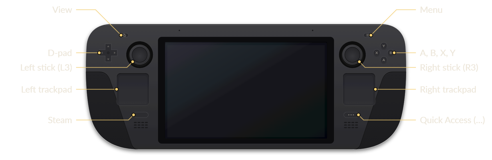
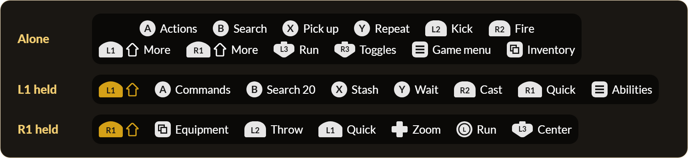
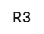
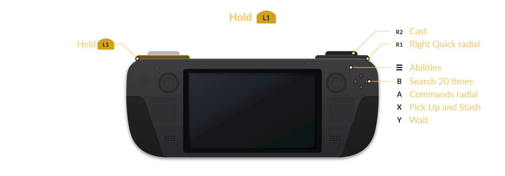
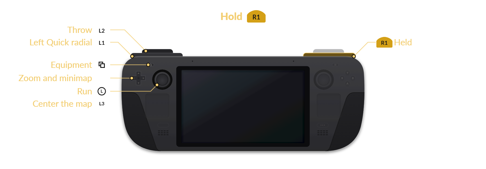
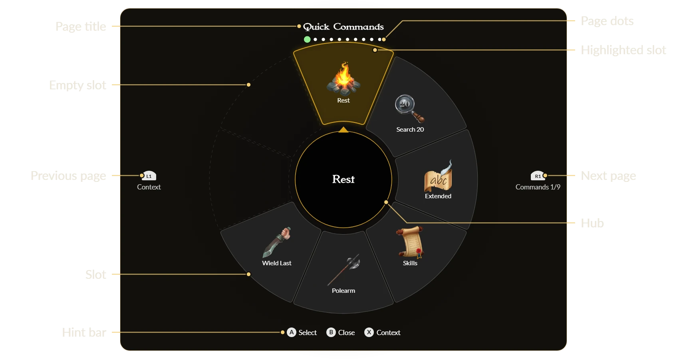
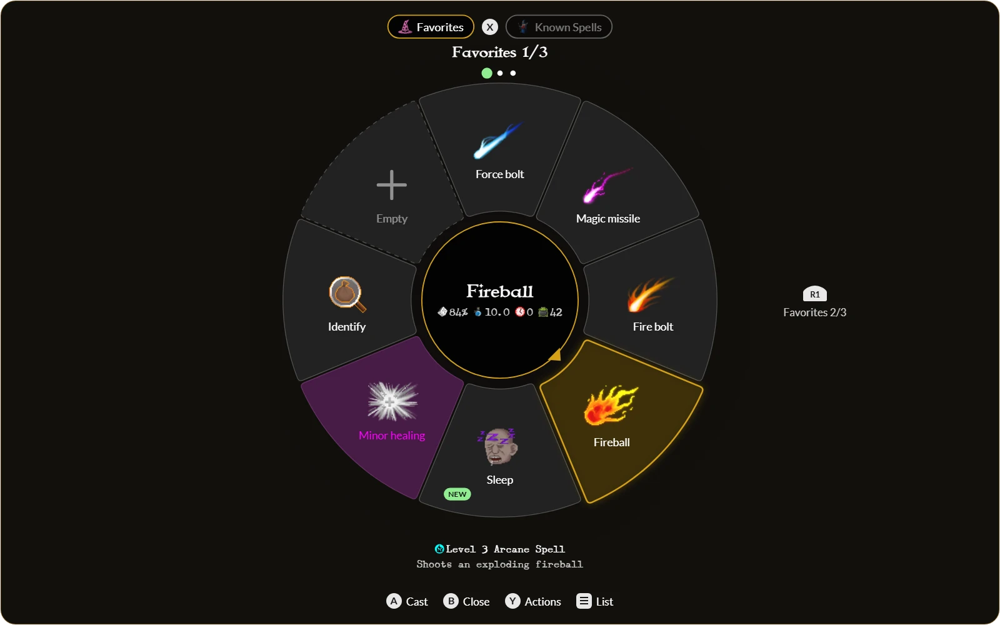
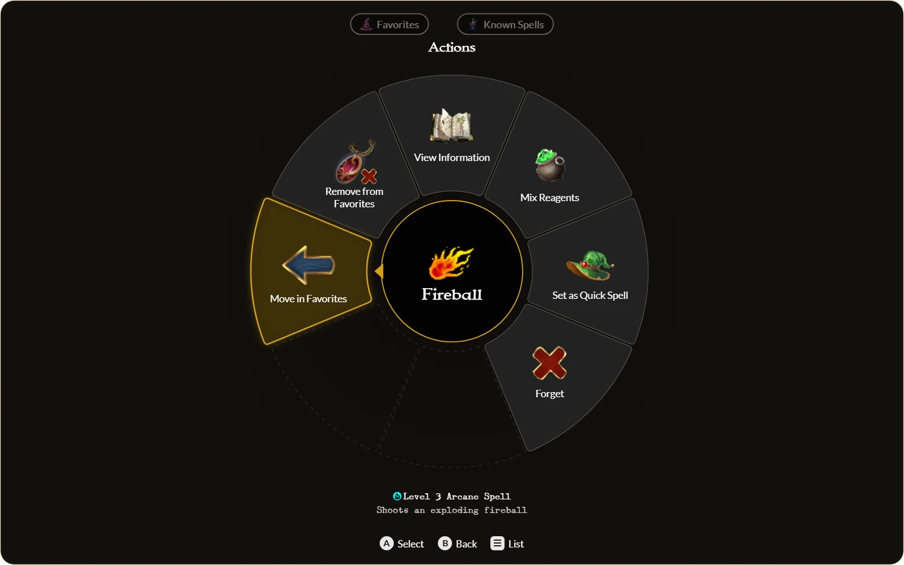
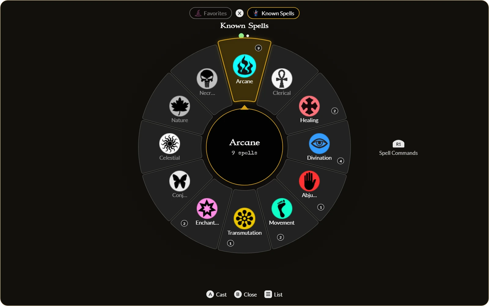

> 👉 **GnollHack can be played with the Steam Deck's built-in controls starting from version 3.32, and with a game controller, such as an Xbox controller, on Windows, Linux, macOS, Android, and iOS.**

*Controls of the Steam Deck.*

Button names on this page follow the Steam Deck; see [[Button Names on Other Controllers|#button-names-on-other-controllers]]. A strip of button hints at the bottom of the screen always shows what each button does at the moment, and it changes when you hold L1 or R1.

Touching the screen, using the mouse, or pressing a keyboard key returns the game to its usual on-screen buttons until you use the controller again.

To make the button hints larger, set **Hint Size** in [[Settings]], under Controller, from 100% to 200%.

## 🏁 Setting Up the Steam Deck

The **Use Controller** setting is on by default, so you only need to install GnollHack from Steam and start it. The setting is in [[Settings]], under Controller.

GnollHack reads the controls through Steam Input. If the controls do nothing in the game:

1. Press the Steam button and open **Controller Settings**.
2. Select the **Gamepad with Mouse Trackpad** template.

If Steam Input is turned off for the game, turn it on in the game's Properties in Steam, under Controller.

The back grips and the left trackpad's click need GnollHack's own Steam Input layout. The Gamepad with Mouse Trackpad template also sends the right trackpad's click as R3, which opens the Toggles radial menu, rather than as a mouse click. Everything else works with the template.

## 🎮 Controllers on Other Platforms

You can also play with a game controller on the [[Modern Windows Version]], the [[Linux Version]] on a desktop computer, the [[macOS Version]] from Steam, the [[Android Version]], and the [[iOS version|iOS and macOS Version]] on iPhones and iPads. On Android, USB and Bluetooth controllers work, including USB-C clip-on controllers. On iOS, the controllers that iOS supports as gamepads work. The controls are the same as on the Steam Deck. Connect the controller and press any button, and the game switches to controller mode. The Controller section of [[Settings]] appears once the game has detected a controller.

| Controller | Windows | Linux | macOS | Android | iOS |
| :--------- | :------ | :---- | :---- | :------ | :-- |
| **Xbox and other XInput controllers** | ✅ Supported | ✅ Supported | ✅ Supported | ✅ Supported | ✅ Supported |
| **PlayStation controllers** | Only if Steam presents them as XInput controllers; not tested | Should work; not tested | ✅ Supported | ✅ Supported | ✅ Supported |
| **Nintendo controllers** | Only if Steam presents them as XInput controllers; not tested | Should work; not tested | Not tested | Not tested | Not tested |
| **Other gamepads** | Only XInput controllers | Should work if the gamepad reports standard gamepad controls; not tested | Controllers that macOS supports as gamepads | Controllers that Android supports as gamepads | Controllers that iOS supports as gamepads |

If a controller does nothing on Windows, it may not be an XInput controller. On Linux, your user account may not have permission to read the controller. On macOS, pair a wireless controller in System Settings → Bluetooth first. On Android and iOS, pair a wireless controller in the device's Bluetooth settings first, and check that **Use Controller** is on in [[Settings]], under Controller.

Some features are not available on every platform:

- **Back grips:** Only on the Steam Deck. Paddles on other controllers, such as the Xbox Elite controllers, are not read.
- **On-screen keyboard:** On the Steam Deck, Android, and iOS. On Windows, desktop Linux, and macOS, when the game asks you to type text, such as a wish or a name, type it on a keyboard.

The iOS version also runs on a Mac and uses the same controller code there, but it has not been tested with a controller. For more details, see [[/Development/Gamepad Support]].

### 🏷️ Button Names on Other Controllers

The buttons work by position: A is the bottom face button, B the right, X the left, and Y the top. The button hints at the bottom of the screen show the labels of the controller you are using, such as Cross and Circle on a PlayStation controller.

| Button | Steam Deck | Xbox | PlayStation | Nintendo |
| :----- | :--------- | :--- | :---------- | :------- |
| **Face buttons** |     |     |     Cross, Circle, Square, Triangle |     |
| **Bumpers** |   |   |   |   |
| **Triggers** |   |   |   |   |
| **Stick clicks** |   |   |   |   |
| **Back grips** |     |     |     |     |
| **View and Menu** |   View, Menu |   View (Back), Menu (Start) |   Create, Options |   Minus, Plus |

On Nintendo controllers, the letters follow the buttons' positions, so the bottom face button reads B.

## 🗺️ Controls on the Map

L1 and R1 do nothing on their own. They are hold modifiers that change what the other buttons do. The one exception: holding one of them, pressing the other, and releasing either with nothing pressed in between opens a Quick radial menu. The game's commands and their keyboard shortcuts are listed in [[Commands]].

| Control | Alone | With L1 Held | With R1 Held |
| :------ | :---- | :----------- | :----------- |
|  | The action available on your square; opens the Actions radial menu if there are several | Commands radial menu | |
|  | Search (`s`); first closes an open overlay, and interrupts an ongoing activity | Search 20 times | |
|  | Pick Up (`,`) | Pick Up and Stash (`;`) | |
|  | Repeat (`Ctrl+a`) | Wait (`.`) | |
|  | R2's command, by default By Role: Cast Quick for spellcasters, Polearm for Knights, Fire for the others | L1 + R2 Action, by default Cast (`Shift+z`), which opens the [[Spells radial menu|#spells-radial]] | |
|  | L2's command, by default Kick (`k`) | | R1 + L2 Action, by default Throw (`t`) |
|  | Hold modifier | Right Quick radial menu, when you release a shoulder button | |
|  | Hold modifier | | Left Quick radial menu, when you release a shoulder button |
|  **Menu** | Game menu | Abilities (`Shift+a`) | |
|  **View** | Inventory (`i`) | | Equipment (`*`) |
|  **D-pad** | Walk one step per press, repeating while held; press two directions together to walk diagonally | | Up and Down zoom, Left toggles the minimap, and Right returns to normal zoom |
|  **Left stick** | Walk in eight directions; with [[Aim and Confirm|#aim-and-confirm]] on, aim, and A moves | | Run in that direction; with Aim and Confirm on, aim, and A runs |
|  **Right stick** | Pan the map | | |
|  | Run: your next direction on the left stick or the D-pad runs, as the Run prefix (`Shift+g`) does; L3 again or B cancels | | Center the map on your character |
|  | Toggles radial menu | | |

Holding both L1 and R1 and pressing Y makes your character rest, and pressing R2 or L2 runs that trigger's command. Pressing Y there also keeps the Quick radial menu from opening when you release the shoulder buttons. Clicking the left trackpad does the same as pressing L3.

### 🎯 Trigger Commands

R2 and L2 each run a command when you press them alone, by default Fire and Kick. Each trigger also has a second command, which runs when you press it with the other side's shoulder button held: **L1 + R2 Action**, by default Cast (`Shift+z`), and **R1 + L2 Action**, by default Throw (`t`). You can set all four to any command, or None, in [[Settings]], under Controller. To choose one, press A on the row: a radial menu of every command opens. L1 and R1 change the page, a stick selects, A sets it, and B closes. Left and Right on the row step through the commands one at a time.

When a trigger's command is Cast Quick, its button hint names your quick spell, such as Cast Minor Healing. While R2 is Cast Quick, the hint strip also shows the L1 + R2 command.

If the command asks for a direction while you still hold the trigger, the **Direction** radial menu opens. See [[Choosing a Direction|#choosing-a-direction]]. Force Fight does not open it, because it is a prefix: press the trigger, then a direction on the left stick or the D-pad. Any other button after it gives an invalid direction message.

### ⚙️ Quick Radials

Hold L1, press R1, and release either of them to open the **Right Quick** radial menu. Hold R1, press L1, and release either of them to open the **Left Quick** radial menu. Pressing another button while you hold both, such as Y to rest, keeps the radial menu from opening. The action that you choose runs at once, and if it asks for a direction, the Direction radial menu opens. Pressing the shoulder button that you pressed second again closes the radial menu. You can change their eight actions in [[Settings]], under Quick Radials. You choose them the same way.

| Radial Menu | Default Actions |
| :---------- | :-------------- |
| **Right Quick** | 2-Weapon, Swap, Chat, Throw, Cast, Cast Quick, Zap, Zap Quick |
| **Left Quick** | Apply, Drop Items, Drop Types, Pray, Yell, Engrave, Pick-axe, Polearm |

### 🕹️ Back Grips

L4, L5, R4, and R5 default to Pick-axe, Polearm, Cast Quick, and Zap Quick. You can change them in [[Settings]], under Controller.

### 🚶 Aim and Confirm

With **Aim and Confirm** on in [[Settings]], under Controller, the left stick does not move your character. It aims instead: the square next to your character in that direction is outlined, in red when a hostile monster you can see is there. Press A to move there, and hold A to keep walking. To run, press R1 + A, or press L3 and then A. Releasing the stick ends the aim, and with the stick centered, A does what it usually does. The D-pad and the prompts for choosing a position or a direction work as before.

### 📍 Choosing a Position

When the game asks you to choose a position on the map:

| Control | Action |
| :------ | :----- |
|  **Left stick** | Move the cursor; a full push jumps eight squares |
|  **Right stick** | Pan the map |
|  | Select |
|  | Cancel |
|   | Previous and next interesting spot |
|   | Previous and next monster |
|  | Put the cursor on your character |

### 🧭 Choosing a Direction

When the game asks for a direction, the violet **Direction** radial menu opens:

| Control | Action |
| :------ | :----- |
|     **Either stick, or D-pad Left and Right** | Select a direction |
|  | Confirm the selected direction |
|   **D-pad Up and Down** | Choose up (`<`) or down (`>`) at once |
|  | Choose yourself at once |
|  | Cancel the action |

If you hold L2 or R2, alone or with a shoulder button, and its command asks for a direction, releasing the trigger confirms the selected direction, or cancels the action if none is selected, and a stick you are already pushing counts at once.

## ⭕ Radial Menus

A radial menu stays open until you choose an item or close it. The exception is the Direction radial menu while its trigger is held, described in [[Choosing a Direction|#choosing-a-direction]].

- Select an item with either stick, or step between items with D-pad Left and Right. D-pad Up and Down jump to the top and bottom items. The center of the menu describes what the selected command does.
- A activates the item, and B closes the menu. Menu closes the menu and opens the game menu. In a Quick radial menu, the shoulder button that you pressed second to open it also closes it.
- L1 and R1 change the page.

The radial menus on the map are:

- **Actions:** The actions available on your square, followed by pages of commands. The first of them is the **Quick Commands** page: Rest, Search 20, Extended, and Skills, Polearm, and Wield Last or Unwield when they are available. Its west and northwest slots hold Quick Command 1 and Quick Command 2, which you can set in [[Settings]], under Actions Radial. The other commands follow in alphabetical order. X switches between the actions on your square and the Quick Commands page.
- **Toggles:** More Messages, Status Screen, Auto-Center, Look Mode, Auto-Dig, Ignore Stopping, Max Hit Points, and Max Mana.

  

  *The Toggles radial menu, with Auto-Center selected.*

- **Left Quick and Right Quick:** The radial menus described in [[Quick Radials|#quick-radials]].
- **Spells:** The Cast menu while you use the controller, described in [[Spells Radial|#spells-radial]].

### 🔮 Spells Radial

While you use the controller, the Cast menu (`Shift+z`) opens as the **Spells** radial menu instead of a list, whether you open it with L1 + R2 or another way, such as Cast in the Right Quick radial menu. After you touch the screen, use the mouse, or press a key, it is the usual list again. With the **spell_table_format** option on, described in [[Options]], the Cast menu stays a list.

The radial menu has two tabs, and X switches between them:

- **Favorites:** Three pages of eight slots, 24 in all, named 1A to 3H: the number is the page, and the letters run clockwise from A at the top. A spell stays in its slot, and so in the same stick direction, until you move it. Press A or Y on an empty slot to choose a spell for it from your known spells. The radial menu opens on the Favorites page you used last, or on Known Spells while you have no favorites.
- **Known Spells:** Every spell you know, eight to a page, by school, level, and name. If you know more than 16 spells, the first page is a ring of the twelve spell schools with the number of spells in each. A opens a school's pages, and B goes back to the ring. The **Spell Commands** page after the spells or the ring has View Spells, Mix Spells, Sort Spells, Reorder Spells, and Set Quick Spell.

The center shows the selected spell's success chance, mana cost, cooldown, and castings left, and below the ring are its school, level, and description. On the Known Spells pages, a gold star marks a favorite. NEW marks a spell you learned since you last opened the radial menu. A spell you cannot cast now has a gray icon and a tinted slice, and the center says why: Cooling down, No chance of success, No castings prepared, Not enough mana, or Forgotten.

| Control | Action |
| :------ | :----- |
|  | Cast the selected spell; a forgotten spell or one that is cooling down cannot be cast |
|  | Open the selected spell's **Actions** radial menu |
|  | Switch between Favorites and Known Spells |
|   | Previous and next page in the same tab, or in the same school |
|  **Menu** | Show the Cast menu as a list; Menu in the list brings the radial menu back |
|  | Close the radial menu |

The **Actions** radial menu has View Information, Mix Reagents, Move to Top and Move to Bottom (for a spell that is not a favorite), Set as Quick Spell, Forget, Add to Favorites (Move in Favorites for a favorite), and Remove from Favorites. B goes back to the Spells radial menu. After View Information, Move to Top, Move to Bottom, Forget, and the Favorites actions, the Spells radial menu comes back on the same spell.

Add to Favorites and Move in Favorites show the Favorites pages with the spell. Select a slot and press A to put the spell there. If the slot already has a spell, the center says what happens: a spell you add replaces it, and a favorite you move swaps places with it. While you move a favorite, Y removes it from Favorites. B goes back to the Actions radial menu.

With **Add New Spells to Favorites** on in [[Settings]], under Controller, each spell you learn goes to the first empty Favorites slot, and the game tells you so. When all 24 slots are full, it tells you that the spell is in Known Spells. A new character's starting spells go to Favorites too. The setting is on by default and works only while Use Controller is on. Your favorites are saved with your character.

Favorites also show in the spell lists. The Cast, Mix Spells, View Spells, and Set Quick Spell lists put your favorites first, under a Favorites heading in slot order, and the other spells under Spells. Hold A on a spell in the Cast list, or long-press it on a touch screen, for Mark as Favorite or Unmark as Favorite, and for a favorite, Move First and Move Last. A list that you open with the controller ends each favorite's row with its slot, from 1A to 3H.

## 📜 Menus and Dialogs

| Control | Action |
| :------ | :----- |
|   **Left stick, D-pad** | Move the focus; in menus, D-pad Left and Right change the page |
|  **Right stick** | Scroll |
|  | Confirm or select the focused item; hold A on a menu row for its count or actions |
|  | Cancel, close, or go back |
|  | Accept the selection in menus |
|  | Select or unselect all items in menus that allow selecting several |
|   | Jump between sections in menus |
|   | First or last row in menus |

In a yes/no prompt, Y answers Yes and X answers No when the prompt offers them.

The main menu, Settings, Library, Top Scores, Replays, and other pages work the same way: the focus moves over the rows and the buttons, A presses the focused one, and B goes back. On the main menu, B does nothing, and X starts Play Game, Y opens About, Menu opens Settings, and View opens the Vault. In Settings, L1 and R1 jump between sections, Left and Right change the focused setting, and X shows its explanation.

During a replay, A pauses, L1 and R1 or L2 and R2 change the speed, D-pad Right steps forward, Y opens Go to Turn, and B quits.

## ⌨️ Typing Text

In Gaming Mode, pressing A on a text field opens Steam's on-screen keyboard. The keyboard's Enter confirms the text, and B ends the editing. When the game asks you to type something, such as a wish or a name, the keyboard opens by itself, and Y opens it again.

In Desktop Mode, pressing A only focuses the field. Press the Steam button and X to open the keyboard by hand.

On Android and iOS, pressing A on a text field opens the system's own on-screen keyboard, and a prompt to type something opens it by itself, as in Gaming Mode. It does not open while a hardware keyboard is connected. Typing on it keeps the game in controller mode.

## 🌐 The Wiki and Web Pages

Web pages, such as this wiki, open in the game's in-app browser, where a gold focus ring moves between the links and controls on the page. On Android, only the Wiki in the game menu and the [[Gnoll Overseer]] use the in-app browser. On iOS, the Gnoll Overseer uses it, and so does the Wiki in the game menu once you have used a controller in the session. Other links on Android and iOS open the system's browser.

| Control | Action |
| :------ | :----- |
|   **D-pad, left stick** | Move to the nearest link or control in that direction |
|  **Right stick** | Scroll |
|  | Follow a link, press a button, or edit a text field |
|  | End a text edit, close an open menu, go back, or close the browser |
|  | Go forward |
|  | Edit the page's search field |
|   | Previous and next section heading |
|   | Page up and page down |
|  | Top of the page |
|  **View** | Move between the article, the sidebar, and the toolbar |
|  **Menu** | Close the browser |

The right trackpad stays a mouse on these pages.

## 🐺 Gnoll Overseer

The [[Gnoll Overseer]] chat page is divided into areas: the menu, the chat controls, the chat list, the messages, and the area where you write. L1 and R1 step through the areas, and View cycles them. The D-pad and the left stick also move between them.

When you are in the writing area:

| Control | Action |
| :------ | :----- |
|  | Go to the model selector |
|  | Go to the text entry |
|  | Open the model selector |
|  | Write in the text entry |

While you are typing text, the D-pad and the left stick move the text cursor, L2 and R2 go to the start and end of the text, and B ends the typing. With nothing else to do, B leaves the page after a confirmation.

## 📁 File Dialogs

In Gaming Mode, and on Windows, Linux, and macOS while you are using the controller, attaching, importing, sharing, and saving files use a file dialog that works with the controller. Android and iOS use the system's own file dialogs.

| Control | Action |
| :------ | :----- |
|   **D-pad, left stick** | Move between rows and buttons |
|  **Right stick** | Scroll |
|  | Open a place or folder, select a file, or save to a place |
|  | Attach the selected files |
|  | Go up a level, then cancel |
|   | First or last row |
|  **Menu** | Cancel |

Files can be attached and imported from Pictures, GnollHack Screenshots, Documents, Downloads, and SD cards. Saved files go to a `GnollHack` folder under Documents, Downloads, or an SD card, and saving never overwrites an existing file.
