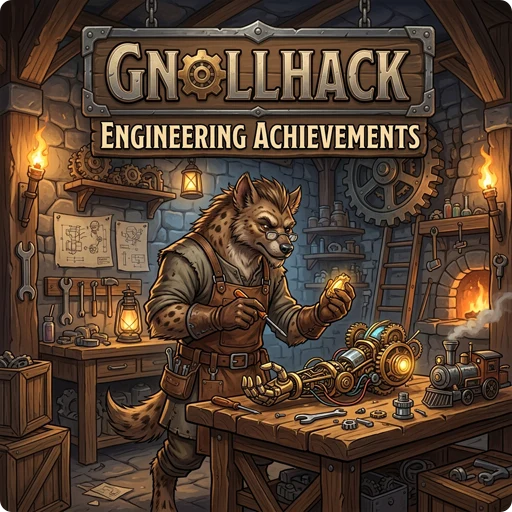

> 👉 **GnollHack is an open-source game that runs NetHack's C game engine inside a .NET MAUI app, built for Android, iOS, Linux, macOS, and Windows from one codebase.**

## 🏆 Engineering Highlights

- **NetHack's C code in a .NET app:** The game logic is [NetHack](https://www.nethack.org/)'s decades-old C code, extended for GnollHack, built as a native library and called from [C#](https://dotnet.microsoft.com/en-us/languages/csharp). The rules were carried over, not rewritten.
- **.NET MAUI as a game engine:** [.NET MAUI](https://github.com/dotnet/maui) is usually used for business apps. GnollHack uses it to run an interactive 2D game.
- **One codebase for five platforms:** The same [.NET](https://dotnet.microsoft.com/) code and native bridge build the Android, iOS, Linux, macOS, and Windows versions, so there is little platform-specific code to maintain.
- **Separate threads:** The C game loop runs apart from the .NET MAUI UI thread and the [Skia](https://skia.org/) rendering threads, which keeps the frame rate up while the game works out a turn.
- **Native libraries:** [SkiaSharp](https://github.com/mono/SkiaSharp) draws the 2D graphics with GPU acceleration, and [FMOD](https://www.fmod.com/) plays sound and music.
- **AI advisor and benchmark:** The optional [[Gnoll Overseer]], built into the game client, answers players' questions with frontier AI models, using the live game state, the game's C source code, and the GnollHack and NetHack wikis. [[GnollBench]] tests models from several AI providers, grades them on accuracy, speed, and cost, and penalizes dangerous mistakes.

## 💻 Technologies Behind GnollHack

### UI Framework: .NET MAUI

_(Originally Xamarin.Forms)_

GnollHack is one of very few games made with [.NET MAUI](https://github.com/dotnet/maui), which is mainly a framework for cross-platform apps; GnollHack uses it to build a full 2D game. .NET MAUI runs GnollHack on Android, iOS, and Windows. On Linux and macOS, the same .NET MAUI app runs on [Avalonia UI](https://avaloniaui.net/).

Its ready-made controls, such as text entries, multiline text boxes, in-game web views, and layouts that size themselves to their content, make a complex UI quick to build.

### Graphics Drawing Engine: SkiaSharp

GnollHack draws its graphics with [SkiaSharp](https://github.com/mono/SkiaSharp), which is built on Google's [Skia](https://skia.org/) graphics engine and is fast and easy on the battery. SkiaSharp draws bitmaps, shapes, and text on a canvas, optionally with GPU acceleration.

### Sound Middleware: FMOD

GnollHack plays its sound and music with [FMOD](https://www.fmod.com/), a commercial cross-platform audio library, on all platforms.
### Native C Code Integration

The game logic is a native C library based on [NetHack](https://www.nethack.org/)'s source code. The same library works on every supported platform.

### Multi-Threaded

GnollHack runs on two or three threads, depending on the operating system, not counting FMOD's own threads. That keeps the game fast, but it means the code needs several thread-safety measures.

### Agentic AI & Benchmarking: Gnoll Overseer and GnollBench

The [[Gnoll Overseer]] is an optional full-stack AI advisor built on ASP.NET Core (Web API + SignalR) and Angular. Its tools work on live game snapshots sent by the client, an in-memory C lexer and source index for both GnollHack and NetHack, the exact monster, item, and artifact definitions, and Lucene.NET indexes of the wikis. Spoiler guardrails are configurable, and chats can use encrypted or ephemeral modes. See [[/Guides/Technological Overview of Gnoll Overseer]].

Because one wrong answer can end a permadeath game, [[GnollBench]] tests candidate models with the same prompt and tools the live Overseer uses. A panel of AI graders from several providers scores the answers, an automated verifier checks their claims against the source code, and strict comparability rules apply to intelligence, latency, and cost. See [[/Guides/Technological Overview of GnollBench]].
