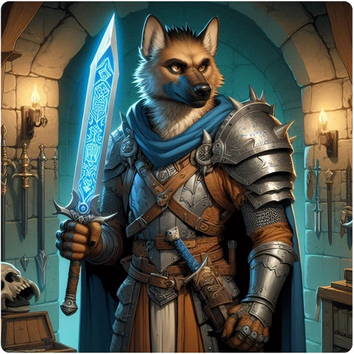

## Weapon Categories

- [[Melee Weapons]]
- [[Polearms]]
- [[Ranged Weapons]]
- [[Ammunition]]
- [[Thrown Weapons]]

## Blessed and Cursed Weapons

A blessed weapon gets +2 to hit against demons, undead, and vampires, even when a vampire has taken another form. Against a monster whose page lists it as vulnerable to blessed weapons, a blessed weapon also deals 1d4 extra damage, and a cursed weapon deals 1d4 extra damage against a monster vulnerable to cursed weapons.

## Additional Information

- [[Weapon Quality Modifiers]]
