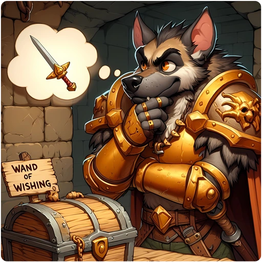

> 👉 **In GnollHack, a wish can ask for item qualities, affixes, multiple quantities, and artifacts, each with its own chance of success.**

## 📦 Quantities

How many items you get when you wish for several at once, such as "3 potions of healing" or "20 +2 arrows", depends on the item type:

| Item Type | Maximum Quantity |
| :--- | :--- |
| **Ammunition & Missiles** | Up to **20** per wish, always (e.g., arrows, bolts, rocks). |
| **Candles** | Up to **7** per wish, always. |
| **Gems** | **1** per wish, although they stack. |
| **Non-stackable Items** | **1** per wish (e.g., weapons, armor, most tools, artifacts). |
| **Other Stackable Items** | Up to **5** per wish, with a chance to get only one (e.g., potions, scrolls). |

For other stackable items, the game rolls once against the chance below. If the roll fails, you get exactly **1** item:

| Requested Quantity | Success Chance |
| :---: | :---: |
| 1 | 100% |
| 2 | 67% |
| 3 | 50% |
| 4 | 33% |
| 5 | 17% |

## ⚔️ Weapon Qualities

Elite, Celestial, Primordial, and Infernal weapons need non-negative luck. If the roll fails, you get a weapon of normal quality.

| Quality Level | Success Chance |
| :--- | :---: |
| **Exceptional** | 100% |
| **Elite** | 80% |
| **Celestial / Primordial / Infernal** | 25% |

## 🛡️ Armor Qualities

Armor gets a quality less often than weapons do. All armor qualities need non-negative luck, except that armor with the double chance gets Exceptional at any luck. Gauntlets, shoes, kicking boots, spiked boots, and spiked shields count as weapons here: they use the chances under *Weapon Qualities*, so they also get Exceptional at any luck. A wish cannot give a quality to helmets, cloaks, shirts, robes, bracers, dragon scale mail, or dragon scales. If the roll fails, you get armor of normal quality.

| Quality Level | Standard Chance | Double Chance | Half Chance |
| :--- | :---: | :---: | :---: |
| **Exceptional** | 50% | 100% | 50% |
| **Elite** | 25% | 50% | 12.5% |
| **Celestial / Primordial / Infernal** | 5% | 10% | 2.5% |

These armors have the double chance: [[/Items/splint mail]], [[/Items/banded mail]], [[/Items/chain mail]], [[/Items/scale mail]], [[/Items/studded leather armor]], [[/Items/ring mail]], and [[/Items/leather armor]]. Armor made of *mithril, adamantium, orichalcum*, or *hard crystal* has the half chance. The half chance lowers only Elite and the higher qualities; Exceptional stays at 50%.

## ✨ Wand Qualities

Only wands of nothing, striking, magic missile, fire, cold, and lightning can have a quality, and then only Exceptional or Elite; every other wand always comes out normal. You need non-negative luck, and if the roll fails, the wand is of normal quality.

| Quality Level | Success Chance |
| :--- | :---: |
| **Exceptional** | 50% |
| **Elite** | 25% |

## ✨ Elemental Enchantments

On weapons and armor that can have one, you can wish for an elemental enchantment: `freezing`, `flaming`, `electrified`, or `death-magical`. You always get it if your luck is non-negative. If you ask for `death-magical` on an item that cannot have it, you get `electrified` instead.

## 🔮 Mythic and Legendary Affixes

Keeping two affixes and getting a Rare affix both need non-negative luck. With negative luck, a wish that names its affixes keeps at most one of them, and only if it is Common.

### Random Affixes

| Request Type | Success Chance | Failure Consequence |
| :--- | :---: | :--- |
| **Random Mythic (One Affix)** | 100% | N/A |
| **Random Legendary (Two Affixes)** | 33% | Item is generated with only one random affix. |

### Specific Affixes

A wish that names its affixes treats **Common** and **Rare** affixes differently. The Rare ones are *of elemental protection, of the Last Alliance, of banishment, of sharpness, Stygian, Witch-King's, Olympian, Jotunheimian,* and *Melnibonean*.

With one named affix (Mythic), a Common affix always succeeds and a Rare one only 33% of the time. If it fails, the item has no affix.

With two named affixes (Legendary), the game first rolls a 33% chance to keep both. If that roll fails, only one of the two remains. Each remaining affix is then checked on its own (100% for Common, 33% for Rare). The chance to get both affixes is:

| Requested Affixes | Chance to Get Both |
| :--- | :---: |
| **Two Common Affixes** | 33% |
| **One Common + One Rare Affix** | 11% |
| **Two Rare Affixes** | ~3.7% (1/27) |

When the roll for both, or one of the affix checks, fails, the item ends up with one of the affixes (Mythic) or none (Normal).

## 💪 Belts of Giant Strength

The stronger the belt of giant strength you wish for, the less likely you are to get it. If the roll fails, you get a [[/Items/Belt of hill giant strength]] instead.

| Belt Type | Success Chance |
| :--- | :---: |
| [[/Items/Belt of hill giant strength]] | 100% |
| [[/Items/Belt of stone giant strength]] | 83% |
| [[/Items/Belt of frost giant strength]] | 67% |
| [[/Items/Belt of fire giant strength]] | 50% |
| [[/Items/Belt of storm giant strength]] | 33% |

## 👑 Artifact Wishing

The chance to get an artifact from a wish depends on how many artifacts the current game has already generated.

| Generated Artifacts | Success Chance |
| :---: | :---: |
| 0 to 2 | 100% |
| 3 | 67% |
| 4 | 50% |
| 5 | 40% |
| 6 | 33% |
| 7 | 29% |

With 3 or more artifacts already generated, the chance is 2/n, where n is the number of those artifacts.

The same chance applies to the quest artifacts of the other roles. The quest artifact of the role you are playing can never be wished for, and the wish is still used up; see [[Quest Artifacts]].

## 🛠️ Item Conditions and Modifiers

Words such as `blessed` or `rustproof` in front of the item name set its condition, as in `"blessed rustproof long sword"`. Some always work. Others fail, or even backfire, if your luck is negative. The chance of getting the enchantment you ask for, such as +3, is on [[Enchantment Wishing Chances]].

| Modifier Type | Wishing Terms | Success Chance & Rules |
| :--- | :--- | :--- |
| **Beatitude** | `blessed`, `uncursed` | 100% chance if your luck is **non-negative**.   ⚠️ *Warning:* If you wish for these with negative luck, the item will be generated as **cursed** instead (unless it cannot be cursed). |
| **Damage Proofing** | `rustproof`, `fireproof`, `corrodeproof`, `rotproof`, `fixed` | 100% chance if your luck is **non-negative**.   If your luck is negative, the request is ignored and the item generates normally. |
| **Poisoned** | `poisoned` | 100% chance on applicable weapons if your luck is **non-negative**.   If your luck is negative, the request is ignored. |
| **Greased** | `greased` | 100% chance, regardless of luck. |
| **Material** | `silver`, `adamantium` and other wishable materials | Takes effect only when the item type accepts that material; otherwise the word is ignored. Many item types accept no material other than their own, among them the javelin, boomerang, dart and shuriken: `silver dart` gives an iron dart and `adamantium boomerang` a wooden one. A short sword, scimitar, broadsword, long sword or two-handed sword accepts `silver` always and `crystal` (hard crystal) with a 40% chance, and no other material, so the word `adamantium` in `adamantium long sword` is ignored. Materials that cannot be wished for, such as `wax` and `ice`, are not recognized, nor are `wood` and `lead` (write `wooden` and `leaden`). A wish like `wax dart`, `wood boomerang` or `silver wand of digging` is refused with *Nothing fitting that description exists in the game.* |

## 📝 Examples

| Wish | What You Get |
| :--- | :--- |
| **`3 potions of full healing`** | All 3 with a 50% chance, otherwise 1. |
| **`20 arrows`** | Always 20 arrows. |
| **`exceptional long sword`** | Always Exceptional. |
| **`elite splint mail`** | Elite with a 50% chance (double chance). |
| **`elite dwarvish mithril-coat`** | Elite with a 12.5% chance (half chance). |
| **`blessed elite wand of fire`** | Elite with a 25% chance, if your luck is non-negative. |
| **`freezing long sword`** | Always freezing, if your luck is non-negative. |
| **`long sword of orc slaying`** | Always has the affix, which is Common. |
| **`Witch-King's plate mail of fire resistance`** | Both affixes with an 11% chance (one Rare, one Common). |
| **`Frost Brand`** | Always, if 0 to 2 artifacts have been generated so far. |
| **`blessed rustproof long sword`** with negative luck | A **cursed** long sword that is not rustproof. |
| **`greased cursed long sword`** | Always exactly what you asked for. |
| **`blessed +3 exceptional freezing long sword`** | Exceptional always (a weapon), and freezing always with non-negative luck. |
| **`uncursed celestial splint mail of lightness`** | Celestial with a 10% chance instead of 5%, because splint mail has the double chance. The Common suffix always applies. |
| **`blessed celestial Witch-King's plate mail of fire resistance`** | Celestial with a 5% chance and both affixes with an 11% chance. The two rolls are independent. |
